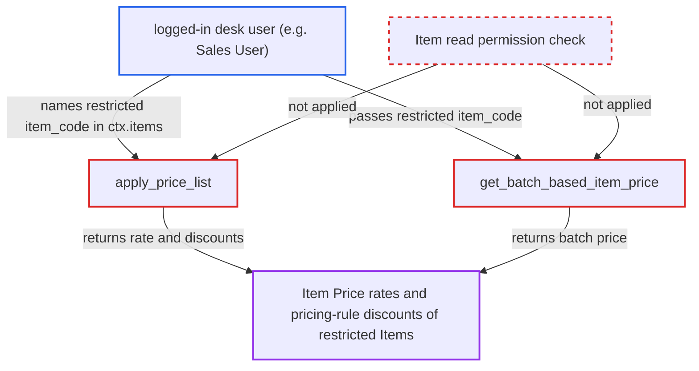

# apply_price_list and get_batch_based_item_price price Items the caller may not read

| Field | Value |
|---|---|
| ID | `find_01VYMAoQLof71gskFZLkPWxD` |
| Severity | **Medium** |
| Status | open |
| CWE | CWE-862 — Missing Authorization |
| Created | 2026-10-27T21:17:14.343296Z |
| Claude Security | https://claude.ai/security/findings/find_01VYMAoQLof71gskFZLkPWxD |

## Description

A logged-in desk user can read price-list rates, batch-specific prices and pricing-rule discounts or margins for Items they are not allowed to read. This works for a user such as a Sales User who has read access to a pricing transaction doctype, and the attacker must supply the item codes. The whitelisted `apply_price_list` and `get_batch_based_item_price` in `erpnext/stock/get_item_details.py` never check read access to the named Items.

1. **Attacker (logged-in desk user)** posts a request to `/api/method/erpnext.stock.get_item_details.apply_price_list`. The `ctx` names a transaction `doctype` such as `Sales Order`, the attacker's own `company`, a selling price list, `currency`/`conversion_rate`, and `items` holding the restricted `item_code`. ([`erpnext/stock/get_item_details.py:1820-1880`](https://github.com/cx-benchmark/erpnext/blob/90e7aefca73da3c440d2e8da7472fcb67838e678/erpnext/stock/get_item_details.py#L1820-L1880))
2. **`validate_pricing_context`** accepts the request. It checks only the doctype at doctype level, the company, the parties and the price list side, and never looks at `ctx.items[*].item_code`. ([`erpnext/accounts/doctype/pricing_rule/pricing_rule.py:766-794`](https://github.com/cx-benchmark/erpnext/blob/90e7aefca73da3c440d2e8da7472fcb67838e678/erpnext/accounts/doctype/pricing_rule/pricing_rule.py#L766-L794))
3. **`apply_price_list_on_item`** loads the named Item without a permission check. It uses `frappe.get_cached_doc`, so neither Item User Permissions nor the Company Restriction `has_permission` hook is applied. ([`erpnext/stock/get_item_details.py:1884-1899`](https://github.com/cx-benchmark/erpnext/blob/90e7aefca73da3c440d2e8da7472fcb67838e678/erpnext/stock/get_item_details.py#L1884-L1899))
4. **`get_price_list_rate`** reads the Item Price row directly. It runs a raw `frappe.qb` query on `tabItem Price` and sets `out.price_list_rate`; the pricing-rule discounts and margins come from `get_pricing_rule_for_item`. ([`erpnext/stock/get_item_details.py:1213-1250`](https://github.com/cx-benchmark/erpnext/blob/90e7aefca73da3c440d2e8da7472fcb67838e678/erpnext/stock/get_item_details.py#L1213-L1250))
5. **`apply_price_list`** returns the pricing for each item to the attacker. The response carries `price_list_rate` and the pricing-rule data for the Item the attacker was not allowed to read. ([`erpnext/stock/get_item_details.py:1820-1880`](https://github.com/cx-benchmark/erpnext/blob/90e7aefca73da3c440d2e8da7472fcb67838e678/erpnext/stock/get_item_details.py#L1820-L1880))
6. **Attacker** can instead call `get_batch_based_item_price` with `item_code`, `batch_no` and `uom`. This function never authorises its `item_code` argument and returns the batch-specific `price_list_rate`. ([`erpnext/stock/get_item_details.py:1456-1474`](https://github.com/cx-benchmark/erpnext/blob/90e7aefca73da3c440d2e8da7472fcb67838e678/erpnext/stock/get_item_details.py#L1456-L1474))

## Assessment

The attacker is a logged-in desk user with read access to a pricing transaction doctype, for example a Sales User. Their access to Items is limited by Item User Permissions or by Company Restriction. They must know or guess the item codes. They can reach the flaw through either of two whitelisted endpoints: `apply_price_list` or `get_batch_based_item_price`. Both are called over the API at `/api/method/erpnext.stock.get_item_details.`. By contrast, `get_item_details` calls `item.check_permission()` and `get_valuation_rate` calls `frappe.has_permission` with `throw=True`, so these two calls are the only ones that skip the check.

Impact: The attacker can read price-list rates, batch-specific prices and applicable pricing-rule discounts or margins for Items they may not read. This crosses the company isolation the project enforces. Nothing is modified, and the disclosure is read-only.

## Recommendation

`apply_price_list` and `get_batch_based_item_price` price caller-named items without checking that the caller may read those Items. This bypasses Item User Permissions and the Company Restriction `has_permission` hook, which `get_item_details` does honour.

Fix criteria: Every item a whitelisted pricing entry point prices must pass an Item record-level read check before any Item Price or pricing-rule data is returned. That means each `ctx.items[*].item_code` in `apply_price_list` and the `item_code` in `get_batch_based_item_price`. A user scoped to company A gets a PermissionError from both endpoints for an Item restricted to company B. The same happens for an Item outside their Item User Permissions. Permitted items still price normally.

## Evidence

**https://github.com/cx-benchmark/erpnext**

- [`erpnext/stock/get_item_details.py:1884-1899`](https://github.com/cx-benchmark/erpnext/blob/90e7aefca73da3c440d2e8da7472fcb67838e678/erpnext/stock/get_item_details.py#L1884-L1899)
- [`erpnext/stock/get_item_details.py:1820-1880`](https://github.com/cx-benchmark/erpnext/blob/90e7aefca73da3c440d2e8da7472fcb67838e678/erpnext/stock/get_item_details.py#L1820-L1880)
- [`erpnext/stock/get_item_details.py:1456-1474`](https://github.com/cx-benchmark/erpnext/blob/90e7aefca73da3c440d2e8da7472fcb67838e678/erpnext/stock/get_item_details.py#L1456-L1474)
- [`erpnext/stock/get_item_details.py:1213-1250`](https://github.com/cx-benchmark/erpnext/blob/90e7aefca73da3c440d2e8da7472fcb67838e678/erpnext/stock/get_item_details.py#L1213-L1250)
- [`erpnext/accounts/doctype/pricing_rule/pricing_rule.py:766-794`](https://github.com/cx-benchmark/erpnext/blob/90e7aefca73da3c440d2e8da7472fcb67838e678/erpnext/accounts/doctype/pricing_rule/pricing_rule.py#L766-L794)
- [`erpnext/stock/get_item_details.py:126-131`](https://github.com/cx-benchmark/erpnext/blob/90e7aefca73da3c440d2e8da7472fcb67838e678/erpnext/stock/get_item_details.py#L126-L131)
- [`erpnext/stock/doctype/company_restriction/test_company_restriction.py:184-204`](https://github.com/cx-benchmark/erpnext/blob/90e7aefca73da3c440d2e8da7472fcb67838e678/erpnext/stock/doctype/company_restriction/test_company_restriction.py#L184-L204)
- [`erpnext/hooks.py:358-373`](https://github.com/cx-benchmark/erpnext/blob/90e7aefca73da3c440d2e8da7472fcb67838e678/erpnext/hooks.py#L358-L373)

