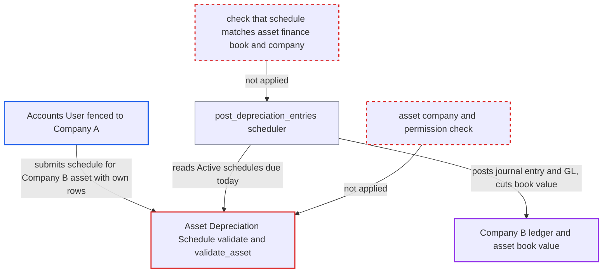

# Asset Depreciation Schedule for another company's asset drives scheduler to post GL into that company

| Field | Value |
|---|---|
| ID | `find_01SqYJgLM31GSo2FPDRwMWsT` |
| Severity | **Medium** |
| Status | open |
| CWE | CWE-862 — Missing Authorization |
| Created | 2026-10-27T22:34:09.123490Z |
| Claude Security | https://claude.ai/security/findings/find_01SqYJgLM31GSo2FPDRwMWsT |

## Description

A low-privilege `Accounts User` fenced to one company can make the system post journal entries and general ledger entries into another company's books, with amounts and dates they choose. It also corrupts that company's asset book value and status. The cause is that `Asset Depreciation Schedule` accepts any `asset` without checking its company or the submitter's permission, and the daily scheduler books any Active schedule.

1. **attacker with the `Accounts User` role** inserts a draft `Asset Depreciation Schedule` with chosen rows. The draft names one of their own company's assets and a Finance Book not used by the target asset. It sets `finance_book_id` to 1 and the method to `Straight Line`. `validate` only checks for a duplicate `(asset, finance_book)` pair and skips `create_depreciation_schedule()`, so the supplied `schedule_date` and `depreciation_amount` rows are stored as given. ([`erpnext/assets/doctype/asset_depreciation_schedule/asset_depreciation_schedule.py:53-82`](https://github.com/cx-benchmark/erpnext/blob/90e7aefca73da3c440d2e8da7472fcb67838e678/erpnext/assets/doctype/asset_depreciation_schedule/asset_depreciation_schedule.py#L53-L82))
2. **attacker** submits the same document with `asset` changed to another company's asset. The payload still says `company = A`. `company` is only filled from the asset by `fetch_from` and is not refreshed on submit, so the company check that Company User Permissions apply still sees the attacker's own company. ([`erpnext/assets/doctype/asset_depreciation_schedule/asset_depreciation_schedule.json:193-200`](https://github.com/cx-benchmark/erpnext/blob/90e7aefca73da3c440d2e8da7472fcb67838e678/erpnext/assets/doctype/asset_depreciation_schedule/asset_depreciation_schedule.json#L193-L200))
3. **the `validate_asset` check** accepts the foreign asset and the schedule becomes Active. It only checks that the asset is submitted and depreciable. It never compares the asset's company with the schedule's company, and it never calls `frappe.has_permission` on the asset. ([`erpnext/assets/doctype/asset_depreciation_schedule/asset_depreciation_schedule.py:125-142`](https://github.com/cx-benchmark/erpnext/blob/90e7aefca73da3c440d2e8da7472fcb67838e678/erpnext/assets/doctype/asset_depreciation_schedule/asset_depreciation_schedule.py#L125-L142))
4. **the daily scheduler `post_depreciation_entries`** selects the rogue schedule through `get_depreciable_assets_data`. This function takes every submitted schedule with unbooked rows due today, whatever created it. The report says this scheduler is enabled by default through the Accounts Settings option `book_asset_depreciation_entry_automatically`. ([`erpnext/assets/doctype/asset/depreciation.py:81-110`](https://github.com/cx-benchmark/erpnext/blob/90e7aefca73da3c440d2e8da7472fcb67838e678/erpnext/assets/doctype/asset/depreciation.py#L81-L110))
5. **`_make_journal_entry_for_depreciation`** submits a `Journal Entry` in the victim company with the attacker's values. The entry uses `je.company = asset.company`, the row's `schedule_date` as the posting date and its `depreciation_amount`. It runs with `je.flags.ignore_permissions = True`, so GL Entries land in the other company's ledger. ([`erpnext/assets/doctype/asset/depreciation.py:230-268`](https://github.com/cx-benchmark/erpnext/blob/90e7aefca73da3c440d2e8da7472fcb67838e678/erpnext/assets/doctype/asset/depreciation.py#L230-L268))
6. **`update_value_after_depreciation`** subtracts the attacker's amount from the victim asset's book value. The rogue finance book is not on the asset, so the code falls back to the first finance book (`fb_idx = 1`). `set_status` may then mark the asset Fully Depreciated, which stops its real depreciation. ([`erpnext/accounts/doctype/journal_entry/services/asset_service.py:82-95`](https://github.com/cx-benchmark/erpnext/blob/90e7aefca73da3c440d2e8da7472fcb67838e678/erpnext/accounts/doctype/journal_entry/services/asset_service.py#L82-L95))

## Assessment

The attacker is an authenticated desk user with the `Accounts User` role, fenced to Company A by a Company User Permission. They use the `/api/resource/Asset Depreciation Schedule` endpoint. They need one asset in their own company and a Finance Book that the target asset does not use. They also need to know a Company B asset. The report does not name any other way in. After the submit, no one else has to act. The next daily `post_depreciation_entries` run books the entries, and the report says that run is on by default.

Impact: The attacker writes general ledger entries (depreciation expense and accumulated depreciation) of any amount, on any non-frozen date, into another company's ledger. They also lower that company's asset book value and can push the asset to Fully Depreciated, which stops its genuine depreciation. The report says no data is disclosed to the attacker beyond error-message hints about the asset's state, and service availability is unaffected.

## Recommendation

(1) `AssetDepreciationSchedule.validate` and `validate_asset` accept any `asset` link. They do not check that the asset's company matches the schedule's company, or that the submitter may write to the asset.

Fix criteria: Saving or submitting an `Asset Depreciation Schedule` fails when `asset.company` differs from `self.company`. It also fails when the current user lacks write permission on the asset, checked with `frappe.has_permission('Asset', 'write', asset)` and honouring User Permissions. The `fetch_from` company is re-derived from the asset on every save, including submit. The insert-then-submit sequence described above is rejected, and no Active schedule for a foreign asset exists afterwards.

(2) When `finance_book_id` is set, the schedule rows are trusted exactly as the caller supplied them. The scheduler then books any Active schedule, so user-supplied dates and amounts become Journal Entries posted with `ignore_permissions`.

Fix criteria: Schedules are always rebuilt from the asset's finance-book row on save. Caller-supplied `finance_book_id` and rows are ignored unless the method is Manual and the asset's values match. Alternatively or in addition, the scheduler books only schedules whose `finance_book` exists on the asset's `finance_books` and whose company equals the asset's company. A payload with arbitrary rows for a foreign asset produces no Journal Entry on the next `post_depreciation_entries` run.

## Evidence

**https://github.com/cx-benchmark/erpnext**

- [`erpnext/assets/doctype/asset_depreciation_schedule/asset_depreciation_schedule.py:125-142`](https://github.com/cx-benchmark/erpnext/blob/90e7aefca73da3c440d2e8da7472fcb67838e678/erpnext/assets/doctype/asset_depreciation_schedule/asset_depreciation_schedule.py#L125-L142)
- [`erpnext/assets/doctype/asset_depreciation_schedule/asset_depreciation_schedule.py:53-82`](https://github.com/cx-benchmark/erpnext/blob/90e7aefca73da3c440d2e8da7472fcb67838e678/erpnext/assets/doctype/asset_depreciation_schedule/asset_depreciation_schedule.py#L53-L82)
- [`erpnext/assets/doctype/asset_depreciation_schedule/asset_depreciation_schedule.json:193-200`](https://github.com/cx-benchmark/erpnext/blob/90e7aefca73da3c440d2e8da7472fcb67838e678/erpnext/assets/doctype/asset_depreciation_schedule/asset_depreciation_schedule.json#L193-L200)
- [`erpnext/assets/doctype/asset/depreciation.py:81-110`](https://github.com/cx-benchmark/erpnext/blob/90e7aefca73da3c440d2e8da7472fcb67838e678/erpnext/assets/doctype/asset/depreciation.py#L81-L110)
- [`erpnext/assets/doctype/asset/depreciation.py:230-268`](https://github.com/cx-benchmark/erpnext/blob/90e7aefca73da3c440d2e8da7472fcb67838e678/erpnext/assets/doctype/asset/depreciation.py#L230-L268)
- [`erpnext/accounts/doctype/journal_entry/services/asset_service.py:82-95`](https://github.com/cx-benchmark/erpnext/blob/90e7aefca73da3c440d2e8da7472fcb67838e678/erpnext/accounts/doctype/journal_entry/services/asset_service.py#L82-L95)

