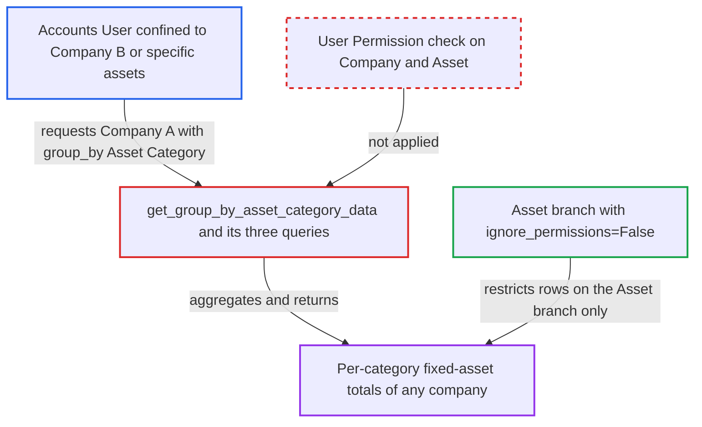

# Asset Depreciations and Balances category view ignores Company and Asset user permissions

| Field | Value |
|---|---|
| ID | `find_01SbR8YeqHSRgigYPEgjfept` |
| Severity | **Medium** |
| Status | open |
| CWE | CWE-862 — Missing Authorization |
| Created | 2026-10-27T21:13:33.755221Z |
| Claude Security | https://claude.ai/security/findings/find_01SbR8YeqHSRgigYPEgjfept |

## Description

A logged-in user with the `Accounts User` role can read per-category fixed-asset totals for a company, or for assets, that their User Permissions should hide. The default `group_by` of `Asset Category` in the Asset Depreciations and Balances report is enough. `get_group_by_asset_category_data()` builds its rows with raw `frappe.qb` queries that apply no User Permissions and never check `filters.company`.

1. **attacker with `Accounts User` role** requests the report for another company. The attacker's User Permissions confine them to Company B or to specific assets. They call `frappe.desk.query_report.run` or open the report page with `company` set to Company A and `group_by` set to `Asset Category`, which is the default.
2. **Frappe report runner** lets the request through on the role check alone. The report JSON has `ref_doctype` `Asset`, role `Accounts User` and empty `filters`. The runner therefore checks only the role and the role-level `report` permission on `Asset`, and has no filter definition to check `company` against. ([`erpnext/accounts/report/asset_depreciations_and_balances/asset_depreciations_and_balances.json`](https://github.com/cx-benchmark/erpnext/blob/90e7aefca73da3c440d2e8da7472fcb67838e678/erpnext/accounts/report/asset_depreciations_and_balances/asset_depreciations_and_balances.json))
3. **`get_data()`** sends the request to `get_group_by_asset_category_data()`. The branch is chosen by the caller's `group_by` value, and nothing checks `filters.company` on the way. ([`erpnext/accounts/report/asset_depreciations_and_balances/asset_depreciations_and_balances.py:23-35`](https://github.com/cx-benchmark/erpnext/blob/90e7aefca73da3c440d2e8da7472fcb67838e678/erpnext/accounts/report/asset_depreciations_and_balances/asset_depreciations_and_balances.py#L23-L35))
4. **the three category queries** read `Asset` and `GL Entry` without permission restrictions. `get_asset_categories_for_grouped_by_category()`, `get_assets_for_grouped_by_category()` and `get_asset_value_adjustment_map_by_category()` filter only by `asset.company == filters.company` plus the date, category and finance-book filters. ([`erpnext/accounts/report/asset_depreciations_and_balances/asset_depreciations_and_balances.py:149-177`](https://github.com/cx-benchmark/erpnext/blob/90e7aefca73da3c440d2e8da7472fcb67838e678/erpnext/accounts/report/asset_depreciations_and_balances/asset_depreciations_and_balances.py#L149-L177))
5. **report** returns Company A's per-category totals to the attacker. The totals sum every submitted asset, including those the user has no permission to read. The `Asset` branch avoids this with `ignore_permissions=False` on the same data. ([`erpnext/accounts/report/asset_depreciations_and_balances/asset_depreciations_and_balances.py:513`](https://github.com/cx-benchmark/erpnext/blob/90e7aefca73da3c440d2e8da7472fcb67838e678/erpnext/accounts/report/asset_depreciations_and_balances/asset_depreciations_and_balances.py#L513))

## Assessment

The attacker is an authenticated desk user with the `Accounts User` role. Their User Permissions limit them to Company B or to specific assets. They call `frappe.desk.query_report.run` over `/api/method`, or open the report page. They name Company A in `company` and leave `group_by` as `Asset Category`, the default. No other setup is needed. The report does not say that any other entry point exists. The report also notes that Frappe's generic post-filter on Link columns might drop category rows by the `asset_category` column only. That is an assumption about Frappe v17-dev, which is not in the checkout.

Impact: The attacker reads aggregated fixed-asset financials for any company they name, or for assets withheld from them. These cover opening and closing value, purchases, sold, scrapped and capitalized value, value adjustments, accumulated and period depreciation, and net asset value. The data stays aggregated and limited to fixed assets. Nothing is modified and availability is not affected. The `asset_category` and date filters can narrow the totals to small groups of assets.

## Recommendation

The `Asset Category` branch queries `Asset` and `GL Entry` for the caller-chosen `company` with raw query-builder queries and no permission restriction. Company and Asset User Permissions are therefore enforced only when the caller picks `group_by` as `Asset`.

Fix criteria: Every query on the category branch aggregates only over assets the current user may read, matching the restriction the `Asset` branch applies. A `company` the user may not read is refused. A user with a User Permission on Company B who runs the report for Company A grouped by `Asset Category` gets a permission error or no rows. A user permitted a single asset gets totals reflecting only that asset.

## Evidence

**https://github.com/cx-benchmark/erpnext**

- [`erpnext/accounts/report/asset_depreciations_and_balances/asset_depreciations_and_balances.py:149-177`](https://github.com/cx-benchmark/erpnext/blob/90e7aefca73da3c440d2e8da7472fcb67838e678/erpnext/accounts/report/asset_depreciations_and_balances/asset_depreciations_and_balances.py#L149-L177)
- [`erpnext/accounts/report/asset_depreciations_and_balances/asset_depreciations_and_balances.py:195-306`](https://github.com/cx-benchmark/erpnext/blob/90e7aefca73da3c440d2e8da7472fcb67838e678/erpnext/accounts/report/asset_depreciations_and_balances/asset_depreciations_and_balances.py#L195-L306)
- [`erpnext/accounts/report/asset_depreciations_and_balances/asset_depreciations_and_balances.py:367-388`](https://github.com/cx-benchmark/erpnext/blob/90e7aefca73da3c440d2e8da7472fcb67838e678/erpnext/accounts/report/asset_depreciations_and_balances/asset_depreciations_and_balances.py#L367-L388)
- [`erpnext/accounts/report/asset_depreciations_and_balances/asset_depreciations_and_balances.py:23-35`](https://github.com/cx-benchmark/erpnext/blob/90e7aefca73da3c440d2e8da7472fcb67838e678/erpnext/accounts/report/asset_depreciations_and_balances/asset_depreciations_and_balances.py#L23-L35)
- [`erpnext/accounts/report/asset_depreciations_and_balances/asset_depreciations_and_balances.py:513`](https://github.com/cx-benchmark/erpnext/blob/90e7aefca73da3c440d2e8da7472fcb67838e678/erpnext/accounts/report/asset_depreciations_and_balances/asset_depreciations_and_balances.py#L513)
- [`erpnext/accounts/report/asset_depreciations_and_balances/test_asset_depreciations_and_balances.py:61-88`](https://github.com/cx-benchmark/erpnext/blob/90e7aefca73da3c440d2e8da7472fcb67838e678/erpnext/accounts/report/asset_depreciations_and_balances/test_asset_depreciations_and_balances.py#L61-L88)
- [`erpnext/accounts/report/asset_depreciations_and_balances/asset_depreciations_and_balances.json`](https://github.com/cx-benchmark/erpnext/blob/90e7aefca73da3c440d2e8da7472fcb67838e678/erpnext/accounts/report/asset_depreciations_and_balances/asset_depreciations_and_balances.json)

