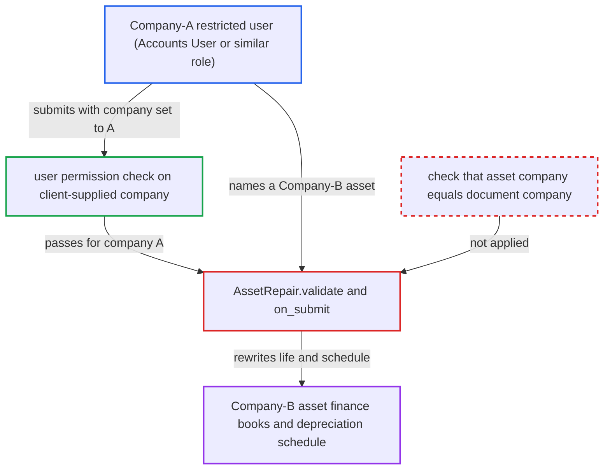

# Asset Repair modifies another company's Asset depreciation without company or permission check

| Field | Value |
|---|---|
| ID | `find_011LXNFETgsF67sJCwGTxa8M` |
| Severity | **Medium** |
| Status | open |
| CWE | CWE-862 — Missing Authorization |
| Created | 2026-10-27T22:00:39.592512Z |
| Claude Security | https://claude.ai/security/findings/find_011LXNFETgsF67sJCwGTxa8M |

## Description

A user restricted to Company A can change the useful life and future depreciation schedule of a fixed asset that belongs to Company B, without any permission on Company B. The user needs a role that can submit Asset Repair: Accounts User, Manufacturing Manager or Quality Manager. The cause is that `AssetRepair.validate` loads whatever Asset the user names and never checks that its company matches `self.company`.

1. **attacker** inserts a draft Asset Repair for an asset of Company A. The attacker is restricted by User Permission to Company A, and the roles Accounts User, Manufacturing Manager and Quality Manager can create, write and submit Asset Repair. ([`erpnext/assets/doctype/asset_repair/asset_repair.json:342-353`](https://github.com/cx-benchmark/erpnext/blob/90e7aefca73da3c440d2e8da7472fcb67838e678/erpnext/assets/doctype/asset_repair/asset_repair.json#L342-L353))
2. **attacker** calls `frappe.client.submit` on the draft with `asset` set to a Company-B asset name. The payload keeps `company` as Company A and sets `repair_status=Completed`, `completion_date`, `capitalize_repair_cost=1`, a large `increase_in_asset_life`, and no invoices or stock items.
3. **Frappe** checks write and submit permission using the client-supplied `company`. In the pinned Frappe this check runs before the link validation, and `fetch_from: asset.company` is not re-applied once the document is submitted, so Company A decides the user-permission check. ([`erpnext/assets/doctype/asset_repair/asset_repair.json:212-218`](https://github.com/cx-benchmark/erpnext/blob/90e7aefca73da3c440d2e8da7472fcb67838e678/erpnext/assets/doctype/asset_repair/asset_repair.json#L212-L218))
4. **the handler `AssetRepair.validate`** loads the named Asset and checks only its status. It never compares the asset's company with `self.company` and never checks the user's permission on that Asset. ([`erpnext/assets/doctype/asset_repair/asset_repair.py:69-97`](https://github.com/cx-benchmark/erpnext/blob/90e7aefca73da3c440d2e8da7472fcb67838e678/erpnext/assets/doctype/asset_repair/asset_repair.py#L69-L97))
5. **the handler `on_submit`** with `capitalize_repair_cost` set, saves the foreign Asset through `update_asset_value`. The save uses `ignore_permissions` and `ignore_validate_update_after_submit`, so the missing permission is not caught there either. ([`erpnext/assets/doctype/asset_repair/asset_repair.py:298-312`](https://github.com/cx-benchmark/erpnext/blob/90e7aefca73da3c440d2e8da7472fcb67838e678/erpnext/assets/doctype/asset_repair/asset_repair.py#L298-L312))
6. **the function `set_increase_in_asset_life`** adds the caller's `increase_in_asset_life` to every finance-book row of the Company-B asset. The value is not bounded, and the rows are written directly with `db_update()`. ([`erpnext/assets/doctype/asset_repair/asset_repair.py:419-425`](https://github.com/cx-benchmark/erpnext/blob/90e7aefca73da3c440d2e8da7472fcb67838e678/erpnext/assets/doctype/asset_repair/asset_repair.py#L419-L425))
7. **the function `reschedule_depreciation`** cancels the asset's submitted Asset Depreciation Schedule and submits a recomputed one. The extra life raises the number of depreciations, so the per-period depreciation amounts change; the call uses `ignore_permissions`. ([`erpnext/assets/doctype/asset_depreciation_schedule/asset_depreciation_schedule.py:242-270`](https://github.com/cx-benchmark/erpnext/blob/90e7aefca73da3c440d2e8da7472fcb67838e678/erpnext/assets/doctype/asset_depreciation_schedule/asset_depreciation_schedule.py#L242-L270))
8. **the function `make_gl_entries`** does not run for this repair. It runs only when `total_repair_cost > 0`, so a zero-cost repair posts no GL entry and meets no GL company check. ([`erpnext/assets/doctype/asset_repair/asset_repair.py:409-412`](https://github.com/cx-benchmark/erpnext/blob/90e7aefca73da3c440d2e8da7472fcb67838e678/erpnext/assets/doctype/asset_repair/asset_repair.py#L409-L412))

## Assessment

The attacker is a logged-in user with the Accounts User, Manufacturing Manager or Quality Manager role, restricted by User Permission to Company A. They first insert a draft Asset Repair for a Company-A asset. They then call `frappe.client.submit` on that draft with `asset` set to a Company-B asset name, which follows a guessable naming series. The payload keeps `company` as A, sets `repair_status=Completed`, `completion_date`, `capitalize_repair_cost=1`, a large `increase_in_asset_life`, and no invoices or stock items. The report names no other way in.

Impact: The attacker changes a Company-B asset's finance-book life by any number of months, replaces its submitted depreciation schedule, adds Asset Activity rows and recomputes its status. This misstates Company B's future depreciation postings. Recorded asset values and GL entries are not changed directly, because a non-zero cost fails the GL company check. Cancelling the repair reverses the change, and the loss is limited to depreciation timing for the targeted assets.

## Recommendation

Asset Repair accepts any Asset name and writes to that Asset on submit. The only tie between the Asset's company and the document's `company` is `fetch_from`, which the pinned Frappe applies after the permission check and skips for submitted documents.

Fix criteria: On every save and submit, `validate` re-reads the Asset's company from the database and rejects the document unless it equals `self.company`, or the user holds write permission on that Asset. A Company-A-restricted user who submits a repair naming a Company-B asset gets an error. The Company-B asset's finance books, depreciation schedule, activity and status stay unchanged.

## Evidence

**https://github.com/cx-benchmark/erpnext**

- [`erpnext/assets/doctype/asset_repair/asset_repair.py:69-97`](https://github.com/cx-benchmark/erpnext/blob/90e7aefca73da3c440d2e8da7472fcb67838e678/erpnext/assets/doctype/asset_repair/asset_repair.py#L69-L97)
- [`erpnext/assets/doctype/asset_repair/asset_repair.py:229-243`](https://github.com/cx-benchmark/erpnext/blob/90e7aefca73da3c440d2e8da7472fcb67838e678/erpnext/assets/doctype/asset_repair/asset_repair.py#L229-L243)
- [`erpnext/assets/doctype/asset_repair/asset_repair.py:298-312`](https://github.com/cx-benchmark/erpnext/blob/90e7aefca73da3c440d2e8da7472fcb67838e678/erpnext/assets/doctype/asset_repair/asset_repair.py#L298-L312)
- [`erpnext/assets/doctype/asset_repair/asset_repair.py:419-425`](https://github.com/cx-benchmark/erpnext/blob/90e7aefca73da3c440d2e8da7472fcb67838e678/erpnext/assets/doctype/asset_repair/asset_repair.py#L419-L425)
- [`erpnext/assets/doctype/asset_depreciation_schedule/asset_depreciation_schedule.py:242-270`](https://github.com/cx-benchmark/erpnext/blob/90e7aefca73da3c440d2e8da7472fcb67838e678/erpnext/assets/doctype/asset_depreciation_schedule/asset_depreciation_schedule.py#L242-L270)
- [`erpnext/assets/doctype/asset_depreciation_schedule/deppreciation_schedule_controller.py:150-160`](https://github.com/cx-benchmark/erpnext/blob/90e7aefca73da3c440d2e8da7472fcb67838e678/erpnext/assets/doctype/asset_depreciation_schedule/deppreciation_schedule_controller.py#L150-L160)
- [`erpnext/assets/doctype/asset_repair/asset_repair.py:409-412`](https://github.com/cx-benchmark/erpnext/blob/90e7aefca73da3c440d2e8da7472fcb67838e678/erpnext/assets/doctype/asset_repair/asset_repair.py#L409-L412)
- [`erpnext/assets/doctype/asset_repair/asset_repair.json:212-218`](https://github.com/cx-benchmark/erpnext/blob/90e7aefca73da3c440d2e8da7472fcb67838e678/erpnext/assets/doctype/asset_repair/asset_repair.json#L212-L218)
- [`erpnext/assets/doctype/asset_repair/asset_repair.json:342-353`](https://github.com/cx-benchmark/erpnext/blob/90e7aefca73da3c440d2e8da7472fcb67838e678/erpnext/assets/doctype/asset_repair/asset_repair.json#L342-L353)
- [`erpnext/stock/doctype/company_restriction/company_restriction.py:256-268`](https://github.com/cx-benchmark/erpnext/blob/90e7aefca73da3c440d2e8da7472fcb67838e678/erpnext/stock/doctype/company_restriction/company_restriction.py#L256-L268)
- [`erpnext/assets/doctype/asset_movement/asset_movement.py:51-57`](https://github.com/cx-benchmark/erpnext/blob/90e7aefca73da3c440d2e8da7472fcb67838e678/erpnext/assets/doctype/asset_movement/asset_movement.py#L51-L57)
- [`erpnext/assets/doctype/asset_repair/asset_repair.py:452-463`](https://github.com/cx-benchmark/erpnext/blob/90e7aefca73da3c440d2e8da7472fcb67838e678/erpnext/assets/doctype/asset_repair/asset_repair.py#L452-L463)

