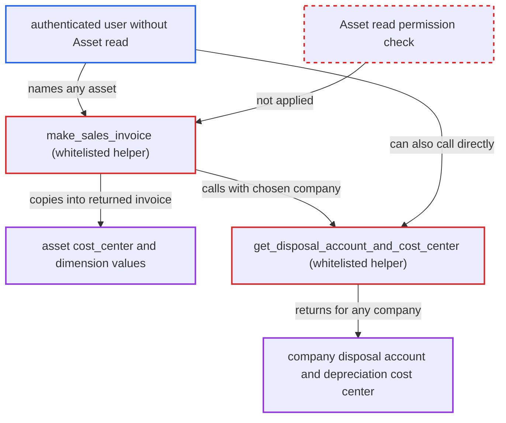

# Asset Sell Invoice helper discloses accounting dimensions of assets the caller cannot read

| Field | Value |
|---|---|
| ID | `find_01R7pT59Ty5GMoVPsp7bjbJZ` |
| Severity | **Medium** |
| Status | open |
| CWE | CWE-862 — Missing Authorization |
| Created | 2026-10-27T21:17:14.411262Z |
| Claude Security | https://claude.ai/security/findings/find_01R7pT59Ty5GMoVPsp7bjbJZ |

## Description

Any logged-in user can read the cost centre and custom accounting-dimension values of assets they are not allowed to read, including other companies' assets. They can also tell whether an asset name exists. The whitelisted `make_sales_invoice` loads the named Asset without checking read permission. The data is low-sensitivity accounting configuration, and nothing is modified.

1. **authenticated user** posts a request to the `make_sales_invoice` endpoint. The request goes to `/api/method/erpnext.assets.doctype.asset.mapper.make_sales_invoice` with a known or guessed `asset` name, a readable `item_code`, any `company` and `sell_qty=1`, and needs no Asset role. ([`erpnext/assets/doctype/asset/mapper.py:24-54`](https://github.com/cx-benchmark/erpnext/blob/90e7aefca73da3c440d2e8da7472fcb67838e678/erpnext/assets/doctype/asset/mapper.py#L24-L54))
2. **the helper `make_sales_invoice`** loads the named Asset with `frappe.get_doc`. No `frappe.has_permission` call runs first, so role permissions and company user permissions are skipped, and a missing asset raises `DoesNotExistError`, which shows whether the name exists. ([`erpnext/assets/doctype/asset/mapper.py:24-54`](https://github.com/cx-benchmark/erpnext/blob/90e7aefca73da3c440d2e8da7472fcb67838e678/erpnext/assets/doctype/asset/mapper.py#L24-L54))
3. **the helper `make_sales_invoice`** copies the asset's `cost_center` and custom dimension values into a new Sales Invoice. Asset is listed in `accounting_dimension_doctypes`, so every enabled dimension is copied, and `project` falls back to the default dimension because Asset has no such field. ([`erpnext/assets/doctype/asset/mapper.py:24-54`](https://github.com/cx-benchmark/erpnext/blob/90e7aefca73da3c440d2e8da7472fcb67838e678/erpnext/assets/doctype/asset/mapper.py#L24-L54))
4. **the helper `make_sales_invoice`** calls `get_disposal_account_and_cost_center` with the caller's `company`. The company's disposal account and depreciation cost centre end up in the item row of the invoice. ([`erpnext/assets/doctype/asset/depreciation.py:848-859`](https://github.com/cx-benchmark/erpnext/blob/90e7aefca73da3c440d2e8da7472fcb67838e678/erpnext/assets/doctype/asset/depreciation.py#L848-L859))
5. **the helper `make_sales_invoice`** returns the unsaved Sales Invoice to the caller in full. The caller reads the dimension values and the company's accounts from the response, although `read` on Asset is granted only to `Accounts User` and `Quality Manager`. ([`erpnext/assets/doctype/asset/asset.json:660-722`](https://github.com/cx-benchmark/erpnext/blob/90e7aefca73da3c440d2e8da7472fcb67838e678/erpnext/assets/doctype/asset/asset.json#L660-L722))

## Assessment

The attacker is any authenticated user and needs no Asset read role. They send one request to the whitelisted `make_sales_invoice` endpoint with an asset name they know or guess. No victim action and no special configuration are needed. A user restricted by user permissions to one company can still read other companies' asset dimensions. A second way in exists for the company accounts: the whitelisted and unguarded `get_disposal_account_and_cost_center` can be called directly. The `item_code` path is not a bypass, because `_get_item_details` calls `item.check_permission()`.

Impact: The attacker learns the cost centre and custom accounting-dimension assignments of assets they may not read, and can confirm whether an asset name exists. Other asset fields such as values, custodian and purchase data are not returned. Nothing is written, and saving the invoice later goes through the normal insert permission checks.

## Recommendation

(1) `make_sales_invoice` loads a caller-named Asset with `frappe.get_doc` and returns its dimension values without checking that the caller may read that Asset. This bypasses doctype role permissions and company user permissions.

Fix criteria: Before any asset field is read, a caller without `read` permission on the named Asset, including user-permission restrictions, gets a `PermissionError` that does not reveal whether the asset exists. A test confirms that a user with only `select`, or with no Asset role, or one restricted to another company, gets no `cost_center` or dimension values back.

(2) `get_disposal_account_and_cost_center` is whitelisted and returns any Company's disposal account and depreciation cost centre without checking the caller's access to that Company.

Fix criteria: The helper refuses callers who lack access to the named Company, including company user permissions, or is no longer directly callable. A test confirms that a user restricted to company A cannot get company B's disposal account through either this helper or `make_sales_invoice`.

## Evidence

**https://github.com/cx-benchmark/erpnext**

- [`erpnext/assets/doctype/asset/mapper.py:24-54`](https://github.com/cx-benchmark/erpnext/blob/90e7aefca73da3c440d2e8da7472fcb67838e678/erpnext/assets/doctype/asset/mapper.py#L24-L54)
- [`erpnext/assets/doctype/asset/mapper.py:119-122`](https://github.com/cx-benchmark/erpnext/blob/90e7aefca73da3c440d2e8da7472fcb67838e678/erpnext/assets/doctype/asset/mapper.py#L119-L122)
- [`erpnext/assets/doctype/asset/asset.json:660-722`](https://github.com/cx-benchmark/erpnext/blob/90e7aefca73da3c440d2e8da7472fcb67838e678/erpnext/assets/doctype/asset/asset.json#L660-L722)
- [`erpnext/assets/doctype/asset/depreciation.py:848-859`](https://github.com/cx-benchmark/erpnext/blob/90e7aefca73da3c440d2e8da7472fcb67838e678/erpnext/assets/doctype/asset/depreciation.py#L848-L859)

