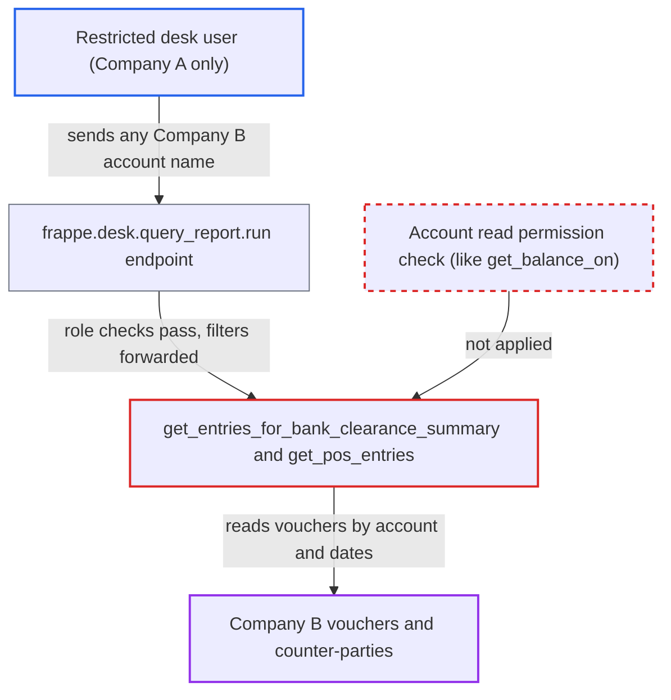

# Bank Clearance Summary report lists any company's account vouchers, bypassing Company user permissions

| Field | Value |
|---|---|
| ID | `find_01GtvDq2oymRgXHvZnHnFQLw` |
| Severity | **Medium** |
| Status | open |
| CWE | CWE-862 — Missing Authorization |
| Created | 2026-10-27T21:16:27.192592Z |
| Claude Security | https://claude.ai/security/findings/find_01GtvDq2oymRgXHvZnHnFQLw |

## Description

A desk user restricted to one company can read another company's payment vouchers through the Bank Clearance Summary report. The rows include voucher numbers, reference numbers, counter-parties and amounts. The attacker needs the Accounts User, Accounts Manager or Auditor role and a Company User Permission on a multi-company site. The report's `execute` path runs `frappe.qb` queries scoped only by the caller-supplied `account` and never checks read permission on that Account or its Company.

1. **the attacker (a restricted desk user)** posts a direct request to `/api/method/frappe.desk.query_report.run`. The request uses `report_name=Bank Clearance Summary` and `filters` with a Company B account such as `Cash - B`, `from_date` `2000-01-01` and `to_date` `2100-01-01`; the Bank/Cash limit exists only in the browser-side `get_query`, so the server never sees it. ([`erpnext/accounts/report/bank_clearance_summary/bank_clearance_summary.js:19-36`](https://github.com/cx-benchmark/erpnext/blob/90e7aefca73da3c440d2e8da7472fcb67838e678/erpnext/accounts/report/bank_clearance_summary/bank_clearance_summary.js#L19-L36))
2. **the framework report runner** lets the request through. It checks only the report roles and the `report` permission on `Journal Entry`, and the report's JSON defines no `filters` table for it to validate the account against. ([`erpnext/accounts/report/bank_clearance_summary/bank_clearance_summary.json`](https://github.com/cx-benchmark/erpnext/blob/90e7aefca73da3c440d2e8da7472fcb67838e678/erpnext/accounts/report/bank_clearance_summary/bank_clearance_summary.json))
3. **the report function `execute`** hands the raw request filters to `get_entries`. `get_entries` calls every `get_entries_for_bank_clearance_summary` hook, including ERPNext's own, and nothing on this path validates `account` against the user's permissions. ([`erpnext/accounts/report/bank_clearance_summary/bank_clearance_summary.py:13-70`](https://github.com/cx-benchmark/erpnext/blob/90e7aefca73da3c440d2e8da7472fcb67838e678/erpnext/accounts/report/bank_clearance_summary/bank_clearance_summary.py#L13-L70))
4. **the function `get_entries_for_bank_clearance_summary`** queries vouchers on the chosen account. Its three `frappe.qb` queries cover `Journal Entry`, `Payment Entry` and paid `Purchase Invoice`, filtered only by account, docstatus and dates, and query-builder SQL ignores User Permissions. ([`erpnext/accounts/report/bank_clearance_summary/bank_clearance_summary.py:73-154`](https://github.com/cx-benchmark/erpnext/blob/90e7aefca73da3c440d2e8da7472fcb67838e678/erpnext/accounts/report/bank_clearance_summary/bank_clearance_summary.py#L73-L154))
5. **the function `get_pos_entries`** adds the POS payments on the same account. It returns `Sales Invoice` POS payments with customer, reference number and amount, with no company or permission condition. ([`erpnext/accounts/report/bank_clearance_summary/bank_clearance_summary.py:157-181`](https://github.com/cx-benchmark/erpnext/blob/90e7aefca73da3c440d2e8da7472fcb67838e678/erpnext/accounts/report/bank_clearance_summary/bank_clearance_summary.py#L157-L181))
6. **the framework runner** returns the rows to the attacker. Its row post-filter compares only the Link columns `DocType` and `Account` (`against`), so a Company User Permission drops no rows, despite `apply_user_permissions: 1` in the JSON.

## Assessment

The attacker is an authenticated desk user with the Accounts User, Accounts Manager or Auditor role. On a multi-company site, a Company User Permission limits them to Company A. They need no victim action. They call `frappe.desk.query_report.run` directly for this report with an account name from a company they are barred from. The report accepts any GL account, not only Bank or Cash accounts. The report says the framework runner's behaviour is assumed for Frappe >=17.0.0-dev, which is not in the checkout.

Impact: The attacker can read every submitted Journal Entry line, Payment Entry, paid Purchase Invoice and POS payment on any account of a company they are barred from, over any date range. Each row shows the voucher number, dates, cheque/reference/bill number, clearance date, counter-party or against account, and amount. Repeating this over bank, cash, debtors, creditors or payroll accounts exposes that company's cash movements and counter-parties. The access is read-only.

## Recommendation

The report uses the caller-supplied `account` as the only scope of permission-free `frappe.qb` queries over payment vouchers. It never checks that the session user may read that Account or its Company, so Company and Account User Permissions are not enforced.

Fix criteria: Before querying, the report refuses any `account` the session user cannot read, or it limits every voucher query to the user's permitted companies. Running `frappe.desk.query_report.run` for this report as a user restricted to Company A with a Company B account (bank or non-bank) raises a PermissionError or returns no rows. A Company A account still returns its rows.

## Evidence

**https://github.com/cx-benchmark/erpnext**

- [`erpnext/accounts/report/bank_clearance_summary/bank_clearance_summary.py:73-154`](https://github.com/cx-benchmark/erpnext/blob/90e7aefca73da3c440d2e8da7472fcb67838e678/erpnext/accounts/report/bank_clearance_summary/bank_clearance_summary.py#L73-L154)
- [`erpnext/accounts/report/bank_clearance_summary/bank_clearance_summary.py:157-181`](https://github.com/cx-benchmark/erpnext/blob/90e7aefca73da3c440d2e8da7472fcb67838e678/erpnext/accounts/report/bank_clearance_summary/bank_clearance_summary.py#L157-L181)
- [`erpnext/accounts/report/bank_clearance_summary/bank_clearance_summary.py:13-70`](https://github.com/cx-benchmark/erpnext/blob/90e7aefca73da3c440d2e8da7472fcb67838e678/erpnext/accounts/report/bank_clearance_summary/bank_clearance_summary.py#L13-L70)
- [`erpnext/accounts/report/bank_clearance_summary/bank_clearance_summary.js:19-36`](https://github.com/cx-benchmark/erpnext/blob/90e7aefca73da3c440d2e8da7472fcb67838e678/erpnext/accounts/report/bank_clearance_summary/bank_clearance_summary.js#L19-L36)
- [`erpnext/accounts/report/bank_clearance_summary/bank_clearance_summary.json`](https://github.com/cx-benchmark/erpnext/blob/90e7aefca73da3c440d2e8da7472fcb67838e678/erpnext/accounts/report/bank_clearance_summary/bank_clearance_summary.json)
- [`erpnext/accounts/doctype/account/account.json:72-83`](https://github.com/cx-benchmark/erpnext/blob/90e7aefca73da3c440d2e8da7472fcb67838e678/erpnext/accounts/doctype/account/account.json#L72-L83)
- [`erpnext/accounts/utils.py:268-270`](https://github.com/cx-benchmark/erpnext/blob/90e7aefca73da3c440d2e8da7472fcb67838e678/erpnext/accounts/utils.py#L268-L270)

