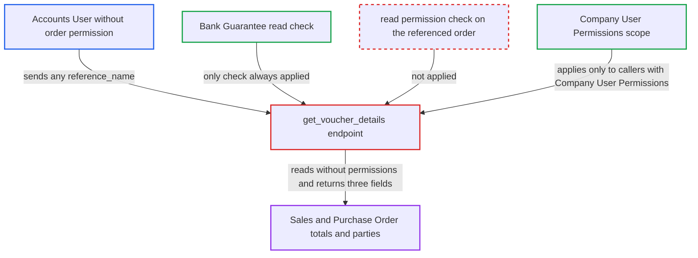

# Bank Guarantee get_voucher_details discloses any Sales/Purchase Order total and party without order permission

| Field | Value |
|---|---|
| ID | `find_01B36iQ4b1eaJEx8NEr4qSHp` |
| Severity | **Medium** |
| Status | open |
| CWE | CWE-639 — Authorization Bypass Through User-Controlled Key |
| Created | 2026-10-27T21:22:13.244521Z |
| Claude Security | https://claude.ai/security/findings/find_01B36iQ4b1eaJEx8NEr4qSHp |

## Description

An authenticated user with the `Accounts User` role can read the total, the counterparty and, for Sales Orders, the project of orders they are not allowed to see. This includes every Purchase Order, even though the role has no Purchase Order access. It works through the whitelisted `get_voucher_details` in `bank_guarantee.py`. That function checks only read access on Bank Guarantee, not on the order, and then reads the order with `frappe.db.get_value`, which applies no permissions. Only three fields are exposed per order.

1. **attacker with the `Accounts User` role** calls the `get_voucher_details` endpoint with a chosen `reference_name`. The request goes to `/api/method/erpnext.accounts.doctype.bank_guarantee.bank_guarantee.get_voucher_details` with `bank_guarantee_type=Providing` and `reference_name=PUR-ORD-2026-00001`, or with `Receiving` to target a Sales Order. ([`erpnext/accounts/doctype/bank_guarantee/bank_guarantee.py:58-86`](https://github.com/cx-benchmark/erpnext/blob/90e7aefca73da3c440d2e8da7472fcb67838e678/erpnext/accounts/doctype/bank_guarantee/bank_guarantee.py#L58-L86))
2. **the handler `get_voucher_details`** checks only read access on the Bank Guarantee doctype. The call `frappe.has_permission("Bank Guarantee", throw=True)` passes for `Accounts User`, and nothing is checked on the referenced order. ([`erpnext/accounts/doctype/bank_guarantee/bank_guarantee.py:58-86`](https://github.com/cx-benchmark/erpnext/blob/90e7aefca73da3c440d2e8da7472fcb67838e678/erpnext/accounts/doctype/bank_guarantee/bank_guarantee.py#L58-L86))
3. **the handler `get_voucher_details`** picks the order doctype from `bank_guarantee_type`. `Receiving` selects `Sales Order`, and any other value selects `Purchase Order`. ([`erpnext/accounts/doctype/bank_guarantee/bank_guarantee.py:58-86`](https://github.com/cx-benchmark/erpnext/blob/90e7aefca73da3c440d2e8da7472fcb67838e678/erpnext/accounts/doctype/bank_guarantee/bank_guarantee.py#L58-L86))
4. **the handler `get_voucher_details`** applies the company scope only to callers who have `Company` User Permissions. Callers without `Company` User Permissions are not scoped at all, and nothing else is checked. ([`erpnext/accounts/doctype/bank_guarantee/bank_guarantee.py:58-86`](https://github.com/cx-benchmark/erpnext/blob/90e7aefca73da3c440d2e8da7472fcb67838e678/erpnext/accounts/doctype/bank_guarantee/bank_guarantee.py#L58-L86))
5. **the handler `get_voucher_details`** reads the order with `frappe.db.get_value` and returns it. This read enforces no role permissions, User Permissions or `has_permission` hooks. It returns `grand_total` plus `customer` and `project` for a Sales Order, or `supplier` for a Purchase Order. ([`erpnext/accounts/doctype/bank_guarantee/bank_guarantee.py:58-86`](https://github.com/cx-benchmark/erpnext/blob/90e7aefca73da3c440d2e8da7472fcb67838e678/erpnext/accounts/doctype/bank_guarantee/bank_guarantee.py#L58-L86))
6. **attacker** increments the order number and repeats the call. Purchase Order names follow the sequential `PUR-ORD-.YYYY.-` series, so they are easy to enumerate. The `Accounts User` and `Accounts Manager` roles have no read or select on Purchase Order. ([`erpnext/buying/doctype/purchase_order/purchase_order.json:1318-1358`](https://github.com/cx-benchmark/erpnext/blob/90e7aefca73da3c440d2e8da7472fcb67838e678/erpnext/buying/doctype/purchase_order/purchase_order.json#L1318-L1358))

## Assessment

The attacker is an authenticated desk user with `Accounts User`, which grants Bank Guarantee read, but with no Purchase Order role. Alternatively, the attacker is a user restricted by Customer, Supplier or Project User Permissions. They need no victim action. They call the endpoint with `bank_guarantee_type=Providing` to read Purchase Orders, or with `Receiving` to read Sales Orders. The only obstacles are the Bank Guarantee check and the `Company` User Permissions scope, and the scope applies only to callers who have such permissions.

Impact: The attacker can read the `supplier` and `grand_total` of every Purchase Order, including drafts, cancelled and fully billed ones. They can also read the `customer`, `project` and `grand_total` of Sales Orders that their role or User Permissions deny. Each call returns only three fields, `Company` User Permissions still limit the read, and nothing can be written.

## Recommendation

`get_voucher_details` authorizes the caller on the Bank Guarantee doctype instead of the referenced Sales Order or Purchase Order. It then reads the order with `frappe.db.get_value`, which enforces no permissions, so role permissions, User Permissions and permission hooks on the order are never applied.

Fix criteria: The endpoint returns order data only when the caller has read (or at least select) permission on the specific referenced Sales Order or Purchase Order document, as `get_reference_details` in `payment_entry.py` already requires. An `Accounts User` without a Purchase Order role gets a `PermissionError` for any Purchase Order name. A user restricted by Customer, Supplier, Project or Company User Permissions gets an error for orders outside those restrictions.

## Evidence

**https://github.com/cx-benchmark/erpnext**

- [`erpnext/accounts/doctype/bank_guarantee/bank_guarantee.py:58-86`](https://github.com/cx-benchmark/erpnext/blob/90e7aefca73da3c440d2e8da7472fcb67838e678/erpnext/accounts/doctype/bank_guarantee/bank_guarantee.py#L58-L86)
- [`erpnext/buying/doctype/purchase_order/purchase_order.json:1318-1358`](https://github.com/cx-benchmark/erpnext/blob/90e7aefca73da3c440d2e8da7472fcb67838e678/erpnext/buying/doctype/purchase_order/purchase_order.json#L1318-L1358)
- [`erpnext/accounts/doctype/bank_guarantee/bank_guarantee.json:230-257`](https://github.com/cx-benchmark/erpnext/blob/90e7aefca73da3c440d2e8da7472fcb67838e678/erpnext/accounts/doctype/bank_guarantee/bank_guarantee.json#L230-L257)
- [`erpnext/accounts/doctype/payment_entry/payment_entry.py:2621-2631`](https://github.com/cx-benchmark/erpnext/blob/90e7aefca73da3c440d2e8da7472fcb67838e678/erpnext/accounts/doctype/payment_entry/payment_entry.py#L2621-L2631)
- [`erpnext/hooks.py:363-373`](https://github.com/cx-benchmark/erpnext/blob/90e7aefca73da3c440d2e8da7472fcb67838e678/erpnext/hooks.py#L363-L373)

