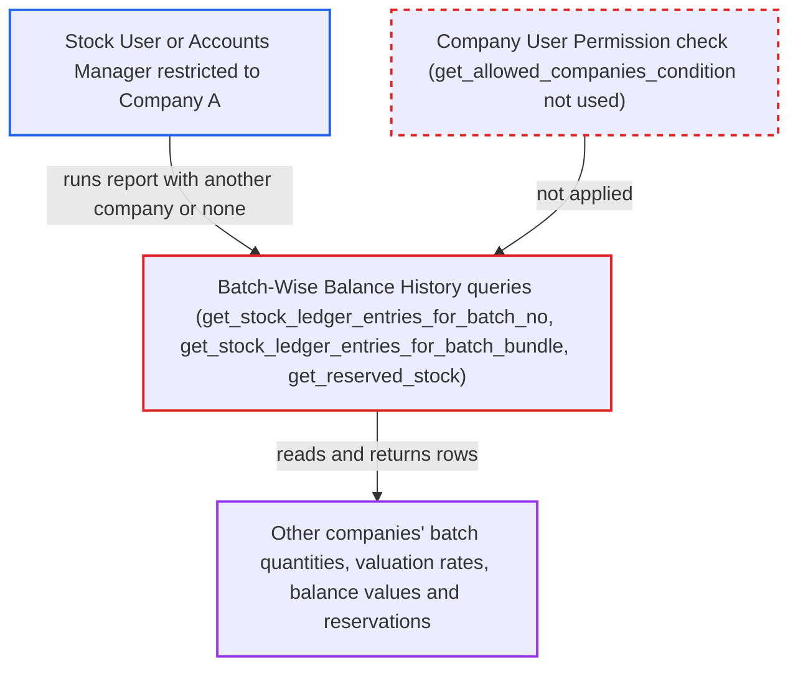

# Batch-Wise Balance History report ignores Company user permissions

| Field | Value |
|---|---|
| ID | `find_012YYGXFKUmapukzmQAsSeiz` |
| Severity | **Medium** |
| Status | open |
| CWE | CWE-862 — Missing authorization |
| Created | 2026-10-27T21:19:43.721956Z |
| Claude Security | https://claude.ai/security/findings/find_012YYGXFKUmapukzmQAsSeiz |

## Description

A logged-in Stock User or Accounts Manager who is fenced to one company by a Company User Permission can read other companies' batch stock data. This covers per-batch quantities, valuation rates, balance values and reserved stock. The attacker names another company in the report filters or leaves `company` out. The report queries in `batch_wise_balance_history.py` take company scope only from the caller's filters and never check the user's Company User Permissions.

1. **Restricted employee** calls the report endpoint with another company or none. The request is a POST to `/api/method/frappe.desk.query_report.run` with `report_name=Batch-Wise Balance History` and filters such as `company` set to "B", or with no `company`, plus wide `from_date` and `to_date` values.
2. **Frappe report runner** lets the request through the role and report checks. The report is a Script Report on Stock Ledger Entry for Stock User and Accounts Manager, and it has no `filters` table, so no filter value is checked against the user's permissions. ([`erpnext/stock/report/batch_wise_balance_history/batch_wise_balance_history.json:16-25`](https://github.com/cx-benchmark/erpnext/blob/90e7aefca73da3c440d2e8da7472fcb67838e678/erpnext/stock/report/batch_wise_balance_history/batch_wise_balance_history.json#L16-L25))
3. **the function `get_data`** collects rows for every item, warehouse and batch the queries return. On a ledger over 100k rows it needs only one of item_code, warehouse or warehouse_type, and it never checks company permission. ([`erpnext/stock/report/batch_wise_balance_history/batch_wise_balance_history.py:28-81`](https://github.com/cx-benchmark/erpnext/blob/90e7aefca73da3c440d2e8da7472fcb67838e678/erpnext/stock/report/batch_wise_balance_history/batch_wise_balance_history.py#L28-L81))
4. **the function `get_stock_ledger_entries_for_batch_no`** reads Stock Ledger Entry rows with `frappe.qb` without any permission check. The company condition is added only when the caller sent `company`, so omitting it reads every company's ledger. `get_stock_ledger_entries_for_batch_bundle` repeats this for bundle-based entries. ([`erpnext/stock/report/batch_wise_balance_history/batch_wise_balance_history.py:180-230`](https://github.com/cx-benchmark/erpnext/blob/90e7aefca73da3c440d2e8da7472fcb67838e678/erpnext/stock/report/batch_wise_balance_history/batch_wise_balance_history.py#L180-L230))
5. **the function `get_reserved_stock`** reads Stock Reservation Entries scoped only by the caller's `company` filter. Current reserved quantities for other companies' warehouses are added to the output. ([`erpnext/stock/report/batch_wise_balance_history/batch_wise_balance_history.py:112-145`](https://github.com/cx-benchmark/erpnext/blob/90e7aefca73da3c440d2e8da7472fcb67838e678/erpnext/stock/report/batch_wise_balance_history/batch_wise_balance_history.py#L112-L145))
6. **Frappe desk runner** trims rows by their link cells but finds no company to reject. The output columns hold Item, Warehouse and Batch links and no Company link, so rows from other companies pass through and the attacker receives them. ([`erpnext/stock/report/batch_wise_balance_history/batch_wise_balance_history.py:90-108`](https://github.com/cx-benchmark/erpnext/blob/90e7aefca73da3c440d2e8da7472fcb67838e678/erpnext/stock/report/batch_wise_balance_history/batch_wise_balance_history.py#L90-L108))

## Assessment

The attacker is a logged-in employee with the Stock User or Accounts Manager role whose User Permission limits them to one company. They need no other setup. They can name another company in `company` or leave `company` out. On a large ledger they also add an `item_code`, `warehouse` or `warehouse_type` filter. Warehouse- and Item-level User Permissions are still enforced by the desk (the report assumes Frappe >=17.0.0-dev, which is not in the checkout), but a Company User Permission is never checked.

Impact: The attacker can read, for other companies' warehouses, per-batch opening, in, out and balance quantities, valuation rates, balance values and current reserved stock. The disclosure is read-only. It covers batch-tracked items only and carries no voucher or party detail. Nothing can be written or made unavailable.

## Recommendation

The ledger, closing-balance and reservation queries take company scope from the caller's filter and never intersect it with the running user's Company User Permissions. The output has no Company column that the framework's row trimming could use.

Fix criteria: Every returned row belongs to a company the running user is permitted under the Company User Permissions applicable to Stock Ledger Entry, whether `company` is named, omitted or set to another company. A Stock User restricted to Company A who runs the report with `company=B` gets no Company-B rows or a PermissionError. The same holds when `company` is omitted and a `warehouse_type` or Company-B item is given.

## Evidence

**https://github.com/cx-benchmark/erpnext**

- [`erpnext/stock/report/batch_wise_balance_history/batch_wise_balance_history.py:180-230`](https://github.com/cx-benchmark/erpnext/blob/90e7aefca73da3c440d2e8da7472fcb67838e678/erpnext/stock/report/batch_wise_balance_history/batch_wise_balance_history.py#L180-L230)
- [`erpnext/stock/report/batch_wise_balance_history/batch_wise_balance_history.py:233-288`](https://github.com/cx-benchmark/erpnext/blob/90e7aefca73da3c440d2e8da7472fcb67838e678/erpnext/stock/report/batch_wise_balance_history/batch_wise_balance_history.py#L233-L288)
- [`erpnext/stock/report/batch_wise_balance_history/batch_wise_balance_history.py:90-108`](https://github.com/cx-benchmark/erpnext/blob/90e7aefca73da3c440d2e8da7472fcb67838e678/erpnext/stock/report/batch_wise_balance_history/batch_wise_balance_history.py#L90-L108)
- [`erpnext/stock/report/batch_wise_balance_history/batch_wise_balance_history.py:28-81`](https://github.com/cx-benchmark/erpnext/blob/90e7aefca73da3c440d2e8da7472fcb67838e678/erpnext/stock/report/batch_wise_balance_history/batch_wise_balance_history.py#L28-L81)
- [`erpnext/stock/report/batch_wise_balance_history/batch_wise_balance_history.py:112-145`](https://github.com/cx-benchmark/erpnext/blob/90e7aefca73da3c440d2e8da7472fcb67838e678/erpnext/stock/report/batch_wise_balance_history/batch_wise_balance_history.py#L112-L145)
- [`erpnext/stock/report/batch_wise_balance_history/batch_wise_balance_history.json:16-25`](https://github.com/cx-benchmark/erpnext/blob/90e7aefca73da3c440d2e8da7472fcb67838e678/erpnext/stock/report/batch_wise_balance_history/batch_wise_balance_history.json#L16-L25)
- [`erpnext/stock/doctype/company_restriction/company_restriction.py:62-81`](https://github.com/cx-benchmark/erpnext/blob/90e7aefca73da3c440d2e8da7472fcb67838e678/erpnext/stock/doctype/company_restriction/company_restriction.py#L62-L81)

