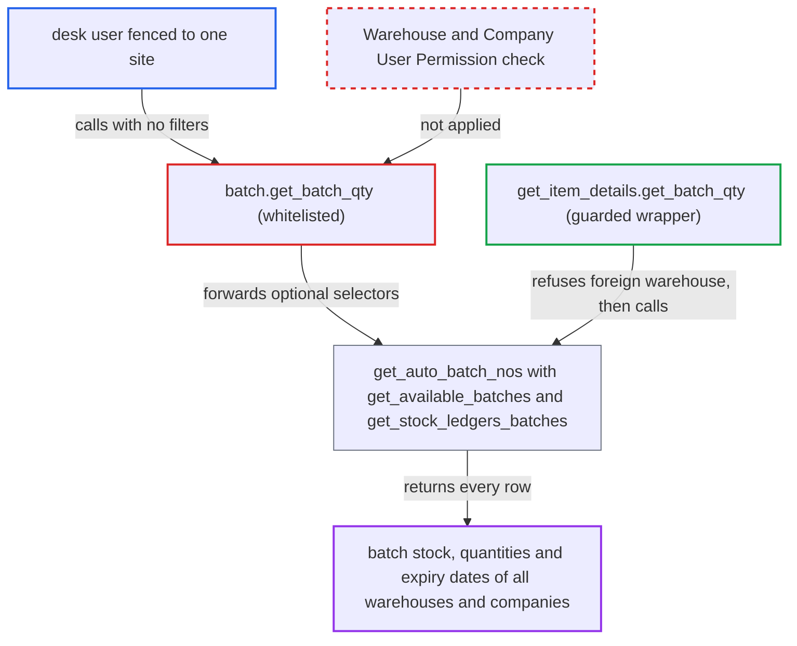

# batch.get_batch_qty returns batch stock of all warehouses and companies, ignoring User Permissions

| Field | Value |
|---|---|
| ID | `find_01Mci1fY4QFnXdhFKurrrArC` |
| Severity | **Medium** |
| Status | open |
| CWE | CWE-862 — Missing Authorization |
| Created | 2026-10-27T21:51:42.816664Z |
| Claude Security | https://claude.ai/security/findings/find_01Mci1fY4QFnXdhFKurrrArC |

## Description

A logged-in desk user whose Warehouse or Company User Permissions limit them to one site can read batch stock for every warehouse of every company. They get batch names, per-warehouse quantities and expiry dates. The whitelisted `get_batch_qty` in `batch.py` checks only doctype-level Batch `select` permission and treats every filter as optional.

1. **attacker (desk user with Batch select)** calls the whitelisted `get_batch_qty` with no arguments. The call is a GET to `/api/method/erpnext.stock.doctype.batch.batch.get_batch_qty`. The optional flags `for_stock_levels=1`, `consider_negative_batches=1` and `ignore_reserved_stock=1` can be added. ([`erpnext/stock/doctype/batch/batch.py:271-331`](https://github.com/cx-benchmark/erpnext/blob/90e7aefca73da3c440d2e8da7472fcb67838e678/erpnext/stock/doctype/batch/batch.py#L271-L331))
2. **the method `get_batch_qty`** checks only doctype-level Batch select permission. `frappe.has_permission("Batch", "select", throw=True)` passes for every role in `batch.json`. Without a document it never consults User Permissions, and no Warehouse, Company or Item permission is checked. ([`erpnext/stock/doctype/batch/batch.py:271-331`](https://github.com/cx-benchmark/erpnext/blob/90e7aefca73da3c440d2e8da7472fcb67838e678/erpnext/stock/doctype/batch/batch.py#L271-L331))
3. **the method `get_batch_qty`** passes the empty selectors on to `get_auto_batch_nos`. `get_auto_batch_nos` calls `get_available_batches` and `get_stock_ledgers_batches`. Both add `company`, `warehouse`, `item_code` and `batch_no` predicates only when the caller supplies them. ([`erpnext/stock/doctype/serial_and_batch_bundle/serial_and_batch_bundle.py:3505-3573`](https://github.com/cx-benchmark/erpnext/blob/90e7aefca73da3c440d2e8da7472fcb67838e678/erpnext/stock/doctype/serial_and_batch_bundle/serial_and_batch_bundle.py#L3505-L3573))
4. **the helper `get_stock_ledgers_batches`** adds the legacy batch_no stock ledger rows to the result. It has the same optional filters, so these rows also cover every warehouse of every company. ([`erpnext/stock/doctype/serial_and_batch_bundle/serial_and_batch_bundle.py:3844-3910`](https://github.com/cx-benchmark/erpnext/blob/90e7aefca73da3c440d2e8da7472fcb67838e678/erpnext/stock/doctype/serial_and_batch_bundle/serial_and_batch_bundle.py#L3844-L3910))
5. **the method `get_batch_qty`** returns the full list of rows. Unless both `batch_no` and `warehouse` are given, the whole `{batch_no, warehouse, qty, expiry_date}` list comes back. If `batch_no` and a foreign `warehouse` are given, the quantity of that batch in that warehouse is returned. ([`erpnext/stock/doctype/batch/batch.py:271-331`](https://github.com/cx-benchmark/erpnext/blob/90e7aefca73da3c440d2e8da7472fcb67838e678/erpnext/stock/doctype/batch/batch.py#L271-L331))

## Assessment

The attacker is any authenticated desk user who holds Batch select. Roles that have it include Stock User, Sales User and Accounts User. Their Warehouse or Company User Permissions are meant to limit them to one site. No victim action and no configuration setting is needed. Passing `item_code` or `batch_no` narrows the call to one target. The sibling whitelisted readers `get_batches_by_oldest` and `get_pos_reserved_batch_qty` have the same Batch-select-only gate and take a caller-chosen warehouse. The fork's other wrapper of this call, `get_item_details.get_batch_qty`, runs `erpnext.require_user_permission("Warehouse", warehouse)` first, and a test requires a warehouse-fenced Stock User to be refused there. The helper `get_allowed_warehouses_condition` is not used in `batch.get_batch_qty`. A separate defect in `get_auto_data` has its own fix.

Impact: The attacker reads batch names, per-warehouse on-hand quantities and expiry dates for every warehouse of every company, past their User Permission and Company restrictions. With `for_stock_levels=1` expired batches are added. With `consider_negative_batches=1` negative batches are added. Only quantities are exposed, with no valuation, and there is no write path.

## Recommendation

`batch.get_batch_qty`, `get_batches_by_oldest` and `get_pos_reserved_batch_qty` authorise only at the Batch doctype level. Every scoping argument can be left out, so the unscoped aggregation returns stock outside the caller's User Permissions.

Fix criteria: The whitelisted entry points require the scoping arguments they need, at least `warehouse` or `batch_no`. They refuse with a PermissionError when the caller lacks User Permission access to the named Warehouse or Item, or to the warehouse's Company. Alternatively they filter the returned rows with `get_allowed_warehouses_condition` or Warehouse User Permission filtering. A warehouse-fenced Sales User who calls `get_batch_qty()` with no arguments or with another warehouse gets no rows for warehouses outside their permission. The serial/batch selector (`serial_no_batch_selector.js:416`) and the Batch dashboard (`batch.js:97`) still work for permitted warehouses.

## Evidence

**https://github.com/cx-benchmark/erpnext**

- [`erpnext/stock/doctype/batch/batch.py:271-331`](https://github.com/cx-benchmark/erpnext/blob/90e7aefca73da3c440d2e8da7472fcb67838e678/erpnext/stock/doctype/batch/batch.py#L271-L331)
- [`erpnext/stock/doctype/serial_and_batch_bundle/serial_and_batch_bundle.py:3505-3573`](https://github.com/cx-benchmark/erpnext/blob/90e7aefca73da3c440d2e8da7472fcb67838e678/erpnext/stock/doctype/serial_and_batch_bundle/serial_and_batch_bundle.py#L3505-L3573)
- [`erpnext/stock/doctype/serial_and_batch_bundle/serial_and_batch_bundle.py:3844-3910`](https://github.com/cx-benchmark/erpnext/blob/90e7aefca73da3c440d2e8da7472fcb67838e678/erpnext/stock/doctype/serial_and_batch_bundle/serial_and_batch_bundle.py#L3844-L3910)
- [`erpnext/stock/get_item_details.py:1811-1817`](https://github.com/cx-benchmark/erpnext/blob/90e7aefca73da3c440d2e8da7472fcb67838e678/erpnext/stock/get_item_details.py#L1811-L1817)
- [`erpnext/stock/tests/test_get_item_details.py:148-157`](https://github.com/cx-benchmark/erpnext/blob/90e7aefca73da3c440d2e8da7472fcb67838e678/erpnext/stock/tests/test_get_item_details.py#L148-L157)
- [`erpnext/buying/doctype/purchase_order/purchase_order.py:622-624`](https://github.com/cx-benchmark/erpnext/blob/90e7aefca73da3c440d2e8da7472fcb67838e678/erpnext/buying/doctype/purchase_order/purchase_order.py#L622-L624)
- [`erpnext/stock/doctype/batch/batch.py:334-353`](https://github.com/cx-benchmark/erpnext/blob/90e7aefca73da3c440d2e8da7472fcb67838e678/erpnext/stock/doctype/batch/batch.py#L334-L353)
- [`erpnext/stock/doctype/batch/batch.json`](https://github.com/cx-benchmark/erpnext/blob/90e7aefca73da3c440d2e8da7472fcb67838e678/erpnext/stock/doctype/batch/batch.json)

