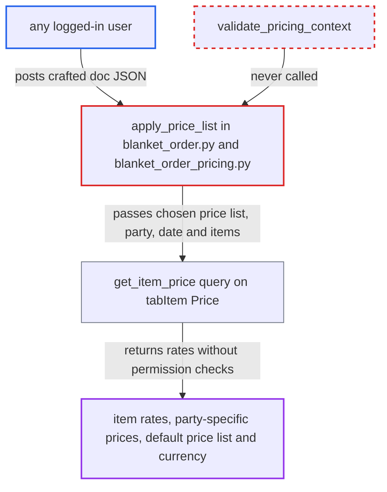

# Blanket Order apply_price_list returns Item Price rates without any permission check

| Field | Value |
|---|---|
| ID | `find_01FTbt9v1YgVAjgoYNxGwZ3g` |
| Severity | **Medium** |
| Status | open |
| CWE | CWE-862 — Missing Authorization |
| Created | 2026-10-27T21:15:28.751500Z |
| Claude Security | https://claude.ai/security/findings/find_01FTbt9v1YgVAjgoYNxGwZ3g |

## Description

Any logged-in user can read item prices they should not see, including customer-specific negotiated rates and supplier-specific buying costs. The only requirement is a valid login, with no special role. The whitelisted `apply_price_list` in `blanket_order.py` and `blanket_order_pricing.apply_price_list` build a document from the caller's JSON and return Item Price rates without any permission check.

1. **Authenticated user** posts a crafted `doc` JSON to the whitelisted `apply_price_list`. The JSON names a Blanket Order type, company, currency, customer or supplier, price list, `from_date` and `items` with `item_code` values. The method is reachable at `/api/method/erpnext.manufacturing.doctype.blanket_order.blanket_order.apply_price_list` and does no role check. ([`erpnext/manufacturing/doctype/blanket_order/blanket_order.py:332-346`](https://github.com/cx-benchmark/erpnext/blob/90e7aefca73da3c440d2e8da7472fcb67838e678/erpnext/manufacturing/doctype/blanket_order/blanket_order.py#L332-L346))
2. **`blanket_order_pricing.apply_price_list`** builds an unsaved Blanket Order from the caller's JSON. It uses `frappe.get_doc(frappe.parse_json(doc))`, so every field comes from the attacker, and then sets currency, conversion rate and price list. ([`erpnext/manufacturing/doctype/blanket_order/blanket_order_pricing.py:186-228`](https://github.com/cx-benchmark/erpnext/blob/90e7aefca73da3c440d2e8da7472fcb67838e678/erpnext/manufacturing/doctype/blanket_order/blanket_order_pricing.py#L186-L228))
3. **`set_price_list`** checks only the Price List itself. It confirms that the Price List exists, is enabled and is flagged for the order type. It does not check whether the caller may use it. With `reset_party_values=1`, it also returns the named party's default price list. ([`erpnext/manufacturing/doctype/blanket_order/blanket_order_pricing.py:51-111`](https://github.com/cx-benchmark/erpnext/blob/90e7aefca73da3c440d2e8da7472fcb67838e678/erpnext/manufacturing/doctype/blanket_order/blanket_order_pricing.py#L51-L111))
4. **`get_price_list_rates`** looks up a rate for each item with the attacker's price list, party and date. It passes these values to `get_price_list_rate_for` and reads Item stock UOMs with `frappe.get_all`, which applies no permission check. ([`erpnext/manufacturing/doctype/blanket_order/blanket_order_pricing.py:114-168`](https://github.com/cx-benchmark/erpnext/blob/90e7aefca73da3c440d2e8da7472fcb67838e678/erpnext/manufacturing/doctype/blanket_order/blanket_order_pricing.py#L114-L168))
5. **`get_item_price`** reads `tabItem Price` with a raw `frappe.qb` query. The query has no permission conditions. A named customer or supplier gets that party's specific rate ahead of the generic one. ([`erpnext/stock/get_item_details.py:1387-1441`](https://github.com/cx-benchmark/erpnext/blob/90e7aefca73da3c440d2e8da7472fcb67838e678/erpnext/stock/get_item_details.py#L1387-L1441))
6. **Endpoint** returns the rates, currency and conversion rates to the caller. The response includes `price_list_rate` and `rate` for each item. The caller only needs to be logged in, while Item Price is meant to be readable by `Sales Master Manager` and `Purchase Master Manager` only. ([`erpnext/stock/doctype/item_price/item_price.json:236-266`](https://github.com/cx-benchmark/erpnext/blob/90e7aefca73da3c440d2e8da7472fcb67838e678/erpnext/stock/doctype/item_price/item_price.json#L236-L266))

## Assessment

The attacker is any authenticated user, for example one with only the `Employee` role. No victim, no special configuration and no extra setting is needed. The attacker sends a `doc` JSON naming the Blanket Order type (`Selling` or `Purchasing`), company, currency, a customer or supplier, a price list, a date and the items to price. By default only `System Manager` can read or create a Blanket Order, and only `Sales Master Manager` or `Purchase Master Manager` can read `Item Price`, so this bypasses those restrictions. The other pricing entry points call `validate_pricing_context`. The report assumes Frappe `>=17.0.0-dev,<18`, where `@frappe.whitelist()` without `allow_guest` lets any authenticated session call the method and does no role check.

Impact: The attacker can read the effective rate of any item in any enabled selling or buying price list on a date they choose. This includes customer-specific negotiated prices and supplier-specific buying costs. The response also gives the named party's default price list and default currency. Access is read-only: nothing is written and availability is unaffected.

## Recommendation

`apply_price_list` in `blanket_order.py` and `blanket_order_pricing.apply_price_list` trust a caller-built document. They return Item Price rates without authorising the caller for Blanket Order, the named items, parties, price lists or company. The other pricing endpoints enforce this through `validate_pricing_context`.

Fix criteria: Before any rate is computed, the endpoint requires the caller's Blanket Order permission, on the named document where `doc.name` exists. It also applies guarantees equivalent to `validate_pricing_context`: company restrictions, `select` on the named Customer or Supplier, the price-list side, and Item permission for each priced item. Verify that a user with only the Employee role, or a Sales User restricted to another company, gets a PermissionError and no `price_list_rate` values.

## Evidence

**https://github.com/cx-benchmark/erpnext**

- [`erpnext/manufacturing/doctype/blanket_order/blanket_order.py:332-346`](https://github.com/cx-benchmark/erpnext/blob/90e7aefca73da3c440d2e8da7472fcb67838e678/erpnext/manufacturing/doctype/blanket_order/blanket_order.py#L332-L346)
- [`erpnext/manufacturing/doctype/blanket_order/blanket_order_pricing.py:186-228`](https://github.com/cx-benchmark/erpnext/blob/90e7aefca73da3c440d2e8da7472fcb67838e678/erpnext/manufacturing/doctype/blanket_order/blanket_order_pricing.py#L186-L228)
- [`erpnext/manufacturing/doctype/blanket_order/blanket_order_pricing.py:114-168`](https://github.com/cx-benchmark/erpnext/blob/90e7aefca73da3c440d2e8da7472fcb67838e678/erpnext/manufacturing/doctype/blanket_order/blanket_order_pricing.py#L114-L168)
- [`erpnext/stock/get_item_details.py:1387-1441`](https://github.com/cx-benchmark/erpnext/blob/90e7aefca73da3c440d2e8da7472fcb67838e678/erpnext/stock/get_item_details.py#L1387-L1441)
- [`erpnext/manufacturing/doctype/blanket_order/blanket_order_pricing.py:51-111`](https://github.com/cx-benchmark/erpnext/blob/90e7aefca73da3c440d2e8da7472fcb67838e678/erpnext/manufacturing/doctype/blanket_order/blanket_order_pricing.py#L51-L111)
- [`erpnext/manufacturing/doctype/blanket_order/blanket_order.json:239-276`](https://github.com/cx-benchmark/erpnext/blob/90e7aefca73da3c440d2e8da7472fcb67838e678/erpnext/manufacturing/doctype/blanket_order/blanket_order.json#L239-L276)
- [`erpnext/stock/doctype/item_price/item_price.json:236-266`](https://github.com/cx-benchmark/erpnext/blob/90e7aefca73da3c440d2e8da7472fcb67838e678/erpnext/stock/doctype/item_price/item_price.json#L236-L266)
- [`erpnext/accounts/doctype/pricing_rule/pricing_rule.py:766-794`](https://github.com/cx-benchmark/erpnext/blob/90e7aefca73da3c440d2e8da7472fcb67838e678/erpnext/accounts/doctype/pricing_rule/pricing_rule.py#L766-L794)

