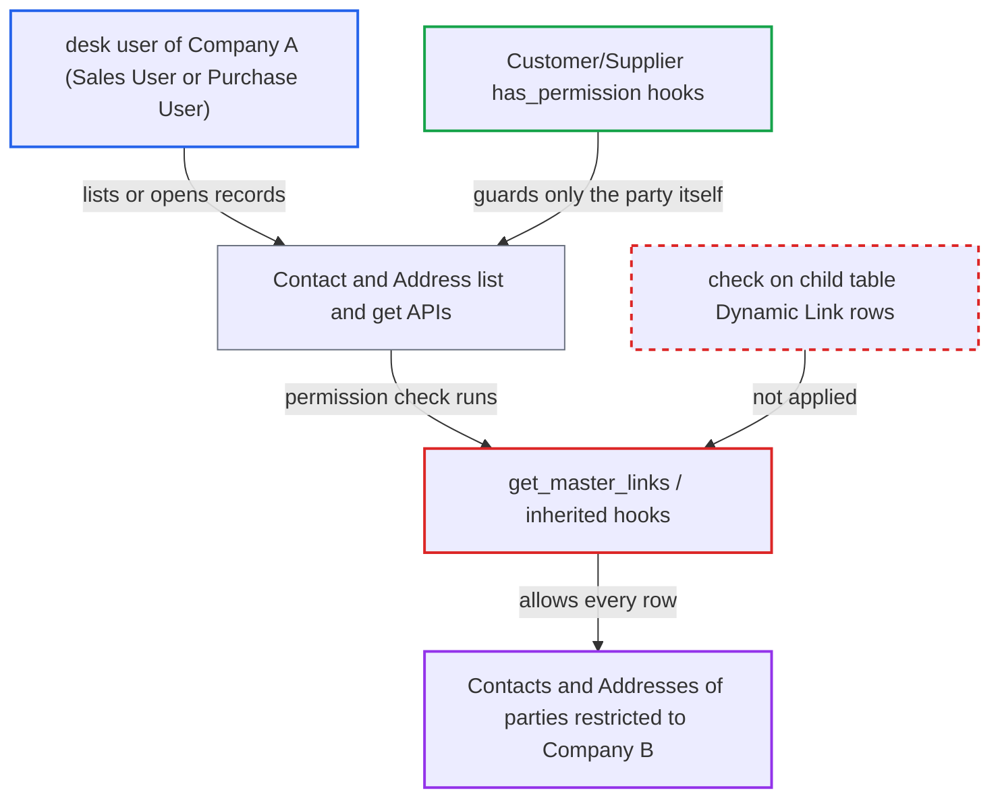

# Company Restriction skips child-table Dynamic Links, exposing restricted parties' Contacts and Addresses

| Field | Value |
|---|---|
| ID | `find_0134twDVuwgSJiZzKsxYfGxE` |
| Severity | **Medium** |
| Status | open |
| CWE | CWE-863 — Missing authorization |
| Created | 2026-10-27T21:49:18.795612Z |
| Claude Security | https://claude.ai/security/findings/find_0134twDVuwgSJiZzKsxYfGxE |

## Description

A desk user of one company can list and open Contacts and Addresses that belong to a Customer or Supplier restricted to another company. They see the party's name, the contact's name, designation, email and phone numbers, and the postal address. The user needs a role with read access on Contact or Address, such as Sales User or Purchase User. The cause is `get_master_links()`, which ignores the `links` child table that Contact and Address use to reference a party.

1. **master manager** sets `restrict_to_companies` on a Customer or Supplier. Users whose Company User Permission covers none of its `allowed_companies` are then denied the party itself. ([`erpnext/hooks.py:356-374`](https://github.com/cx-benchmark/erpnext/blob/90e7aefca73da3c440d2e8da7472fcb67838e678/erpnext/hooks.py#L356-L374))
2. **desk user of Company A** requests Contact or Address records through `frappe.client.get_list` or `/api/resource/Contact`, or opens one by name. The user has a role with read on Contact/Address and asks for fields such as `email_id`, `phone`, `mobile_no` and `tabDynamic Link`.link_name, filtered on `link_doctype = Customer`. ([`erpnext/selling/report/address_and_contacts/address_and_contacts.py:144-157`](https://github.com/cx-benchmark/erpnext/blob/90e7aefca73da3c440d2e8da7472fcb67838e678/erpnext/selling/report/address_and_contacts/address_and_contacts.py#L144-L157))
3. **the helper `get_master_links()`** returns no links for Contact and Address. It reads only the parent doctype's own `Link` and `Dynamic Link` fields, and Contact and Address have none, because they point to a party only through rows of the `links` child table. ([`erpnext/stock/doctype/company_restriction/company_restriction.py:205-224`](https://github.com/cx-benchmark/erpnext/blob/90e7aefca73da3c440d2e8da7472fcb67838e678/erpnext/stock/doctype/company_restriction/company_restriction.py#L205-L224))
4. **the hook `get_inherited_permission_query_conditions`** adds no condition to the list query and returns `None`. With no master links there is nothing to filter on, so no Contact or Address rows are removed. ([`erpnext/stock/doctype/company_restriction/company_restriction.py:149-164`](https://github.com/cx-benchmark/erpnext/blob/90e7aefca73da3c440d2e8da7472fcb67838e678/erpnext/stock/doctype/company_restriction/company_restriction.py#L149-L164))
5. **the hook `has_inherited_permission`** returns `True` when a single Contact or Address is opened. It returns `True` early for doctypes without master links, so opening a restricted party's record by name is allowed. ([`erpnext/stock/doctype/company_restriction/company_restriction.py:191-202`](https://github.com/cx-benchmark/erpnext/blob/90e7aefca73da3c440d2e8da7472fcb67838e678/erpnext/stock/doctype/company_restriction/company_restriction.py#L191-L202))
6. **desk user of Company A** reads the restricted party's contact and address data. Each record shows the party's name in `links.link_name` plus the contact or address details.

## Assessment

The attacker is a desk user whose Company User Permission is Company A. The user holds a role with read on Contact or Address, such as Sales User or Purchase User. The target is a Customer or Supplier restricted to Company B, which the user is already denied. The attacker calls `frappe.client.get_list` or `/api/resource/Contact` (or Address) with filters on `Dynamic Link`, or opens a Contact or Address by name. No user interaction is needed. The report assumes Frappe `>=17.0.0-dev,<18`, which is not in the checkout, calls the `*` hooks for every doctype. It also assumes Frappe's own Contact/Address `has_permission` hook adds nothing, and that User Permissions do not apply through Dynamic Link fields. Other child-table Dynamic Links to parties may have the same gap, but the report did not trace them.

Impact: The user learns which Customers and Suppliers are hidden from them. The user also reads those parties' contact names, designations, emails, phone numbers and postal addresses. The exposure is limited to Contact and Address records, with no transactions or financial figures. The report rates the issue as read-only, though a user with write permission could also edit those records.

## Recommendation

`get_master_links()` and `has_inherited_permission` look only at the parent doctype's Link and Dynamic Link fields. Contact and Address reference a restrictable party only through the `links` child table, so they inherit no restriction.

Fix criteria: A user whose Company User Permission excludes every allowed company of a restricted Customer or Supplier cannot list or open a Contact or Address whose `links` rows reference that party. Both the list condition and the doc-level check must evaluate child-table references, for example an EXISTS over `Dynamic Link`. As a Company-A Sales User with a Customer restricted to Company B, `get_list` on Contact and Address with `Dynamic Link` fields returns no row for that Customer. `frappe.get_doc` on its Contact or Address raises a PermissionError. Contacts of permitted or unrestricted parties stay visible.

## Evidence

**https://github.com/cx-benchmark/erpnext**

- [`erpnext/stock/doctype/company_restriction/company_restriction.py:205-224`](https://github.com/cx-benchmark/erpnext/blob/90e7aefca73da3c440d2e8da7472fcb67838e678/erpnext/stock/doctype/company_restriction/company_restriction.py#L205-L224)
- [`erpnext/stock/doctype/company_restriction/company_restriction.py:149-164`](https://github.com/cx-benchmark/erpnext/blob/90e7aefca73da3c440d2e8da7472fcb67838e678/erpnext/stock/doctype/company_restriction/company_restriction.py#L149-L164)
- [`erpnext/stock/doctype/company_restriction/company_restriction.py:191-202`](https://github.com/cx-benchmark/erpnext/blob/90e7aefca73da3c440d2e8da7472fcb67838e678/erpnext/stock/doctype/company_restriction/company_restriction.py#L191-L202)
- [`erpnext/hooks.py:356-374`](https://github.com/cx-benchmark/erpnext/blob/90e7aefca73da3c440d2e8da7472fcb67838e678/erpnext/hooks.py#L356-L374)
- [`erpnext/selling/doctype/customer/customer.py:942-955`](https://github.com/cx-benchmark/erpnext/blob/90e7aefca73da3c440d2e8da7472fcb67838e678/erpnext/selling/doctype/customer/customer.py#L942-L955)
- [`erpnext/stock/doctype/company_restriction/test_company_restriction.py:216-237`](https://github.com/cx-benchmark/erpnext/blob/90e7aefca73da3c440d2e8da7472fcb67838e678/erpnext/stock/doctype/company_restriction/test_company_restriction.py#L216-L237)
- [`erpnext/selling/report/address_and_contacts/address_and_contacts.py:144-157`](https://github.com/cx-benchmark/erpnext/blob/90e7aefca73da3c440d2e8da7472fcb67838e678/erpnext/selling/report/address_and_contacts/address_and_contacts.py#L144-L157)
- [`erpnext/setup/install.py:223-251`](https://github.com/cx-benchmark/erpnext/blob/90e7aefca73da3c440d2e8da7472fcb67838e678/erpnext/setup/install.py#L223-L251)

