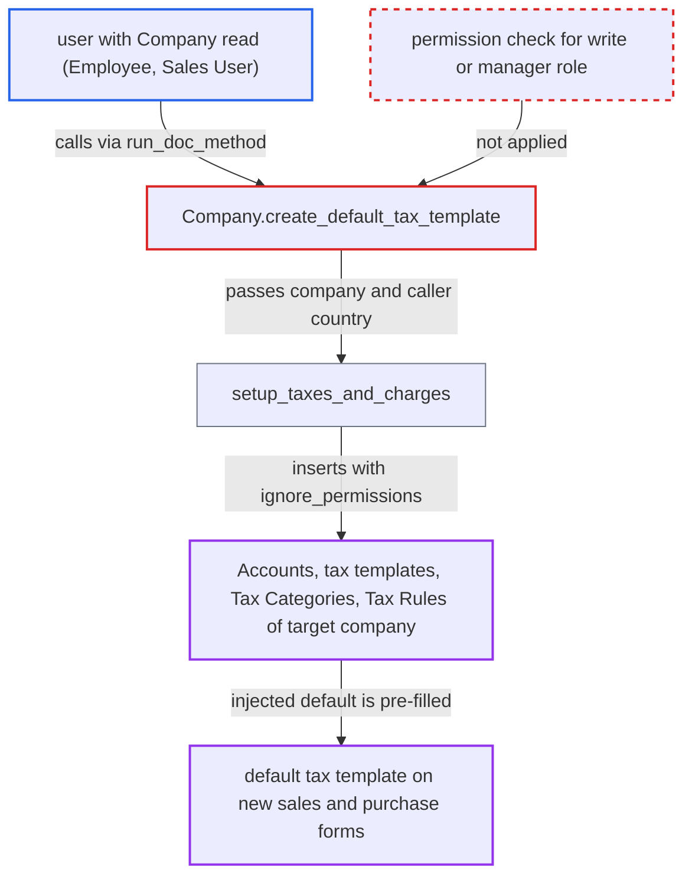

# Company.create_default_tax_template lets any Company reader create Accounts and default tax templates

| Field | Value |
|---|---|
| ID | `find_01LN5uGNet5PAxyntQtSieTL` |
| Severity | **Medium** |
| Status | open |
| CWE | CWE-862 — Missing Authorization |
| Created | 2026-10-27T21:07:44.796579Z |
| Claude Security | https://claude.ai/security/findings/find_01LN5uGNet5PAxyntQtSieTL |

## Description

Any logged-in user who can read a Company, such as an `Employee` or `Sales User`, can create Accounts and tax templates in that company without having create rights. They can also install a default tax template that new sales and purchase forms pre-fill. The whitelisted method `Company.create_default_tax_template` does no permission check of its own. It inserts everything with `ignore_permissions=True`.

1. **Attacker with Company `read`** posts to `/api/method/run_doc_method` with `method=create_default_tax_template`. The request names the target company with `dt=Company&dn=<target>`, or sends a `docs` JSON of that Company with a `country` the attacker picks. ([`erpnext/setup/doctype/company/company.json`](https://github.com/cx-benchmark/erpnext/blob/90e7aefca73da3c440d2e8da7472fcb67838e678/erpnext/setup/doctype/company/company.json))
2. **Frappe `run_doc_method`** accepts the call after checking only `read` on the Company. Several roles hold that `read`, including `Employee`, `Sales User`, `Purchase User` and `Accounts User`, so the check passes. ([`erpnext/setup/doctype/company/company.json`](https://github.com/cx-benchmark/erpnext/blob/90e7aefca73da3c440d2e8da7472fcb67838e678/erpnext/setup/doctype/company/company.json))
3. **the method `create_default_tax_template`** passes `self.country` to `setup_taxes_and_charges`. The method has no `check_permission` or `only_for`, and `self.country` can come from the posted JSON. ([`erpnext/setup/doctype/company/company.py:356-358`](https://github.com/cx-benchmark/erpnext/blob/90e7aefca73da3c440d2e8da7472fcb67838e678/erpnext/setup/doctype/company/company.py#L356-L358))
4. **the function `setup_taxes_and_charges`** builds templates for the given country in the named company. It only checks that the company exists, then runs the regional update that adds Tax Rules for Australia. ([`erpnext/setup/setup_wizard/operations/taxes_setup.py:12-30`](https://github.com/cx-benchmark/erpnext/blob/90e7aefca73da3c440d2e8da7472fcb67838e678/erpnext/setup/setup_wizard/operations/taxes_setup.py#L12-L30))
5. **the tax setup code** inserts Account rows and tax templates with `ignore_permissions=True`. This covers a tax group under the root account, one tax account per rate, and the Sales and Purchase templates, which also use `ignore_validate`. The caller's missing `create` rights are bypassed. ([`erpnext/setup/setup_wizard/operations/taxes_setup.py:211-299`](https://github.com/cx-benchmark/erpnext/blob/90e7aefca73da3c440d2e8da7472fcb67838e678/erpnext/setup/setup_wizard/operations/taxes_setup.py#L211-L299))
6. **the Sales Taxes and Charges Template `validate`** is skipped, so an injected `is_default` template is not reconciled with the existing defaults. The injected template then sits next to the company default or becomes it when none existed. ([`erpnext/accounts/doctype/sales_taxes_and_charges_template/sales_taxes_and_charges_template.py:39-66`](https://github.com/cx-benchmark/erpnext/blob/90e7aefca73da3c440d2e8da7472fcb67838e678/erpnext/accounts/doctype/sales_taxes_and_charges_template/sales_taxes_and_charges_template.py#L39-L66))
7. **the function `apply_default_taxes`** fills the injected default template into new sales and purchase documents. `_get_default_taxes_and_charges` returns the company's `is_default: 1` template, and the form code applies it. ([`erpnext/public/js/controllers/transaction.js:708-748`](https://github.com/cx-benchmark/erpnext/blob/90e7aefca73da3c440d2e8da7472fcb67838e678/erpnext/public/js/controllers/transaction.js#L708-L748))

## Assessment

The attacker is an authenticated desk user with `read` on a Company. Roles that have it include `Employee`, `Sales User`, `Sales Manager`, `Purchase User`, `Stock User`, `Projects User` and `Accounts User`. No victim action is needed for the writes. The attacker can name the target company with `dt` and `dn`, or post a `docs` JSON of the Company with the current `modified` value and a chosen `country`. The country must be one in `country_wise_tax.json`. 31 of its 170 countries carry a default template.

Impact: The attacker creates Account, tax template, Tax Category and Tax Rule master data in any company they can read, without `create` rights. They can also make a default tax template pre-fill on new sales and purchase documents. The content comes only from the shipped `country_wise_tax.json`. The rows stay until an Accounts Manager removes them. The report notes no disclosure and no availability effect beyond clutter.

## Recommendation

`Company.create_default_tax_template` is a whitelisted doc method that relies on the framework's implicit `read` check. It creates Accounts, tax templates, Tax Categories and Tax Rules with `ignore_permissions=True`, and it takes `country` from caller-supplied document JSON.

Fix criteria: The method refuses callers who lack `write` on that Company, or an Accounts Manager or System Manager equivalent. It uses the stored company's country, not posted JSON. To verify, an `Employee` or `Sales User` calls `run_doc_method` with `method=create_default_tax_template`, by `dt/dn` or by `docs` with another `country`. The call gets a PermissionError and no Account or template rows are created.

## Evidence

**https://github.com/cx-benchmark/erpnext**

- [`erpnext/setup/doctype/company/company.py:356-358`](https://github.com/cx-benchmark/erpnext/blob/90e7aefca73da3c440d2e8da7472fcb67838e678/erpnext/setup/doctype/company/company.py#L356-L358)
- [`erpnext/setup/doctype/company/company.json`](https://github.com/cx-benchmark/erpnext/blob/90e7aefca73da3c440d2e8da7472fcb67838e678/erpnext/setup/doctype/company/company.json)
- [`erpnext/setup/setup_wizard/operations/taxes_setup.py:12-30`](https://github.com/cx-benchmark/erpnext/blob/90e7aefca73da3c440d2e8da7472fcb67838e678/erpnext/setup/setup_wizard/operations/taxes_setup.py#L12-L30)
- [`erpnext/setup/setup_wizard/operations/taxes_setup.py:135-174`](https://github.com/cx-benchmark/erpnext/blob/90e7aefca73da3c440d2e8da7472fcb67838e678/erpnext/setup/setup_wizard/operations/taxes_setup.py#L135-L174)
- [`erpnext/setup/setup_wizard/operations/taxes_setup.py:211-299`](https://github.com/cx-benchmark/erpnext/blob/90e7aefca73da3c440d2e8da7472fcb67838e678/erpnext/setup/setup_wizard/operations/taxes_setup.py#L211-L299)
- [`erpnext/accounts/doctype/sales_taxes_and_charges_template/sales_taxes_and_charges_template.py:39-66`](https://github.com/cx-benchmark/erpnext/blob/90e7aefca73da3c440d2e8da7472fcb67838e678/erpnext/accounts/doctype/sales_taxes_and_charges_template/sales_taxes_and_charges_template.py#L39-L66)
- [`erpnext/accounts/services/taxes.py:221-239`](https://github.com/cx-benchmark/erpnext/blob/90e7aefca73da3c440d2e8da7472fcb67838e678/erpnext/accounts/services/taxes.py#L221-L239)
- [`erpnext/public/js/controllers/transaction.js:708-748`](https://github.com/cx-benchmark/erpnext/blob/90e7aefca73da3c440d2e8da7472fcb67838e678/erpnext/public/js/controllers/transaction.js#L708-L748)

