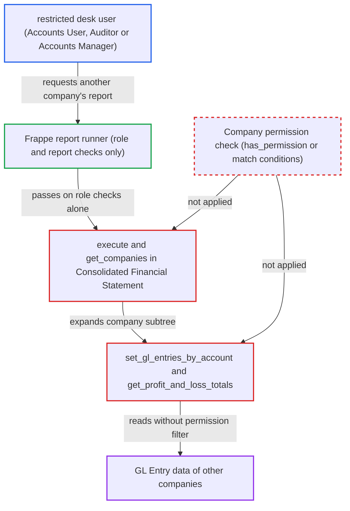

# Consolidated Financial Statement skips Company permission checks, exposing other companies' financials

| Field | Value |
|---|---|
| ID | `find_013btds3MzMjUSqhnyVuEv66` |
| Severity | **Medium** |
| Status | open |
| CWE | CWE-862 — Missing Authorization |
| Created | 2026-10-27T21:11:31.851798Z |
| Claude Security | https://claude.ai/security/findings/find_013btds3MzMjUSqhnyVuEv66 |

## Description

A desk user restricted by User Permissions to one company can read the per-account Balance Sheet, Profit and Loss and opening balances of any other company, or of a whole company group. The user needs the `Accounts User`, `Auditor` or `Accounts Manager` role. The Consolidated Financial Statement report's `execute()` trusts `filters.company`, and its GL queries add no company permission filter. The access is read-only.

1. **restricted user** calls the report runner with another company. The user calls `/api/method/frappe.desk.query_report.run` with `report_name=Consolidated Financial Statement` and `filters.company` set to a parent company or to Company B, which User Permissions bar for them. ([`erpnext/accounts/report/consolidated_financial_statement/consolidated_financial_statement.json`](https://github.com/cx-benchmark/erpnext/blob/90e7aefca73da3c440d2e8da7472fcb67838e678/erpnext/accounts/report/consolidated_financial_statement/consolidated_financial_statement.json))
2. **report runner** lets the request through on role checks alone. It checks only the report's roles and the `report` permission on `Account`, and the report has no `filters` table to validate the company value. ([`erpnext/accounts/report/consolidated_financial_statement/consolidated_financial_statement.json`](https://github.com/cx-benchmark/erpnext/blob/90e7aefca73da3c440d2e8da7472fcb67838e678/erpnext/accounts/report/consolidated_financial_statement/consolidated_financial_statement.json))
3. **`execute()`** takes `filters.company` from the request and goes on to collect data. It never checks that the session user may read the chosen company or the companies under it. ([`erpnext/accounts/report/consolidated_financial_statement/consolidated_financial_statement.py:45-67`](https://github.com/cx-benchmark/erpnext/blob/90e7aefca73da3c440d2e8da7472fcb67838e678/erpnext/accounts/report/consolidated_financial_statement/consolidated_financial_statement.py#L45-L67))
4. **`get_companies()`** expands the chosen company into its whole subtree. `get_subsidiary_companies()` returns every company in the `lft`/`rgt` range, including the company itself, using `frappe.get_all`, which ignores permissions, so any company or a whole group can be chosen. ([`erpnext/accounts/report/consolidated_financial_statement/consolidated_financial_statement.py:741-762`](https://github.com/cx-benchmark/erpnext/blob/90e7aefca73da3c440d2e8da7472fcb67838e678/erpnext/accounts/report/consolidated_financial_statement/consolidated_financial_statement.py#L741-L762))
5. **`set_gl_entries_by_account()`** reads `GL Entry` rows for every expanded company. The `frappe.qb` query is filtered by company, date, account range, root type and finance book, but not by the user's permissions. ([`erpnext/accounts/report/consolidated_financial_statement/consolidated_financial_statement.py:842-931`](https://github.com/cx-benchmark/erpnext/blob/90e7aefca73da3c440d2e8da7472fcb67838e678/erpnext/accounts/report/consolidated_financial_statement/consolidated_financial_statement.py#L842-L931))
6. **`get_profit_and_loss_totals()`** sums income and expense `GL Entry` rows for the currency-translation reserve. It also runs without a permission filter. ([`erpnext/accounts/report/consolidated_financial_statement/consolidated_financial_statement.py:619-657`](https://github.com/cx-benchmark/erpnext/blob/90e7aefca73da3c440d2e8da7472fcb67838e678/erpnext/accounts/report/consolidated_financial_statement/consolidated_financial_statement.py#L619-L657))
7. **report** returns the unfiltered per-account figures to the restricted user. The user can pick any date range, so they also see per-account movements for arbitrary periods.

## Assessment

The attacker is an authenticated desk user with the `Accounts User`, `Auditor` or `Accounts Manager` role. A Company User Permission limits that user to Company A on a multi-company site. The user sends the report request with `filters.company` set to a parent company or to Company B, and with `report` set to Balance Sheet or Profit and Loss Statement. The Cash Flow variant is also affected: only its working-capital rows go through `cash_flow.apply_gl_filters()`, which applies match conditions, while the net profit row still comes from the unfiltered path. A restricted user can learn the parent company's name because `parent_company` has `ignore_user_permissions: 1`. No victim takes part. The report assumes Frappe >=17.0.0-dev behaves as described, because Frappe is not in the checkout.

Impact: The attacker reads the per-account Balance Sheet, Profit and Loss, opening balances and cash flow totals of any company, or of every company in a group, that User Permissions bar them from. This is a serious loss of confidential financial data. Nothing is modified and availability is not affected.

## Recommendation

`execute()` trusts `filters.company` and expands it to the whole company subtree. The GL helpers `set_gl_entries_by_account()` and `get_profit_and_loss_totals()` then query `GL Entry` without the session user's Company User Permissions, which breaks the per-company isolation the other financial reports enforce.

Fix criteria: Every company the report includes, the chosen one and each expanded subsidiary, is one the session user may read; otherwise the report refuses or leaves it out. GL queries do not return entries of companies the user is barred from. To verify, a user restricted to a subsidiary runs the report for the parent and for a sibling company. They must get a PermissionError or no figures for companies outside their permission, in all three report variants.

## Evidence

**https://github.com/cx-benchmark/erpnext**

- [`erpnext/accounts/report/consolidated_financial_statement/consolidated_financial_statement.py:45-67`](https://github.com/cx-benchmark/erpnext/blob/90e7aefca73da3c440d2e8da7472fcb67838e678/erpnext/accounts/report/consolidated_financial_statement/consolidated_financial_statement.py#L45-L67)
- [`erpnext/accounts/report/consolidated_financial_statement/consolidated_financial_statement.py:842-931`](https://github.com/cx-benchmark/erpnext/blob/90e7aefca73da3c440d2e8da7472fcb67838e678/erpnext/accounts/report/consolidated_financial_statement/consolidated_financial_statement.py#L842-L931)
- [`erpnext/accounts/report/consolidated_financial_statement/consolidated_financial_statement.py:741-762`](https://github.com/cx-benchmark/erpnext/blob/90e7aefca73da3c440d2e8da7472fcb67838e678/erpnext/accounts/report/consolidated_financial_statement/consolidated_financial_statement.py#L741-L762)
- [`erpnext/accounts/report/consolidated_financial_statement/consolidated_financial_statement.py:619-657`](https://github.com/cx-benchmark/erpnext/blob/90e7aefca73da3c440d2e8da7472fcb67838e678/erpnext/accounts/report/consolidated_financial_statement/consolidated_financial_statement.py#L619-L657)
- [`erpnext/accounts/report/consolidated_financial_statement/consolidated_financial_statement.json`](https://github.com/cx-benchmark/erpnext/blob/90e7aefca73da3c440d2e8da7472fcb67838e678/erpnext/accounts/report/consolidated_financial_statement/consolidated_financial_statement.json)
- [`erpnext/accounts/report/consolidated_trial_balance/consolidated_trial_balance.py:54-79`](https://github.com/cx-benchmark/erpnext/blob/90e7aefca73da3c440d2e8da7472fcb67838e678/erpnext/accounts/report/consolidated_trial_balance/consolidated_trial_balance.py#L54-L79)
- [`erpnext/accounts/report/financial_statements.py:780-783`](https://github.com/cx-benchmark/erpnext/blob/90e7aefca73da3c440d2e8da7472fcb67838e678/erpnext/accounts/report/financial_statements.py#L780-L783)
- [`erpnext/accounts/report/cash_flow/cash_flow.py:358-362`](https://github.com/cx-benchmark/erpnext/blob/90e7aefca73da3c440d2e8da7472fcb67838e678/erpnext/accounts/report/cash_flow/cash_flow.py#L358-L362)
- [`erpnext/setup/doctype/company/company.json:206-212`](https://github.com/cx-benchmark/erpnext/blob/90e7aefca73da3c440d2e8da7472fcb67838e678/erpnext/setup/doctype/company/company.json#L206-L212)
- [`erpnext/selling/report/sales_partner_commission_summary/test_sales_partner_commission_summary.py:265-300`](https://github.com/cx-benchmark/erpnext/blob/90e7aefca73da3c440d2e8da7472fcb67838e678/erpnext/selling/report/sales_partner_commission_summary/test_sales_partner_commission_summary.py#L265-L300)

