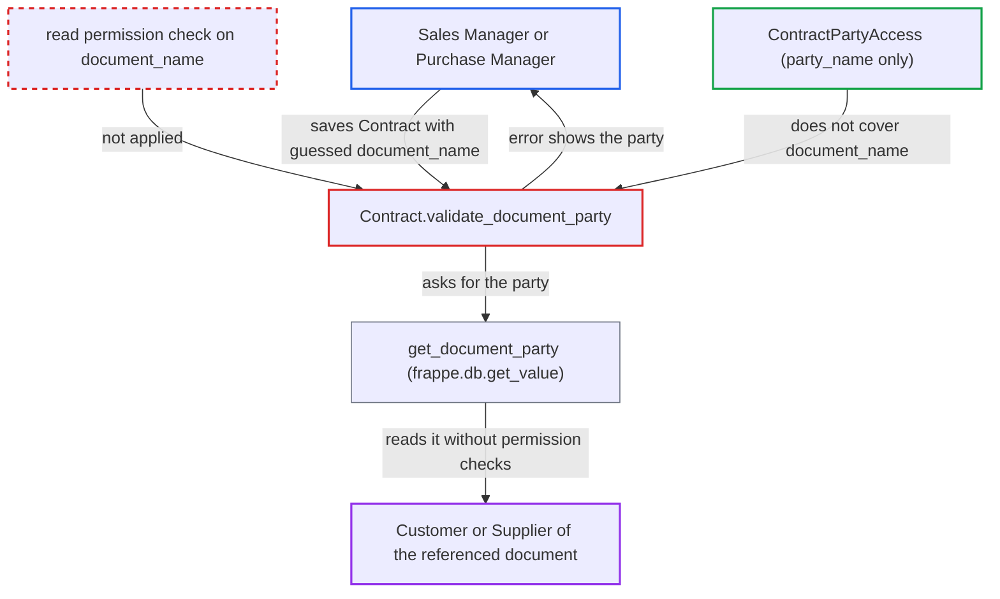

# Contract validation error discloses the party of any referenced document

| Field | Value |
|---|---|
| ID | `find_01M53yGevLZasvSQ6y8ckZbJ` |
| Severity | **Medium** |
| Status | open |
| CWE | CWE-209 — Information exposure |
| Created | 2026-10-27T21:21:25.856769Z |
| Claude Security | https://claude.ai/security/findings/find_01M53yGevLZasvSQ6y8ckZbJ |

## Description

A Sales Manager or Purchase Manager can learn which Customer or Supplier any Sales Invoice, Sales Order, Quotation, Project, Purchase Order or Purchase Invoice belongs to. This works even for other companies' documents or doctypes the role cannot read. It needs only the right to create a Contract. `validate_document_party` looks the party up with `frappe.db.get_value`, which skips permissions, and then puts the party in the error message.

1. **Attacker (Sales Manager or Purchase Manager)** saves a Contract naming a document they cannot read. They use a `party_name` they are allowed to use, a `document_type` such as Sales Invoice, and a guessed `document_name`, which is easy because names follow predictable naming series. ([`erpnext/crm/doctype/contract/contract.json:269-330`](https://github.com/cx-benchmark/erpnext/blob/90e7aefca73da3c440d2e8da7472fcb67838e678/erpnext/crm/doctype/contract/contract.json#L269-L330))
2. **Contract `validate`** calls `validate_document_party` on every insert and save. The ordinary insert/save API therefore reaches the lookup. ([`erpnext/crm/doctype/contract/contract.py:53-59`](https://github.com/cx-benchmark/erpnext/blob/90e7aefca73da3c440d2e8da7472fcb67838e678/erpnext/crm/doctype/contract/contract.py#L53-L59))
3. **`get_document_party`** reads the party of the referenced document with `frappe.db.get_value`. That call applies no role permission, User Permission or Company Restriction, and it uses `self.document_type` directly as the doctype name. ([`erpnext/crm/doctype/contract/contract.py:103-112`](https://github.com/cx-benchmark/erpnext/blob/90e7aefca73da3c440d2e8da7472fcb67838e678/erpnext/crm/doctype/contract/contract.py#L103-L112))
4. **`validate_document_party`** compares the fetched party with `party_name` and throws an error that contains the party. The message reads "{Document Type} {document_name} is for Customer {party}, not {party_name}". No read permission on the referenced document is checked first. If the party matches, no error is raised, so a correct guess is confirmed too. ([`erpnext/crm/doctype/contract/contract.py:87-101`](https://github.com/cx-benchmark/erpnext/blob/90e7aefca73da3c440d2e8da7472fcb67838e678/erpnext/crm/doctype/contract/contract.py#L87-L101))
5. **`ContractPartyAccess`** does not stop the request. It checks only `party_type` and `party_name`, so nothing authorizes `document_name`. ([`erpnext/crm/doctype/contract/contract.py:182-234`](https://github.com/cx-benchmark/erpnext/blob/90e7aefca73da3c440d2e8da7472fcb67838e678/erpnext/crm/doctype/contract/contract.py#L182-L234))

## Assessment

The attacker is a logged-in desk user with Sales Manager (for Customers) or Purchase Manager (for Suppliers), and therefore with Contract `create`. HR Manager and System Manager can also create Contracts. The attacker lacks read access to the target document, either through their roles or through User Permissions or Company Restrictions. They send a Contract with a `party_name` they may use, and no victim action is needed. Frappe does not apply User Permissions to Dynamic Links, so `document_name` is never checked. The fork's Company Restriction check handles a Dynamic Link only for Item, Customer or Supplier, and Contract has no `company` field. The report also assumes (Frappe source is not in the checkout) that Frappe checks links before `validate()` and Select options only after it. If so, `document_type` is not yet limited to the six options when `get_document_party` runs. Then any existing doctype with a `customer` or `supplier` column, such as Delivery Note, Issue, Pricing Rule or Timesheet, can be queried. The leak on the six listed doctypes does not depend on this assumption.

Impact: The attacker learns the Customer or Supplier of any referenced document, and whether a document exists. Enumerating the naming series can map another company's customer and supplier relationships. Only one field leaks per request. Nothing is written, because the error rolls back the insert, and availability is not affected.

## Recommendation

`validate_document_party` reveals data read without authorization from the document named by the caller-controlled Dynamic Link. It also uses `document_type` as a doctype name before Frappe has limited it to the Select options.

Fix criteria: A Contract save verifies that the current user has read permission on `document_name` before any lookup, for example with `frappe.has_permission(document_type, "read", document_name, throw=True)`. `document_type` is limited to the allowed options before it is used as a doctype name. The mismatch error no longer includes the referenced document's party. Test: save a Contract that names a Sales Invoice of a company the user cannot read. The response must be a permission error that does not reveal the invoice's customer.

## Evidence

**https://github.com/cx-benchmark/erpnext**

- [`erpnext/crm/doctype/contract/contract.py:87-101`](https://github.com/cx-benchmark/erpnext/blob/90e7aefca73da3c440d2e8da7472fcb67838e678/erpnext/crm/doctype/contract/contract.py#L87-L101)
- [`erpnext/crm/doctype/contract/contract.py:103-112`](https://github.com/cx-benchmark/erpnext/blob/90e7aefca73da3c440d2e8da7472fcb67838e678/erpnext/crm/doctype/contract/contract.py#L103-L112)
- [`erpnext/crm/doctype/contract/contract.py:53-59`](https://github.com/cx-benchmark/erpnext/blob/90e7aefca73da3c440d2e8da7472fcb67838e678/erpnext/crm/doctype/contract/contract.py#L53-L59)
- [`erpnext/crm/doctype/contract/contract.py:182-234`](https://github.com/cx-benchmark/erpnext/blob/90e7aefca73da3c440d2e8da7472fcb67838e678/erpnext/crm/doctype/contract/contract.py#L182-L234)
- [`erpnext/crm/doctype/contract/contract.json:207-225`](https://github.com/cx-benchmark/erpnext/blob/90e7aefca73da3c440d2e8da7472fcb67838e678/erpnext/crm/doctype/contract/contract.json#L207-L225)
- [`erpnext/crm/doctype/contract/contract.json:269-330`](https://github.com/cx-benchmark/erpnext/blob/90e7aefca73da3c440d2e8da7472fcb67838e678/erpnext/crm/doctype/contract/contract.json#L269-L330)
- [`erpnext/accounts/doctype/sales_invoice/sales_invoice.json:2418-2456`](https://github.com/cx-benchmark/erpnext/blob/90e7aefca73da3c440d2e8da7472fcb67838e678/erpnext/accounts/doctype/sales_invoice/sales_invoice.json#L2418-L2456)
- [`erpnext/stock/doctype/company_restriction/company_restriction.py:213-224`](https://github.com/cx-benchmark/erpnext/blob/90e7aefca73da3c440d2e8da7472fcb67838e678/erpnext/stock/doctype/company_restriction/company_restriction.py#L213-L224)

