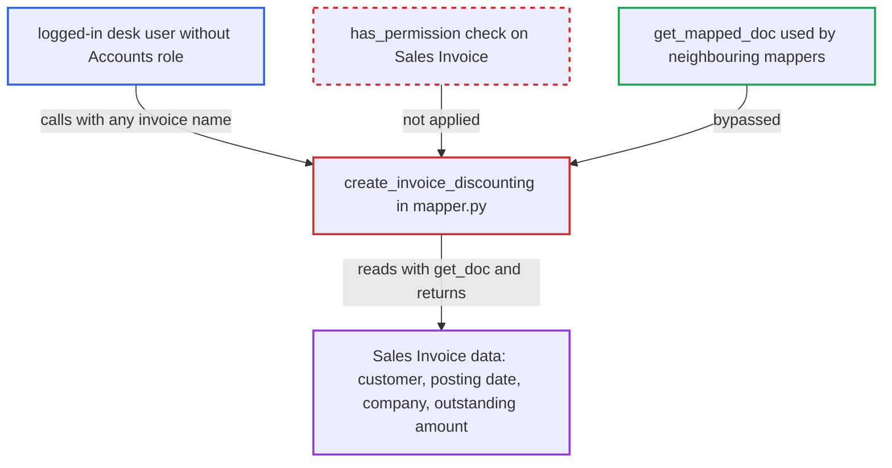

# create_invoice_discounting returns Sales Invoice data without a permission check

| Field | Value |
|---|---|
| ID | `find_01AvftRosTNiRA2NixbHBNrL` |
| Severity | **Medium** |
| Status | open |
| CWE | CWE-862 — Missing Authorization |
| Created | 2026-10-27T21:17:34.858514Z |
| Claude Security | https://claude.ai/security/findings/find_01AvftRosTNiRA2NixbHBNrL |

## Description

Any logged-in desk user can read the customer, posting date, company and outstanding amount of any Sales Invoice in any company, even without an Accounts role or with a company restriction. The call also shows which invoice names exist. The whitelisted function `create_invoice_discounting` loads the invoice with `frappe.get_doc` and never checks permission.

1. **Attacker (any logged-in desk user)** sends a request to the `create_invoice_discounting` endpoint with a guessed invoice name. The request goes to `/api/method/erpnext.accounts.doctype.sales_invoice.mapper.create_invoice_discounting` with `source_name` set to a name from the predictable series `ACC-SINV-.YYYY.-#####`. ([`erpnext/accounts/doctype/sales_invoice/mapper.py:573-588`](https://github.com/cx-benchmark/erpnext/blob/90e7aefca73da3c440d2e8da7472fcb67838e678/erpnext/accounts/doctype/sales_invoice/mapper.py#L573-L588))
2. **the function `create_invoice_discounting`** loads the named Sales Invoice with `frappe.get_doc`. `frappe.get_doc` ignores role and user permissions, and the function has no `frappe.has_permission` call of its own. ([`erpnext/accounts/doctype/sales_invoice/mapper.py:573-588`](https://github.com/cx-benchmark/erpnext/blob/90e7aefca73da3c440d2e8da7472fcb67838e678/erpnext/accounts/doctype/sales_invoice/mapper.py#L573-L588))
3. **the function `create_invoice_discounting`** copies invoice fields into a new in-memory `Invoice Discounting` document. It copies `company` and, into the `invoices` child row, `sales_invoice`, `customer`, `posting_date` and `outstanding_amount`. ([`erpnext/accounts/doctype/sales_invoice/mapper.py:573-588`](https://github.com/cx-benchmark/erpnext/blob/90e7aefca73da3c440d2e8da7472fcb67838e678/erpnext/accounts/doctype/sales_invoice/mapper.py#L573-L588))
4. **Frappe** serializes the returned document into the JSON response. The caller receives the copied values, even though only Accounts roles may read Sales Invoice. ([`erpnext/accounts/doctype/sales_invoice/sales_invoice.json:2418-2460`](https://github.com/cx-benchmark/erpnext/blob/90e7aefca73da3c440d2e8da7472fcb67838e678/erpnext/accounts/doctype/sales_invoice/sales_invoice.json#L2418-L2460))
5. **Attacker** repeats the call for sequential names. Unknown names make `frappe.get_doc` raise `DoesNotExistError`, so the attacker can tell which names exist and list the whole invoice register.

## Assessment

The attacker is any authenticated desk user, for example one with only the `Employee` role, or an Accounts user restricted to one company by User Permission. No victim action is needed. The attacker posts `source_name` values for guessed or sequential invoice names to the whitelisted endpoint. The error for unknown names also works as a way to check whether a name exists.

Impact: The attacker reads the customer, posting date, company and outstanding amount of any Sales Invoice across company and user-permission boundaries. Only these fields are exposed. Items, prices and addresses are not copied, and nothing is written.

## Recommendation

`create_invoice_discounting` reads the source Sales Invoice with `frappe.get_doc` and returns data from it without checking that the caller may read that invoice. This bypasses the Sales Invoice permission model.

Fix criteria: Before any invoice data goes into the response, the call fails with `frappe.PermissionError` unless the session user has read permission on that specific Sales Invoice, including role and user permissions. For example, use `frappe.has_permission("Sales Invoice", doc=source_name, throw=True)` or build the target through `get_mapped_doc`. The call should also require create permission on Invoice Discounting. To verify, call the endpoint as a user without Sales Invoice read, or restricted to another company. Confirm that no customer or outstanding data and no existence oracle is returned.

## Evidence

**https://github.com/cx-benchmark/erpnext**

- [`erpnext/accounts/doctype/sales_invoice/mapper.py:573-588`](https://github.com/cx-benchmark/erpnext/blob/90e7aefca73da3c440d2e8da7472fcb67838e678/erpnext/accounts/doctype/sales_invoice/mapper.py#L573-L588)
- [`erpnext/accounts/doctype/sales_invoice/mapper.py:16-31`](https://github.com/cx-benchmark/erpnext/blob/90e7aefca73da3c440d2e8da7472fcb67838e678/erpnext/accounts/doctype/sales_invoice/mapper.py#L16-L31)
- [`erpnext/accounts/doctype/sales_invoice/sales_invoice.json:2418-2460`](https://github.com/cx-benchmark/erpnext/blob/90e7aefca73da3c440d2e8da7472fcb67838e678/erpnext/accounts/doctype/sales_invoice/sales_invoice.json#L2418-L2460)
- [`erpnext/accounts/doctype/invoice_discounting/invoice_discounting.json:182-205`](https://github.com/cx-benchmark/erpnext/blob/90e7aefca73da3c440d2e8da7472fcb67838e678/erpnext/accounts/doctype/invoice_discounting/invoice_discounting.json#L182-L205)

