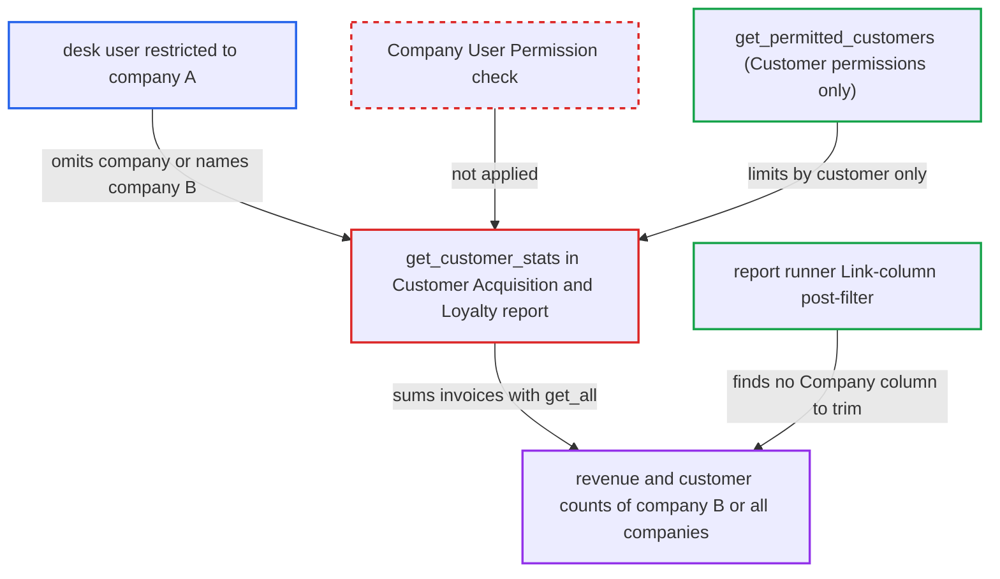

# Customer Acquisition and Loyalty report discloses other companies' revenue, ignoring Company user permissions

| Field | Value |
|---|---|
| ID | `find_01KkonLXwZPDWTZf15HxC7u9` |
| Severity | **Medium** |
| Status | open |
| CWE | CWE-862 — Missing authorization |
| Created | 2026-10-27T21:25:20.860492Z |
| Claude Security | https://claude.ai/security/findings/find_01KkonLXwZPDWTZf15HxC7u9 |

## Description

A desk user restricted to one company can read other companies' sales revenue, and the combined revenue of all companies. This covers new and repeat customer counts and revenue, by month or by territory, for any date range. It needs only a login with `Sales User`, `Stock User` or `Accounts User` and a Company User Permission. The report code `get_customer_stats` reads invoices without a permission check and never applies the caller's Company User Permissions.

1. **attacker with a company-restricted desk user** calls the report runner for `Customer Acquisition and Loyalty`. The request goes to `/api/method/frappe.desk.query_report.run` with a date range and a `view_type`. It either leaves out `company` or sets `company=B`, a company the user may not see. ([`erpnext/selling/report/customer_acquisition_and_loyalty/customer_acquisition_and_loyalty.json`](https://github.com/cx-benchmark/erpnext/blob/90e7aefca73da3c440d2e8da7472fcb67838e678/erpnext/selling/report/customer_acquisition_and_loyalty/customer_acquisition_and_loyalty.json))
2. **the function `get_customer_stats`** builds the Sales Invoice filter from the client's `company` only if one was supplied. With no `company`, the filter has no company limit. With `company=B`, it limits to B without checking that the caller may see B. ([`erpnext/selling/report/customer_acquisition_and_loyalty/customer_acquisition_and_loyalty.py:157-172`](https://github.com/cx-benchmark/erpnext/blob/90e7aefca73da3c440d2e8da7472fcb67838e678/erpnext/selling/report/customer_acquisition_and_loyalty/customer_acquisition_and_loyalty.py#L157-L172))
3. **the function `get_customer_stats`** reads submitted `Sales Invoice` rows with `frappe.get_all`. `frappe.get_all` skips permission checks, and the code comments that Sales Invoice read permission is bypassed on purpose. ([`erpnext/selling/report/customer_acquisition_and_loyalty/customer_acquisition_and_loyalty.py:157-172`](https://github.com/cx-benchmark/erpnext/blob/90e7aefca73da3c440d2e8da7472fcb67838e678/erpnext/selling/report/customer_acquisition_and_loyalty/customer_acquisition_and_loyalty.py#L157-L172))
4. **the function `get_permitted_customers`** narrows the results by Customer User Permissions only. No Company restriction is derived, so the other companies' invoices stay in the totals. ([`erpnext/selling/report/customer_acquisition_and_loyalty/customer_acquisition_and_loyalty.py:206-214`](https://github.com/cx-benchmark/erpnext/blob/90e7aefca73da3c440d2e8da7472fcb67838e678/erpnext/selling/report/customer_acquisition_and_loyalty/customer_acquisition_and_loyalty.py#L206-L214))
5. **Frappe report runner** returns the aggregated rows to the caller. Its post-filter acts only on Link-column values. The Monthly view has only Data columns and the Territory view has only a Territory Link, so no row carries a Company to check. ([`erpnext/selling/report/customer_acquisition_and_loyalty/customer_acquisition_and_loyalty.py:56-109`](https://github.com/cx-benchmark/erpnext/blob/90e7aefca73da3c440d2e8da7472fcb67838e678/erpnext/selling/report/customer_acquisition_and_loyalty/customer_acquisition_and_loyalty.py#L56-L109))

## Assessment

The attacker is a desk user with `Sales User`, `Stock User` or `Accounts User` whose Company User Permission limits them to company A. The report is granted to these roles, but only Accounts User and Accounts Manager can read `Sales Invoice`. The default configuration is enough, and no victim action is needed. The attacker chooses the date range, so totals can be as fine as one day. The `reqd` flag on the company filter in the report's JS is enforced only in the browser, and the report JSON declares no server-side filters. Sibling reports do apply Company permissions (`territory_wise_sales.restrict`, `inactive_customers` via `get_allowed_companies_condition`, and `customers_without_any_sales_transactions` via `frappe.has_permission`), which shows that company isolation is the intended control.

Impact: The attacker learns other companies' sales revenue (new versus repeat, by month or territory) and their new and repeat customer counts. The data is aggregated, and no individual invoice, customer name or line item is returned. The report is read-only.

## Recommendation

`get_customer_stats` aggregates invoices without a permission check and applies only Customer user permissions. The optional, client-controlled `company` filter is the only company boundary.

Fix criteria: The invoice query is restricted to the companies the caller may see, for example with Company user permissions or `get_allowed_companies_condition`. A `company` filter outside that set is rejected, whether or not the client supplies the filter. To verify, a user restricted to company A gets totals for company A only, both with no `company` filter and with `company=B`.

## Evidence

**https://github.com/cx-benchmark/erpnext**

- [`erpnext/selling/report/customer_acquisition_and_loyalty/customer_acquisition_and_loyalty.py:157-172`](https://github.com/cx-benchmark/erpnext/blob/90e7aefca73da3c440d2e8da7472fcb67838e678/erpnext/selling/report/customer_acquisition_and_loyalty/customer_acquisition_and_loyalty.py#L157-L172)
- [`erpnext/selling/report/customer_acquisition_and_loyalty/customer_acquisition_and_loyalty.py:206-214`](https://github.com/cx-benchmark/erpnext/blob/90e7aefca73da3c440d2e8da7472fcb67838e678/erpnext/selling/report/customer_acquisition_and_loyalty/customer_acquisition_and_loyalty.py#L206-L214)
- [`erpnext/selling/report/customer_acquisition_and_loyalty/customer_acquisition_and_loyalty.py:56-109`](https://github.com/cx-benchmark/erpnext/blob/90e7aefca73da3c440d2e8da7472fcb67838e678/erpnext/selling/report/customer_acquisition_and_loyalty/customer_acquisition_and_loyalty.py#L56-L109)
- [`erpnext/selling/report/customer_acquisition_and_loyalty/customer_acquisition_and_loyalty.json`](https://github.com/cx-benchmark/erpnext/blob/90e7aefca73da3c440d2e8da7472fcb67838e678/erpnext/selling/report/customer_acquisition_and_loyalty/customer_acquisition_and_loyalty.json)
- [`erpnext/selling/report/territory_wise_sales/territory_wise_sales.py:127-145`](https://github.com/cx-benchmark/erpnext/blob/90e7aefca73da3c440d2e8da7472fcb67838e678/erpnext/selling/report/territory_wise_sales/territory_wise_sales.py#L127-L145)

