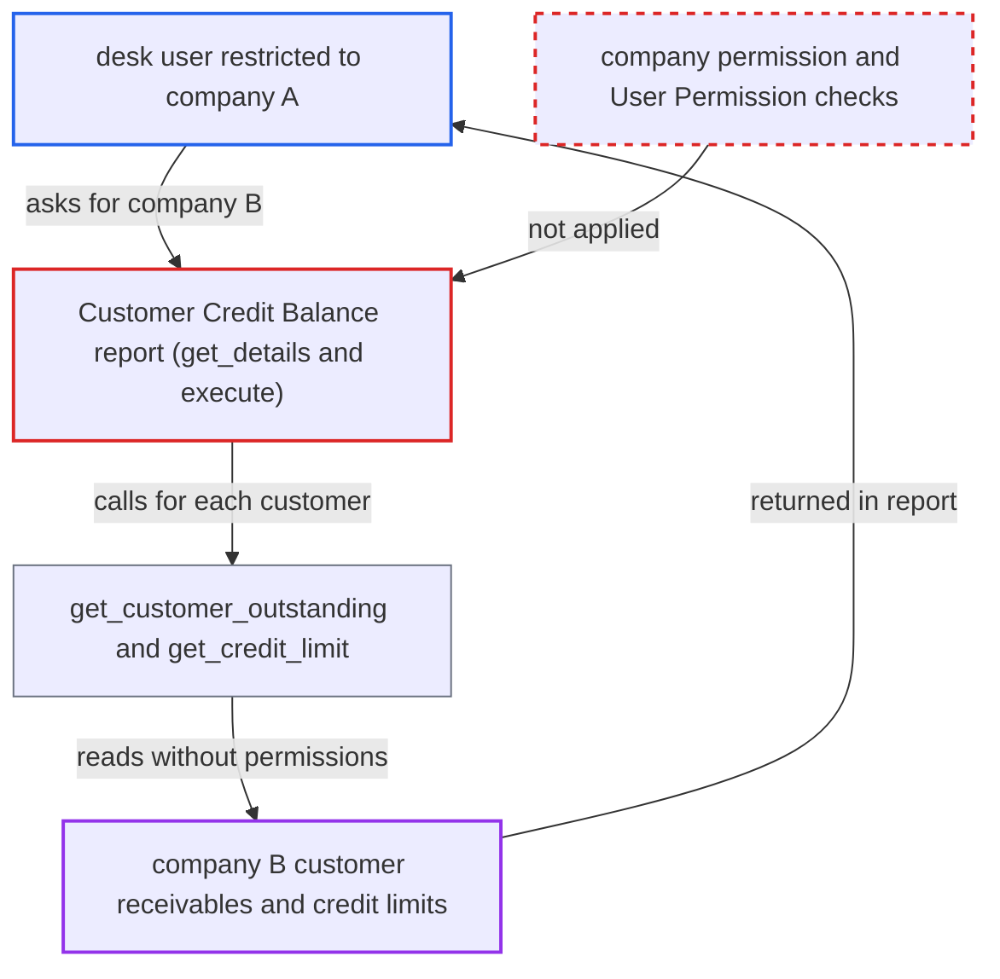

# Customer Credit Balance report discloses receivables for any company and customer

| Field | Value |
|---|---|
| ID | `find_01N9ApdzUytt6N3SzLjnezSS` |
| Severity | **Medium** |
| Status | open |
| CWE | CWE-862 — Missing authorization |
| Created | 2026-10-27T21:25:03.331745Z |
| Claude Security | https://claude.ai/security/findings/find_01N9ApdzUytt6N3SzLjnezSS |

## Description

A logged-in desk user restricted to one company can read another company's customer receivables and credit headroom. The attacker needs a role such as `Sales User`, `Stock User` or `Accounts User`, and the default configuration is enough. The `Customer Credit Balance` report uses the client-supplied `company` filter with no permission check. Its helpers query the ledger without permissions. The leak is per-customer totals, not individual invoices.

1. **attacker (desk user)** runs the report with another company's name. The user is limited by User Permissions to company A. They call `/api/method/frappe.desk.query_report.run` with `report_name=Customer Credit Balance` and `filters={"company":"B"}`, and may add a `customer`. ([`erpnext/selling/report/customer_credit_balance/customer_credit_balance.json`](https://github.com/cx-benchmark/erpnext/blob/90e7aefca73da3c440d2e8da7472fcb67838e678/erpnext/selling/report/customer_credit_balance/customer_credit_balance.json))
2. **the function `get_details`** lists customers for the supplied company. It uses a raw `frappe.qb` query on `Customer` and `Customer Credit Limit` keyed on `filters.company`. It applies no `frappe.has_permission("Company", doc=company)` check and no User Permission or company restriction. ([`erpnext/selling/report/customer_credit_balance/customer_credit_balance.py:79-114`](https://github.com/cx-benchmark/erpnext/blob/90e7aefca73da3c440d2e8da7472fcb67838e678/erpnext/selling/report/customer_credit_balance/customer_credit_balance.py#L79-L114))
3. **the function `execute`** computes balances for every listed customer. It calls `get_customer_outstanding(d.name, filters.company, ...)` and `get_credit_limit(...)` for each customer. It emits credit limit, outstanding receivable and remaining credit as report rows. ([`erpnext/selling/report/customer_credit_balance/customer_credit_balance.py:12-60`](https://github.com/cx-benchmark/erpnext/blob/90e7aefca73da3c440d2e8da7472fcb67838e678/erpnext/selling/report/customer_credit_balance/customer_credit_balance.py#L12-L60))
4. **the function `get_customer_outstanding`** sums ledger and order data without permission checks. It reads `GL Entry`, unbilled Sales Orders and Delivery Notes through `frappe.qb` queries that ignore permissions. ([`erpnext/selling/doctype/customer/customer.py:760-790`](https://github.com/cx-benchmark/erpnext/blob/90e7aefca73da3c440d2e8da7472fcb67838e678/erpnext/selling/doctype/customer/customer.py#L760-L790))
5. **the report response** returns company B's customer figures to the attacker. The response lists each customer with its outstanding receivable and credit headroom, and no check stops it.

## Assessment

The attacker is a desk user with `Sales User`, `Stock User` or `Accounts User` whose User Permissions limit them to company A. Some of these roles have no `GL Entry` or Sales Invoice read access. The report is still granted to them, with `Customer` as its reference doctype. They need no victim interaction, and the default configuration is enough. They can optionally pass a `customer` filter.

Impact: The attacker can read, for any company they name, each customer that has a credit limit. They see its outstanding receivable balance, credit limit and remaining credit, plus frozen or disabled flags. The loss is limited because the figures are per-customer totals, not individual invoices. The access is read-only.

## Recommendation

The report trusts the client-supplied `company` filter. It lists customers and ledger balances without applying the caller's Company or Customer permissions, or a read check on the underlying financial doctypes.

Fix criteria: The selected company is checked against the caller's permissions with `frappe.has_permission("Company", doc=company)` or `get_allowed_companies_condition`. The customer list honours User Permissions and company restriction via `get_allowed_masters_condition` or `frappe.get_list`. Outstanding amounts are computed only for permitted customers. A user restricted to company A gets an error or an empty result when requesting company B, and never sees customers outside their permission set.

## Evidence

**https://github.com/cx-benchmark/erpnext**

- [`erpnext/selling/report/customer_credit_balance/customer_credit_balance.py:79-114`](https://github.com/cx-benchmark/erpnext/blob/90e7aefca73da3c440d2e8da7472fcb67838e678/erpnext/selling/report/customer_credit_balance/customer_credit_balance.py#L79-L114)
- [`erpnext/selling/report/customer_credit_balance/customer_credit_balance.py:12-60`](https://github.com/cx-benchmark/erpnext/blob/90e7aefca73da3c440d2e8da7472fcb67838e678/erpnext/selling/report/customer_credit_balance/customer_credit_balance.py#L12-L60)
- [`erpnext/selling/doctype/customer/customer.py:760-790`](https://github.com/cx-benchmark/erpnext/blob/90e7aefca73da3c440d2e8da7472fcb67838e678/erpnext/selling/doctype/customer/customer.py#L760-L790)
- [`erpnext/selling/report/customer_credit_balance/customer_credit_balance.json`](https://github.com/cx-benchmark/erpnext/blob/90e7aefca73da3c440d2e8da7472fcb67838e678/erpnext/selling/report/customer_credit_balance/customer_credit_balance.json)

