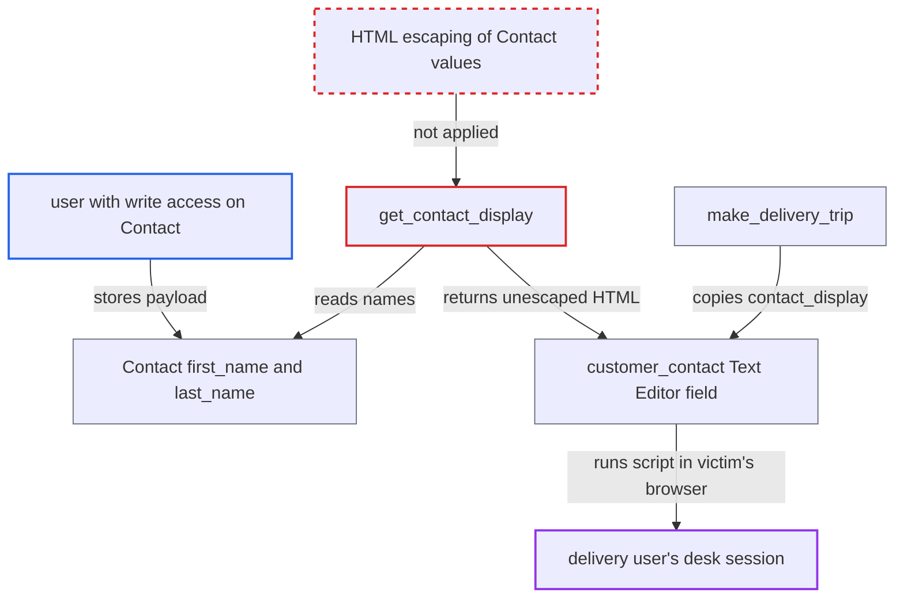

# Delivery Trip get_contact_display builds HTML from unescaped Contact fields rendered in Text Editor

| Field | Value |
|---|---|
| ID | `find_01Sz6JbKjzAuZv9bDpsXXoSd` |
| Severity | **Medium** |
| Status | open |
| CWE | CWE-79 — Cross-site scripting |
| Created | 2026-10-27T21:58:48.444922Z |
| Claude Security | https://claude.ai/security/findings/find_01Sz6JbKjzAuZv9bDpsXXoSd |

## Description

A user who can edit Contacts can run script in the browser of a delivery user who is filling in a Delivery Trip. The script runs with that user's desk session and is limited to what their roles allow. It needs a Contact name field holding a payload and a victim who picks that customer on a stop. The cause is `get_contact_display`, which puts Contact fields into HTML without escaping them.

1. **attacker with write access on Contact** edits `first_name` or `last_name` of an existing Contact to an unfinished tag such as `` in the Contact's `name`, so the payload goes into the name fields of an existing Contact instead.
2. **Frappe save filter** stores the value unchanged. The report assumes `sanitize_html` returns the value as is when the parser finds no complete tag. An unfinished tag is dropped by `html.parser`. This rests on the pinned `frappe >=17.0.0-dev,<18`, whose source is not in the checkout.
3. **delivery user** picks the customer on a Delivery Stop row. This is routine. It calls `get_contact_and_address`, which sets the customer's primary contact and fires the `contact` handler without any further action. ([`erpnext/stock/doctype/delivery_trip/delivery_trip.js:171-196`](https://github.com/cx-benchmark/erpnext/blob/90e7aefca73da3c440d2e8da7472fcb67838e678/erpnext/stock/doctype/delivery_trip/delivery_trip.js#L171-L196))
4. **the `contact` handler in `delivery_trip.js`** calls `get_contact_display` and writes the result into `customer_contact`. The handler uses `frappe.model.set_value` with `r.message`, which re-renders the field in the open row form. ([`erpnext/stock/doctype/delivery_trip/delivery_trip.js:217-232`](https://github.com/cx-benchmark/erpnext/blob/90e7aefca73da3c440d2e8da7472fcb67838e678/erpnext/stock/doctype/delivery_trip/delivery_trip.js#L217-L232))
5. **the method `get_contact_display`** formats the Contact's `first_name`, `last_name`, `phone` and `mobile_no` into an HTML string with no escaping. The template is `<b>{first_name} {last_name}</b>   {phone}   {mobile_no}`. The `</b>` that follows supplies the closing `>` for the attacker's unfinished `img` tag. ([`erpnext/stock/doctype/delivery_trip/delivery_trip.py:473-489`](https://github.com/cx-benchmark/erpnext/blob/90e7aefca73da3c440d2e8da7472fcb67838e678/erpnext/stock/doctype/delivery_trip/delivery_trip.py#L473-L489))
6. **the read-only `Text Editor` field `customer_contact`** displays the string as HTML in the victim's browser. The `img` tag fails to load `x` and its `onerror` handler runs in the victim's desk session while the unsaved row is open. ([`erpnext/stock/doctype/delivery_stop/delivery_stop.json:125-130`](https://github.com/cx-benchmark/erpnext/blob/90e7aefca73da3c440d2e8da7472fcb67838e678/erpnext/stock/doctype/delivery_stop/delivery_stop.json#L125-L130))

## Assessment

The attacker is a desk user with write on Contact, for example a Sales, Purchase or Accounts User under Frappe's Contact permissions. They edit an existing Contact linked to a customer that gets deliveries. A Stock, Fulfillment or Delivery User then builds a Delivery Trip and picks that customer or contact on a stop. A second way in is `make_delivery_trip` in `erpnext/stock/doctype/delivery_note/mapper.py`. It copies the Delivery Note's `contact_display`, which is built from the Contact's names, into the same `customer_contact` field. The payload fires only while the unsaved row is open. When the trip is saved, the child row's `customer_contact` is bleach-sanitized, so the stored trip does not fire it. `phone` and `mobile_no` are probably phone-validated and are not needed.

Impact: The attacker's script runs in the victim's desk session with their CSRF token. It can read data and call any method the victim's roles allow, such as customer, stock and delivery data, and it can create Delivery Notes and Stock Entries. The victims are limited to users with delivery roles, so the impact is real but bounded.

## Recommendation

`get_contact_display` builds HTML by putting Contact field values into a string without escaping, and the result goes into a read-only Text Editor that renders HTML. `make_delivery_trip` likewise copies the name-derived `contact_display` into the same field.

Fix criteria: Every Contact-derived value placed in `customer_contact` is HTML-escaped before it is joined with markup, or the server returns plain data that the client sets as text. This holds on both paths: selecting on a Delivery Stop directly and mapping from a Delivery Note. Test: a Contact with `first_name = '<img src=x onerror=alert(1)//'` shows as literal text on the stop, with no request to `x` and no script execution.

## Evidence

**https://github.com/cx-benchmark/erpnext**

- [`erpnext/stock/doctype/delivery_trip/delivery_trip.py:473-489`](https://github.com/cx-benchmark/erpnext/blob/90e7aefca73da3c440d2e8da7472fcb67838e678/erpnext/stock/doctype/delivery_trip/delivery_trip.py#L473-L489)
- [`erpnext/stock/doctype/delivery_trip/delivery_trip.js:217-232`](https://github.com/cx-benchmark/erpnext/blob/90e7aefca73da3c440d2e8da7472fcb67838e678/erpnext/stock/doctype/delivery_trip/delivery_trip.js#L217-L232)
- [`erpnext/stock/doctype/delivery_trip/delivery_trip.js:171-196`](https://github.com/cx-benchmark/erpnext/blob/90e7aefca73da3c440d2e8da7472fcb67838e678/erpnext/stock/doctype/delivery_trip/delivery_trip.js#L171-L196)
- [`erpnext/stock/doctype/delivery_stop/delivery_stop.json:125-130`](https://github.com/cx-benchmark/erpnext/blob/90e7aefca73da3c440d2e8da7472fcb67838e678/erpnext/stock/doctype/delivery_stop/delivery_stop.json#L125-L130)
- [`erpnext/stock/doctype/delivery_note/mapper.py:244-250`](https://github.com/cx-benchmark/erpnext/blob/90e7aefca73da3c440d2e8da7472fcb67838e678/erpnext/stock/doctype/delivery_note/mapper.py#L244-L250)

