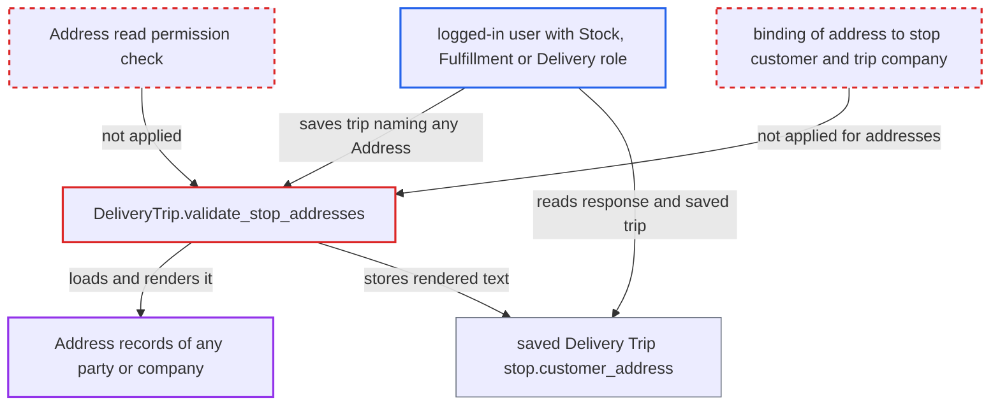

# Delivery Trip stop renders any Address without permission or customer binding

| Field | Value |
|---|---|
| ID | `find_01CdQiy7iJnezvbMEmnuBNpc` |
| Severity | **Medium** |
| Status | open |
| CWE | CWE-862 — Missing Authorization |
| Created | 2026-10-27T22:06:05.494172Z |
| Claude Security | https://claude.ai/security/findings/find_01CdQiy7iJnezvbMEmnuBNpc |

## Description

A logged-in user with the Stock User, Fulfillment User, Delivery User or Delivery Manager role can read the full rendered text of any Address record on the site, across companies. This works by saving a Delivery Trip whose stop names the Address. `DeliveryTrip.validate_stop_addresses` loads and renders that Address without checking read permission, and it does not tie the Address to the stop's customer or the trip's company.

1. **attacker with a delivery or stock role** saves a Delivery Trip containing a stop that names a victim Address. The request goes to `/api/resource/Delivery Trip` or `frappe.client.insert`, with a `delivery_stops` row such as `{address: "<Victim Co-Billing>", customer_address: ""}` and no customer. ([`erpnext/stock/doctype/delivery_trip/delivery_trip.json:208-268`](https://github.com/cx-benchmark/erpnext/blob/90e7aefca73da3c440d2e8da7472fcb67838e678/erpnext/stock/doctype/delivery_trip/delivery_trip.json#L208-L268))
2. **the `validate()` hook of Delivery Trip** calls `validate_stop_addresses` on the save. This runs on every insert or save of a trip, so no special request is needed. ([`erpnext/stock/doctype/delivery_trip/delivery_trip.py:64-71`](https://github.com/cx-benchmark/erpnext/blob/90e7aefca73da3c440d2e8da7472fcb67838e678/erpnext/stock/doctype/delivery_trip/delivery_trip.py#L64-L71))
3. **the method `validate_stop_addresses`** loads the named Address with `frappe.get_doc`. The `address` field is a free link, and `customer` is optional. Nothing checks that the user may read the Address, or that it belongs to the stop's customer or the trip's company. ([`erpnext/stock/doctype/delivery_stop/delivery_stop.json:36-50`](https://github.com/cx-benchmark/erpnext/blob/90e7aefca73da3c440d2e8da7472fcb67838e678/erpnext/stock/doctype/delivery_stop/delivery_stop.json#L36-L50))
4. **the method `validate_stop_addresses`** renders the Address with `get_address_display` and stores it in `stop.customer_address`. The rendered text holds the address lines, city, state, pincode and country. With Frappe's default Address Template it also holds phone, fax and email. ([`erpnext/stock/doctype/delivery_trip/delivery_trip.py:90-93`](https://github.com/cx-benchmark/erpnext/blob/90e7aefca73da3c440d2e8da7472fcb67838e678/erpnext/stock/doctype/delivery_trip/delivery_trip.py#L90-L93))
5. **the attacker** reads the rendered address from the save response and from the saved trip. The trip is a document the caller can read, so the text is returned and also persisted.

## Assessment

The attacker is a logged-in desk user with one of the roles Fulfillment User, Stock User, Delivery User or Delivery Manager. These roles can create and write Delivery Trips, and the repository treats them as holding no Address read. No other setting or victim action is needed. Address names follow a predictable `<title>-<type>` pattern, and `get_contact_and_address` hands out address names for any selectable customer, so the attacker needs no way to enumerate them. The report assumes, without Frappe in the checkout (pinned `>=17.0.0-dev,<18`), that `frappe.get_doc` and `get_address_display` with a dict do no permission check, and that link validation on save checks only that the Address exists. Contacts on a stop are bound to the customer by `validate_stop_contacts`, but addresses have no such binding, and `PartyValidator` does not run for Delivery Trip.

Impact: The attacker reads the full rendered content of any Address on the site, whatever the Address role permissions or user permissions say. This covers companies, suppliers, customers of other companies, leads and drivers. The exposure is limited to the Address doctype, and the only data written is the attacker's own trip.

## Recommendation

`validate_stop_addresses` renders a caller-named Address with `frappe.get_doc` and `get_address_display(dict)`. It does not check Address read permission, and it does not check that the Address is linked to the stop's customer or the trip's company.

Fix criteria: A user saving a Delivery Trip can get an Address rendered into `customer_address` only if they hold read permission on it, or it is linked (Dynamic Link) to the stop's Customer, which they may select and which is in the trip's company scope. Otherwise the save is refused with a PermissionError or ValidationError. Test: as a Stock or Delivery user without Address read, inserting a trip whose stop names another party's Address fails, and no address text is returned or stored. The existing `test_delivery_roles_can_use_the_trip_form` flow, with an address linked to the stop's customer, still succeeds.

## Evidence

**https://github.com/cx-benchmark/erpnext**

- [`erpnext/stock/doctype/delivery_trip/delivery_trip.py:90-93`](https://github.com/cx-benchmark/erpnext/blob/90e7aefca73da3c440d2e8da7472fcb67838e678/erpnext/stock/doctype/delivery_trip/delivery_trip.py#L90-L93)
- [`erpnext/stock/doctype/delivery_trip/delivery_trip.py:64-71`](https://github.com/cx-benchmark/erpnext/blob/90e7aefca73da3c440d2e8da7472fcb67838e678/erpnext/stock/doctype/delivery_trip/delivery_trip.py#L64-L71)
- [`erpnext/stock/doctype/delivery_stop/delivery_stop.json:36-50`](https://github.com/cx-benchmark/erpnext/blob/90e7aefca73da3c440d2e8da7472fcb67838e678/erpnext/stock/doctype/delivery_stop/delivery_stop.json#L36-L50)
- [`erpnext/stock/doctype/delivery_trip/delivery_trip.json:208-268`](https://github.com/cx-benchmark/erpnext/blob/90e7aefca73da3c440d2e8da7472fcb67838e678/erpnext/stock/doctype/delivery_trip/delivery_trip.json#L208-L268)
- [`erpnext/accounts/doctype/tax_rule/test_tax_rule.py:437-445`](https://github.com/cx-benchmark/erpnext/blob/90e7aefca73da3c440d2e8da7472fcb67838e678/erpnext/accounts/doctype/tax_rule/test_tax_rule.py#L437-L445)
- [`erpnext/setup/install.py:56-108`](https://github.com/cx-benchmark/erpnext/blob/90e7aefca73da3c440d2e8da7472fcb67838e678/erpnext/setup/install.py#L56-L108)
- [`erpnext/stock/doctype/delivery_trip/test_delivery_trip.py:357-380`](https://github.com/cx-benchmark/erpnext/blob/90e7aefca73da3c440d2e8da7472fcb67838e678/erpnext/stock/doctype/delivery_trip/test_delivery_trip.py#L357-L380)

