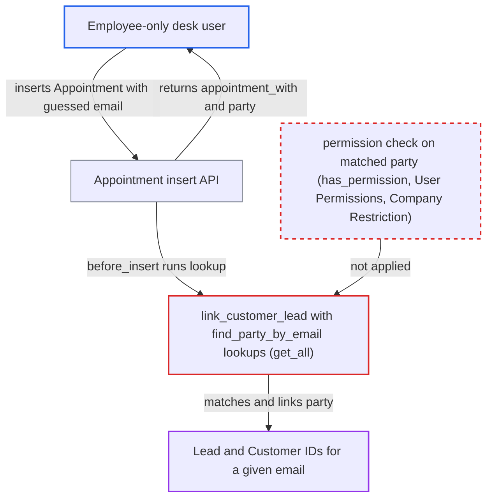

# Desk Appointment insert discloses Customer/Lead matching any email to Employee users

| Field | Value |
|---|---|
| ID | `find_01KmPpXRdM73DAuP84dGzopv` |
| Severity | **Medium** |
| Status | open |
| CWE | CWE-359 — Information exposure |
| Created | 2026-10-27T21:26:00.648978Z |
| Claude Security | https://claude.ai/security/findings/find_01KmPpXRdM73DAuP84dGzopv |

## Description

A logged-in desk user with only the `Employee` role can learn whether an email address belongs to a Lead or a Customer, and get that record's ID. This includes records the role cannot read or that Company Restriction or User Permissions hide. The attacker must supply the email to test. The cause is `link_customer_lead`, which looks up the party with `frappe.get_all` (no permission filtering) and returns the match on the new Appointment without a `frappe.has_permission` check.

1. **Employee-only desk user** inserts an `Appointment` with a target `customer_email`. The request goes through `frappe.client.insert` or `/api/resource/Appointment` and carries `customer_name` and a valid future `scheduled_time`. The `Employee` role has if_owner create and read on Appointment, so Frappe's create check passes. ([`erpnext/crm/doctype/appointment/appointment.json:185-197`](https://github.com/cx-benchmark/erpnext/blob/90e7aefca73da3c440d2e8da7472fcb67838e678/erpnext/crm/doctype/appointment/appointment.json#L185-L197))
2. **hook `before_insert`** calls `link_customer_lead` for every Appointment not flagged `created_through_portal`. This runs after Frappe's create-permission check, so nothing checks the linked party afterwards. ([`erpnext/crm/doctype/appointment/appointment.py:165-171`](https://github.com/cx-benchmark/erpnext/blob/90e7aefca73da3c440d2e8da7472fcb67838e678/erpnext/crm/doctype/appointment/appointment.py#L165-L171))
3. **helpers `find_party_by_email` and `find_party_by_contact_email`** search Customer, Lead, `Contact Email` and `Dynamic Link` for the supplied email. They use `frappe.get_all`, which applies no role check, no User Permissions and no `permission_query_conditions`. Restricted Customers are therefore found too. ([`erpnext/crm/doctype/appointment/appointment.py:296-315`](https://github.com/cx-benchmark/erpnext/blob/90e7aefca73da3c440d2e8da7472fcb67838e678/erpnext/crm/doctype/appointment/appointment.py#L296-L315))
4. **method `link_customer_lead`** writes the match into `appointment_with` and `party` on the caller's own document. No `frappe.has_permission` check is made on the matched Customer or Lead. ([`erpnext/crm/doctype/appointment/appointment.py:288-294`](https://github.com/cx-benchmark/erpnext/blob/90e7aefca73da3c440d2e8da7472fcb67838e678/erpnext/crm/doctype/appointment/appointment.py#L288-L294))
5. **insert API** returns the document to the caller. The response shows `appointment_with` and `party`, so the attacker sees the Lead or Customer ID for that email. The attacker can repeat this for other addresses and delete or close their own appointments to free capacity.

## Assessment

The attacker is a logged-in desk user with only the `Employee` role, the lowest-privileged internal actor. No victim action is needed. They must supply the email to test, so this confirms guesses and does not list records. The portal booking path is not affected, because it defers linking until the email is verified. The desk and API path links at once. A probe with an unknown email creates a Lead, which is the designed desk behaviour. Each probe also assigns an agent and creates a public Event, so probing is noisy but not blocked.

Impact: The attacker learns whether an email belongs to a Lead, and that Lead's ID. They also learn which Customer an email belongs to, directly or through a linked Contact. This covers Leads the role cannot read and Customers hidden by Company Restriction or User Permissions. No other fields are returned, and there is no change to data beyond the designed Lead creation.

## Recommendation

Desk-created Appointments auto-link the party found by a permission-free email lookup. They return it to a creator who may lack read permission on that Customer or Lead, or who is restricted from it by Company Restriction or User Permissions.

Fix criteria: Only a party the current user may read can be linked and returned on the desk path. This is decided with `frappe.has_permission` on the matched Customer or Lead, honouring User Permissions and Company Restriction. Otherwise linking is skipped or deferred. Test: as an Employee-only user, insert an Appointment with a known Lead's email and with a company-restricted Customer's email. Neither the response nor the stored document reveals the matched record's ID.

## Evidence

**https://github.com/cx-benchmark/erpnext**

- [`erpnext/crm/doctype/appointment/appointment.py:288-294`](https://github.com/cx-benchmark/erpnext/blob/90e7aefca73da3c440d2e8da7472fcb67838e678/erpnext/crm/doctype/appointment/appointment.py#L288-L294)
- [`erpnext/crm/doctype/appointment/appointment.py:296-315`](https://github.com/cx-benchmark/erpnext/blob/90e7aefca73da3c440d2e8da7472fcb67838e678/erpnext/crm/doctype/appointment/appointment.py#L296-L315)
- [`erpnext/crm/doctype/appointment/appointment.py:165-171`](https://github.com/cx-benchmark/erpnext/blob/90e7aefca73da3c440d2e8da7472fcb67838e678/erpnext/crm/doctype/appointment/appointment.py#L165-L171)
- [`erpnext/crm/doctype/appointment/appointment.json:185-197`](https://github.com/cx-benchmark/erpnext/blob/90e7aefca73da3c440d2e8da7472fcb67838e678/erpnext/crm/doctype/appointment/appointment.json#L185-L197)
- [`erpnext/crm/doctype/lead/lead.json:564-620`](https://github.com/cx-benchmark/erpnext/blob/90e7aefca73da3c440d2e8da7472fcb67838e678/erpnext/crm/doctype/lead/lead.json#L564-L620)
- [`erpnext/selling/doctype/customer/customer.json:894-897`](https://github.com/cx-benchmark/erpnext/blob/90e7aefca73da3c440d2e8da7472fcb67838e678/erpnext/selling/doctype/customer/customer.json#L894-L897)
- [`erpnext/hooks.py:355-373`](https://github.com/cx-benchmark/erpnext/blob/90e7aefca73da3c440d2e8da7472fcb67838e678/erpnext/hooks.py#L355-L373)

