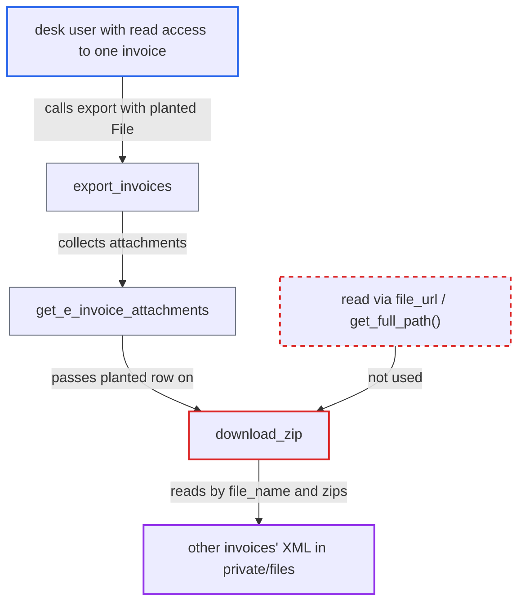

# E-invoice export reads the disk file named by File.file_name, exposing other invoices' XML

| Field | Value |
|---|---|
| ID | `find_016DsrWLVasGAKUd95hmGB7a` |
| Severity | **Medium** |
| Status | open |
| CWE | CWE-73 — External Control of File Name |
| Created | 2026-10-27T22:12:10.478017Z |
| Claude Security | https://claude.ai/security/findings/find_016DsrWLVasGAKUd95hmGB7a |

## Description

A desk user who can read one submitted Sales Invoice of an Italian company can download the full e-invoice XML of other invoices of that company, including invoices the row-level permissions hide from them. The attack needs only that one readable invoice and a File attached to it. The cause is `download_zip`, which reads the file from disk using the File's display name `file_name`, not its stored location.

1. **desk user** attaches a File to their own readable invoice with a chosen `file_name`. The name is set to another invoice's XML basename, such as `IT<taxid>_00042.xml`. This is done either by re-uploading the same bytes so Frappe reuses the existing private file's `file_url` and keeps the supplied name, or by editing `file_name` on a File they own.
2. **desk user** calls the whitelisted `export_invoices` for the company. The function checks only doctype-level read. It limits the invoices with `frappe.get_list`, so the user's own invoice is in scope. ([`erpnext/regional/italy/utils.py:33-46`](https://github.com/cx-benchmark/erpnext/blob/90e7aefca73da3c440d2e8da7472fcb67838e678/erpnext/regional/italy/utils.py#L33-L46))
3. **`get_e_invoice_attachments`** selects the planted File row as if it were a genuine e-invoice. It loads File rows with `frappe.get_all` without a permission filter. It keeps rows on in-scope invoices whose `file_name` starts with `IT<company tax id>` and ends with `.xml`. ([`erpnext/regional/italy/utils.py:405-436`](https://github.com/cx-benchmark/erpnext/blob/90e7aefca73da3c440d2e8da7472fcb67838e678/erpnext/regional/italy/utils.py#L405-L436))
4. **`download_zip`** opens the file at `get_files_path(file.file_name, is_private=file.is_private)`. The path is built from the display name, so it points at the other invoice's XML in `private/files`, not at the planted row's own content. ([`erpnext/regional/italy/utils.py:128-141`](https://github.com/cx-benchmark/erpnext/blob/90e7aefca73da3c440d2e8da7472fcb67838e678/erpnext/regional/italy/utils.py#L128-L141))
5. **`export_invoices`** returns the zip containing the other invoice's XML to the caller. Frappe's normal private-file download would have refused this, because the user cannot read the invoice that file belongs to.
6. **desk user** repeats with the next guessed name to read more invoices. Basenames come from the sequential `make_autoname(company_tax_id + "_.#####")` series, so they can be guessed from the user's own invoice's XML name. ([`erpnext/regional/italy/utils.py:470-474`](https://github.com/cx-benchmark/erpnext/blob/90e7aefca73da3c440d2e8da7472fcb67838e678/erpnext/regional/italy/utils.py#L470-L474))

## Assessment

The attacker is a desk user, for example an Accounts User restricted by User Permissions on Customer or Territory. They need to read one submitted Sales Invoice of an Italian company and to be able to create a File on it (File create, role All). They download their invoice's XML and re-upload the same bytes as a private File attached to it, with `file_name` set to another invoice's XML basename. As an alternative, they edit `file_name` on a File they own, because the stored file does not move. Then they call `export_invoices` for the company. No victim action is needed. This relies on Frappe behaviour that is not in the checkout (pinned `frappe>=17.0.0-dev,<18.0.0`): deduplication by `content_hash` and `is_private`, owner permissions on File, and no check that an edited `file_name` matches `file_url`.

Impact: The attacker reads the complete FatturaPA XML of any e-invoice of the company, guessing one number at a time. This includes customer name, VAT and fiscal codes (personal ones for individuals), addresses, line items, prices, totals and PO/DDT references. It bypasses the row-level Sales Invoice permissions the export applies. Reach is limited to `.xml` files in the site's files directories whose names start with that company's `IT<tax id>`. Nothing is written.

## Recommendation

`download_zip` builds the disk path from `File.file_name`. That display name can differ from the file the row stores, and the caller can set it, so an attachment row can make the export read another invoice's file.

Fix criteria: Each exported attachment is read from the File document's own stored location, using `file_url` resolved with `File.get_full_path()` or the File content API, and never from a path built from `file_name`. To verify, on a readable invoice create a File whose `file_name` equals another invoice's XML basename, once by a deduplicated upload and once by editing `file_name`. Run `export_invoices` and check that the archive holds only that row's own content and none of the other invoice's XML.

## Evidence

**https://github.com/cx-benchmark/erpnext**

- [`erpnext/regional/italy/utils.py:128-141`](https://github.com/cx-benchmark/erpnext/blob/90e7aefca73da3c440d2e8da7472fcb67838e678/erpnext/regional/italy/utils.py#L128-L141)
- [`erpnext/regional/italy/utils.py:405-436`](https://github.com/cx-benchmark/erpnext/blob/90e7aefca73da3c440d2e8da7472fcb67838e678/erpnext/regional/italy/utils.py#L405-L436)
- [`erpnext/regional/italy/utils.py:33-46`](https://github.com/cx-benchmark/erpnext/blob/90e7aefca73da3c440d2e8da7472fcb67838e678/erpnext/regional/italy/utils.py#L33-L46)
- [`erpnext/regional/italy/utils.py:362-374`](https://github.com/cx-benchmark/erpnext/blob/90e7aefca73da3c440d2e8da7472fcb67838e678/erpnext/regional/italy/utils.py#L362-L374)
- [`erpnext/regional/italy/utils.py:470-474`](https://github.com/cx-benchmark/erpnext/blob/90e7aefca73da3c440d2e8da7472fcb67838e678/erpnext/regional/italy/utils.py#L470-L474)
- [`erpnext/regional/doctype/import_supplier_invoice/import_supplier_invoice.py:78-83`](https://github.com/cx-benchmark/erpnext/blob/90e7aefca73da3c440d2e8da7472fcb67838e678/erpnext/regional/doctype/import_supplier_invoice/import_supplier_invoice.py#L78-L83)

