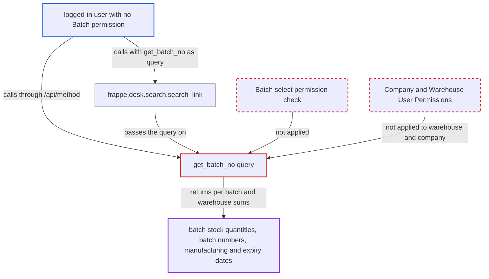

# get_batch_no link query returns batch stock quantities to users without Batch permission

| Field | Value |
|---|---|
| ID | `find_01PuFrEs6XcJfqLebTpFX2jD` |
| Severity | **Medium** |
| Status | open |
| CWE | CWE-862 — Missing authorization |
| Created | 2026-10-27T21:26:29.167049Z |
| Claude Security | https://claude.ai/security/findings/find_01PuFrEs6XcJfqLebTpFX2jD |

## Description

Any logged-in user, even one whose roles give no access to Batch (a portal customer or supplier, a Purchase User, or an HR, Projects or Support user), can read stock on hand per batch for any item. They also get batch numbers and manufacturing and expiry dates. The whitelisted query `get_batch_no` never checks permissions and ignores Company and Warehouse User Permissions.

1. **the attacker** calls the whitelisted method `erpnext.controllers.queries.get_batch_no`. The call goes to `/api/method/erpnext.controllers.queries.get_batch_no`, or through `frappe.desk.search.search_link` with that `query`, and passes `doctype=Batch` and `filters` holding `item_code`, optionally `warehouse`, `include_expired_batches` and `is_inward`. ([`erpnext/controllers/queries.py:602-628`](https://github.com/cx-benchmark/erpnext/blob/90e7aefca73da3c440d2e8da7472fcb67838e678/erpnext/controllers/queries.py#L602-L628))
2. **the query `get_batch_no`** runs without any permission check. It has only `@frappe.whitelist()` and `@frappe.validate_and_sanitize_search_inputs` and never calls `frappe.has_permission`, so a caller with no Batch permission goes straight on. ([`erpnext/controllers/queries.py:602-628`](https://github.com/cx-benchmark/erpnext/blob/90e7aefca73da3c440d2e8da7472fcb67838e678/erpnext/controllers/queries.py#L602-L628))
3. **the helper `get_batches_from_stock_ledger_entries`** sums `actual_qty` per batch for the chosen item. It uses a raw `frappe.qb` join with no permission or user-permission condition. It limits by warehouse only if the caller names one, otherwise it covers all warehouses of all companies. ([`erpnext/controllers/queries.py:669-729`](https://github.com/cx-benchmark/erpnext/blob/90e7aefca73da3c440d2e8da7472fcb67838e678/erpnext/controllers/queries.py#L669-L729))
4. **the helper `get_batches_from_serial_and_batch_bundle`** sums `Serial and Batch Entry.qty` per batch in the same unguarded way. This second aggregate is also a raw join with no permission check, so batches held through serial and batch bundles are included too. ([`erpnext/controllers/queries.py:732-799`](https://github.com/cx-benchmark/erpnext/blob/90e7aefca73da3c440d2e8da7472fcb67838e678/erpnext/controllers/queries.py#L732-L799))
5. **the helper `get_empty_batches`** adds `Batch.name` and `batch_qty` when `is_inward` is set. It calls `frappe.qb.get_query` without `ignore_permissions=False`, unlike the guarded calls elsewhere in the same file. ([`erpnext/controllers/queries.py:631-649`](https://github.com/cx-benchmark/erpnext/blob/90e7aefca73da3c440d2e8da7472fcb67838e678/erpnext/controllers/queries.py#L631-L649))
6. **`get_batch_no`** maps batch names to `batch_id` with `frappe.get_all` and returns the rows. `frappe.get_all` ignores permissions. Each tuple holds the batch, `batch_id`, quantity, the manufacturing and expiry dates and the item. ([`erpnext/controllers/queries.py:602-628`](https://github.com/cx-benchmark/erpnext/blob/90e7aefca73da3c440d2e8da7472fcb67838e678/erpnext/controllers/queries.py#L602-L628))

## Assessment

The attacker is any authenticated user whose roles grant nothing on Batch, Stock Ledger Entry or Serial and Batch Bundle, such as a portal Customer or Supplier, a Purchase User, or an HR, Projects or Support user. No victim action is needed. The attacker can call the method directly at `/api/method/erpnext.controllers.queries.get_batch_no` or go through `frappe.desk.search.search_link` with that `query`. The attacker chooses the `item_code` and may choose a `warehouse` in any company. Without a `warehouse`, the sums cover all warehouses of all companies.

Impact: The attacker reads stock on hand per batch, per warehouse if asked, for any chosen item, plus batch numbers and manufacturing and expiry dates. This is inventory data the role model withholds from these users. Each call covers one `item_code` and at most 300 rows, and nothing is modified.

## Recommendation

(1) `get_batch_no` and its helpers read Stock Ledger Entry, Serial and Batch Entry and Batch through raw `frappe.qb` joins, a permission-ignoring `get_query` and `frappe.get_all`. They never check the caller's permission, so the Batch gate that `get_batch_qty` enforces is skipped on this path.

Fix criteria: A caller without at least `select` on Batch, as `get_batch_qty` requires, gets a PermissionError or an empty result from `get_batch_no`, whether called directly or through `search_link`. A portal Customer or Supplier and a Purchase User get no rows. A Sales User or Stock User still gets them.

(2) The warehouse filter and the ledger aggregates are not limited by the caller's Company and Warehouse User Permissions.

Fix criteria: A user fenced to one company or warehouse receives no quantities for warehouses outside their user permissions. This holds both when they omit the warehouse filter and when they name another company's warehouse.

## Evidence

**https://github.com/cx-benchmark/erpnext**

- [`erpnext/controllers/queries.py:602-628`](https://github.com/cx-benchmark/erpnext/blob/90e7aefca73da3c440d2e8da7472fcb67838e678/erpnext/controllers/queries.py#L602-L628)
- [`erpnext/controllers/queries.py:669-729`](https://github.com/cx-benchmark/erpnext/blob/90e7aefca73da3c440d2e8da7472fcb67838e678/erpnext/controllers/queries.py#L669-L729)
- [`erpnext/controllers/queries.py:732-799`](https://github.com/cx-benchmark/erpnext/blob/90e7aefca73da3c440d2e8da7472fcb67838e678/erpnext/controllers/queries.py#L732-L799)
- [`erpnext/controllers/queries.py:631-649`](https://github.com/cx-benchmark/erpnext/blob/90e7aefca73da3c440d2e8da7472fcb67838e678/erpnext/controllers/queries.py#L631-L649)
- [`erpnext/stock/doctype/batch/batch.py:271-296`](https://github.com/cx-benchmark/erpnext/blob/90e7aefca73da3c440d2e8da7472fcb67838e678/erpnext/stock/doctype/batch/batch.py#L271-L296)
- [`erpnext/stock/report/serial_and_batch_summary/serial_and_batch_summary.py:224-242`](https://github.com/cx-benchmark/erpnext/blob/90e7aefca73da3c440d2e8da7472fcb67838e678/erpnext/stock/report/serial_and_batch_summary/serial_and_batch_summary.py#L224-L242)
- [`erpnext/stock/doctype/batch/batch.json:230-310`](https://github.com/cx-benchmark/erpnext/blob/90e7aefca73da3c440d2e8da7472fcb67838e678/erpnext/stock/doctype/batch/batch.json#L230-L310)
- [`erpnext/stock/tests/test_serial_batch_link_queries.py:87-94`](https://github.com/cx-benchmark/erpnext/blob/90e7aefca73da3c440d2e8da7472fcb67838e678/erpnext/stock/tests/test_serial_batch_link_queries.py#L87-L94)

