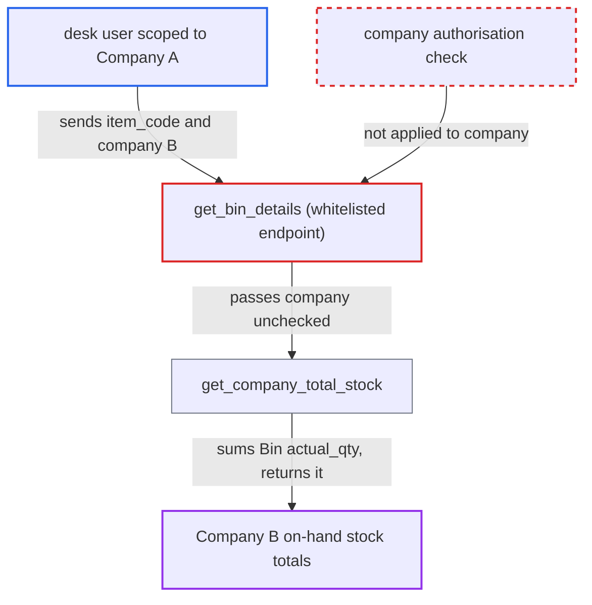

# get_bin_details returns company_total_stock for any company, bypassing Company user permissions

| Field | Value |
|---|---|
| ID | `find_01Hr8wxk9cDLVqseSC4LATFu` |
| Severity | **Medium** |
| Status | open |
| CWE | CWE-862 — Missing Authorization |
| Created | 2026-10-27T21:14:06.779495Z |
| Claude Security | https://claude.ai/security/findings/find_01Hr8wxk9cDLVqseSC4LATFu |

## Description

A logged-in desk user restricted to one company can read the total on-hand stock of any item in another company. Any role with Item `select` can do it, including the default Desk User role. The whitelisted `get_bin_details` checks the warehouse but never checks the caller-supplied `company`, so the total is summed with no permission filtering.

1. **Attacker (desk user scoped to Company A)** posts a request to `/api/method/erpnext.stock.get_item_details.get_bin_details`. The request sets `item_code` to the target item, `warehouse` empty or one of their own warehouses, and `company` to Company B. ([`erpnext/stock/get_item_details.py:1756-1765`](https://github.com/cx-benchmark/erpnext/blob/90e7aefca73da3c440d2e8da7472fcb67838e678/erpnext/stock/get_item_details.py#L1756-L1765))
2. **the whitelisted `get_bin_details`** checks only role-level Item `select` and the warehouse permission. The Warehouse user permission is checked only when `warehouse` is given, and `company` is passed on without any check. ([`erpnext/stock/get_item_details.py:1756-1765`](https://github.com/cx-benchmark/erpnext/blob/90e7aefca73da3c440d2e8da7472fcb67838e678/erpnext/stock/get_item_details.py#L1756-L1765))
3. **the helper `_get_bin_details`** asks for the company total whenever `company` is truthy. This happens whether or not a warehouse was supplied. ([`erpnext/stock/get_item_details.py:1792-1795`](https://github.com/cx-benchmark/erpnext/blob/90e7aefca73da3c440d2e8da7472fcb67838e678/erpnext/stock/get_item_details.py#L1792-L1795))
4. **the helper `get_company_total_stock`** sums `Bin.actual_qty` over every warehouse of the named company. It uses `frappe.qb`, which applies no user permissions, so Company B's stock is included. ([`erpnext/stock/get_item_details.py:1798-1808`](https://github.com/cx-benchmark/erpnext/blob/90e7aefca73da3c440d2e8da7472fcb67838e678/erpnext/stock/get_item_details.py#L1798-L1808))
5. **the endpoint** returns the sum as `company_total_stock`. The attacker can repeat the call for every item to map Company B's stock.

## Assessment

The attacker is an authenticated desk user with Item `select`, including the default Desk User role. Company User Permissions limit them to Company A. They call `get_bin_details` with `warehouse` empty or set to one of their own warehouses, and `company` set to Company B. Because `item_code` is checked only at doctype level, items restricted by Company Restriction to other companies can be queried too. In-process callers use `_get_bin_details` directly, so a guard in the whitelisted wrapper does not affect them.

Impact: The attacker can read the aggregate on-hand quantity of any item in companies they are isolated from. This is read-only. It exposes no valuation or per-warehouse breakdown, and it cannot modify data or affect availability.

## Recommendation

The whitelisted `get_bin_details` authorises `warehouse` but not the caller-chosen `company`. `_get_bin_details` and `get_company_total_stock` then total stock across all of that company's warehouses without permission filtering.

Fix criteria: The whitelisted entry refuses the call, or omits `company_total_stock`, when the caller's Company user permissions or allowed companies do not include the named `company`, as `check_pick_list_company` and `validate_pricing_context` do. A user restricted to Company A who calls `get_bin_details(item, "", company="B")` gets a permission error and no Company B total. The same happens with an A warehouse and `company="B"`. Unrestricted users and in-process `_get_bin_details` callers keep working.

## Evidence

**https://github.com/cx-benchmark/erpnext**

- [`erpnext/stock/get_item_details.py:1756-1765`](https://github.com/cx-benchmark/erpnext/blob/90e7aefca73da3c440d2e8da7472fcb67838e678/erpnext/stock/get_item_details.py#L1756-L1765)
- [`erpnext/stock/get_item_details.py:1792-1795`](https://github.com/cx-benchmark/erpnext/blob/90e7aefca73da3c440d2e8da7472fcb67838e678/erpnext/stock/get_item_details.py#L1792-L1795)
- [`erpnext/stock/get_item_details.py:1798-1808`](https://github.com/cx-benchmark/erpnext/blob/90e7aefca73da3c440d2e8da7472fcb67838e678/erpnext/stock/get_item_details.py#L1798-L1808)
- [`erpnext/stock/doctype/pick_list/pick_list.py:1924-1990`](https://github.com/cx-benchmark/erpnext/blob/90e7aefca73da3c440d2e8da7472fcb67838e678/erpnext/stock/doctype/pick_list/pick_list.py#L1924-L1990)
- [`erpnext/stock/doctype/bin/bin.json`](https://github.com/cx-benchmark/erpnext/blob/90e7aefca73da3c440d2e8da7472fcb67838e678/erpnext/stock/doctype/bin/bin.json)

