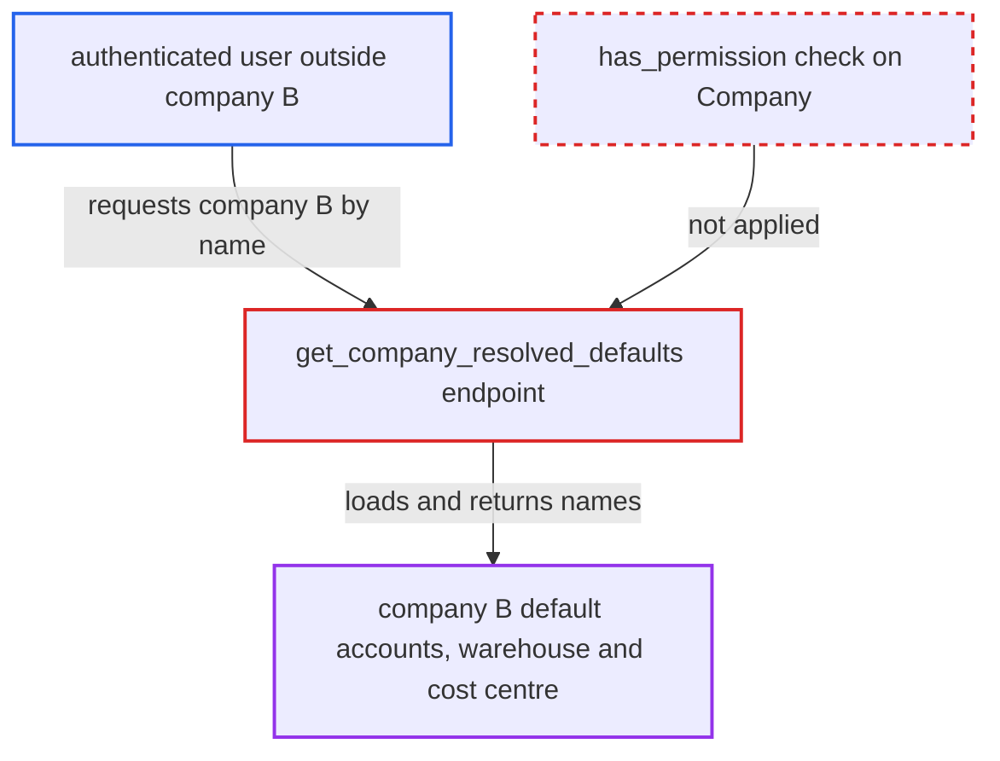

# get_company_resolved_defaults discloses any company's default accounts without permission check

| Field | Value |
|---|---|
| ID | `find_01Vy6wrFZA6vfgLJUtnynok3` |
| Severity | **Medium** |
| Status | open |
| CWE | CWE-862 — Missing Authorization |
| Created | 2026-10-27T21:13:33.664829Z |
| Claude Security | https://claude.ai/security/findings/find_01Vy6wrFZA6vfgLJUtnynok3 |

## Description

Any logged-in user can read another company's default account settings: the default warehouse, cost centre and the names of its default inventory, expense, income and other accounts. The impact is limited to configuration names, not balances or transactions. The whitelisted `get_company_resolved_defaults` loads the named Company with `frappe.get_cached_doc` and never checks permissions.

1. **authenticated user** calls the whitelisted endpoint with another company's name. The request goes to `/api/method/erpnext.setup.doctype.item_group.item_group.get_company_resolved_defaults?company=<company B>`, where the caller belongs to company A or holds only a select-only role. ([`erpnext/setup/doctype/item_group/item_group.py:102-132`](https://github.com/cx-benchmark/erpnext/blob/90e7aefca73da3c440d2e8da7472fcb67838e678/erpnext/setup/doctype/item_group/item_group.py#L102-L132))
2. **the endpoint `get_company_resolved_defaults`** loads the named Company with `frappe.get_cached_doc`. This loader ignores role permissions, Company User Permissions and the company scoping helper `get_allowed_companies`, and the code makes no `frappe.has_permission` call first. ([`erpnext/setup/doctype/item_group/item_group.py:102-132`](https://github.com/cx-benchmark/erpnext/blob/90e7aefca73da3c440d2e8da7472fcb67838e678/erpnext/setup/doctype/item_group/item_group.py#L102-L132))
3. **the endpoint `get_company_resolved_defaults`** returns the company's default warehouse, cost centre and default account names to the caller. The returned fields cover the default inventory, expense/COGS, income, provisional, purchase-expense, deferred revenue/expense, discount and stock-contra accounts. ([`erpnext/setup/doctype/item_group/item_group.py:102-132`](https://github.com/cx-benchmark/erpnext/blob/90e7aefca73da3c440d2e8da7472fcb67838e678/erpnext/setup/doctype/item_group/item_group.py#L102-L132))

## Assessment

The attacker is any authenticated session. Examples are a low-privilege employee limited to company A, a user whose role has only `select` on Company (`Auditor`, `HR User` or `Desk User`), or a portal user. No victim action is needed. The attacker only has to name another company in the `company` parameter. The report notes that `get_company_default` in `erpnext/accounts/utils.py` is also whitelisted. It can return any Company field and has no check, so it has the same gap.

Impact: An attacker can read another company's default account, warehouse and cost-centre names, which they are not permitted to read. This is limited to configuration identifiers, with no balances or transactions and no write access. Part of it is already exposed: `erpnext/startup/boot.py` sends each company's `cost_center` to every desk user, along with `exchange_gain_loss_account`, `bank_charges_account` and `default_bank_account`.

## Recommendation

The whitelisted `get_company_resolved_defaults` loads a caller-named Company with a loader that ignores permissions. It returns the fields without checking that the caller may read that Company. This bypasses role permissions and Company User Permission scoping.

Fix criteria: The endpoint returns values only for a Company the caller may read under role permissions and Company User Permissions / allowed companies. Otherwise it raises a PermissionError. Test: a user confined to company A, a select-only role, or a portal user calling it for company B gets an error and no account, warehouse or cost-centre names. An Item/Item Group editor permitted on B still gets the defaults.

## Evidence

**https://github.com/cx-benchmark/erpnext**

- [`erpnext/setup/doctype/item_group/item_group.py:102-132`](https://github.com/cx-benchmark/erpnext/blob/90e7aefca73da3c440d2e8da7472fcb67838e678/erpnext/setup/doctype/item_group/item_group.py#L102-L132)
- [`erpnext/accounts/doctype/payment_entry/payment_entry.py:2581-2585`](https://github.com/cx-benchmark/erpnext/blob/90e7aefca73da3c440d2e8da7472fcb67838e678/erpnext/accounts/doctype/payment_entry/payment_entry.py#L2581-L2585)
- [`erpnext/setup/doctype/company/company.py:1182-1203`](https://github.com/cx-benchmark/erpnext/blob/90e7aefca73da3c440d2e8da7472fcb67838e678/erpnext/setup/doctype/company/company.py#L1182-L1203)
- [`erpnext/setup/doctype/company/company.json`](https://github.com/cx-benchmark/erpnext/blob/90e7aefca73da3c440d2e8da7472fcb67838e678/erpnext/setup/doctype/company/company.json)
- [`erpnext/startup/boot.py:54-74`](https://github.com/cx-benchmark/erpnext/blob/90e7aefca73da3c440d2e8da7472fcb67838e678/erpnext/startup/boot.py#L54-L74)

