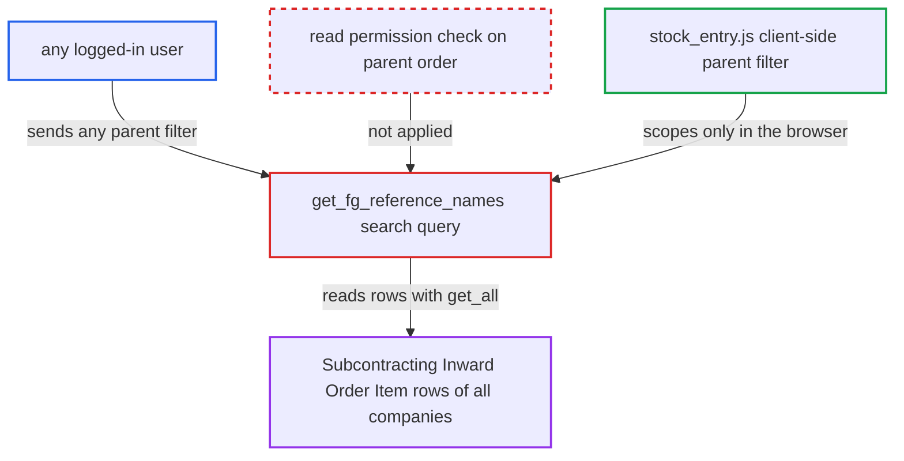

# get_fg_reference_names returns any Subcontracting Inward Order's item rows without permission check

| Field | Value |
|---|---|
| ID | `find_01BEVGooSp24U1LPf1w9LhVD` |
| Severity | **Medium** |
| Status | open |
| CWE | CWE-862 — Missing authorization |
| Created | 2026-10-27T21:27:05.903906Z |
| Claude Security | https://claude.ai/security/findings/find_01BEVGooSp24U1LPf1w9LhVD |

## Description

Any logged-in user can read item codes, row names and delivery warehouses from submitted Subcontracting Inward Orders in every company, even without a role that may read those orders. This is read-only, and the customer and quantities are not returned. The cause is `get_fg_reference_names`, which passes the caller's `parent` filter to `frappe.get_all` and never checks permission on the parent order.

1. **attacker (any logged-in user)** calls the whitelisted search query. The call goes to `/api/method/frappe.desk.search.search_link` with `query=erpnext.controllers.subcontracting_inward_controller.get_fg_reference_names`, or calls the method directly. ([`erpnext/controllers/subcontracting_inward_controller.py:1262-1279`](https://github.com/cx-benchmark/erpnext/blob/90e7aefca73da3c440d2e8da7472fcb67838e678/erpnext/controllers/subcontracting_inward_controller.py#L1262-L1279))
2. **attacker** supplies a `parent` filter of their choice. The value can be `["like","%"]` to span all orders, or a guessed order name such as `SCI-ORD-YYYY-NNNNN`, since the names follow a sequential series. ([`erpnext/subcontracting/doctype/subcontracting_inward_order/subcontracting_inward_order.json:314-360`](https://github.com/cx-benchmark/erpnext/blob/90e7aefca73da3c440d2e8da7472fcb67838e678/erpnext/subcontracting/doctype/subcontracting_inward_order/subcontracting_inward_order.json#L314-L360))
3. **the query `get_fg_reference_names`** reads the rows with `frappe.get_all`. It uses `filters.get("parent")` as given and `docstatus` 1. `frappe.get_all` ignores role permissions and User Permissions, and the query never checks that the caller can read the parent order or that `parent` is a plain string. ([`erpnext/controllers/subcontracting_inward_controller.py:1262-1279`](https://github.com/cx-benchmark/erpnext/blob/90e7aefca73da3c440d2e8da7472fcb67838e678/erpnext/controllers/subcontracting_inward_controller.py#L1262-L1279))
4. **the query `get_fg_reference_names`** returns `name`, `item_code` and `delivery_warehouse` of each matching row. The caller receives rows of orders they are not allowed to read. ([`erpnext/controllers/subcontracting_inward_controller.py:1262-1279`](https://github.com/cx-benchmark/erpnext/blob/90e7aefca73da3c440d2e8da7472fcb67838e678/erpnext/controllers/subcontracting_inward_controller.py#L1262-L1279))

## Assessment

The attacker is any logged-in user. This includes a desk employee without Stock or Sales roles, a user restricted by Company or Customer User Permissions, or a portal Customer or Supplier. No victim action is needed. The attacker either sends `filters={"parent":["like","%"]}` to list rows of all submitted orders, or guesses a single order name from the sequential series `SCI-ORD-.YYYY.-`. The intended caller is the Stock Entry `against_fg` link field, but it scopes `parent` only on the client, so the server does not enforce it.

Impact: The attacker can read the finished-good item codes, row names and delivery warehouses of submitted Subcontracting Inward Orders across all companies. The customer and quantities are not returned, and nothing is modified.

## Recommendation

The whitelisted query returns child rows of a caller-named parent through `frappe.get_all`. It never verifies read permission on that parent, and it accepts a filter operator in place of a single parent name.

Fix criteria: The query accepts only a single plain-string `parent` and enforces read permission, User Permissions included, on that `Subcontracting Inward Order` before returning rows. To verify, call the method as a portal user, as a desk user without Stock or Sales roles, and as a Company-restricted user. Use another company's order or `parent=["like","%"]`. Each call must return a permission error or no rows.

## Evidence

**https://github.com/cx-benchmark/erpnext**

- [`erpnext/controllers/subcontracting_inward_controller.py:1262-1279`](https://github.com/cx-benchmark/erpnext/blob/90e7aefca73da3c440d2e8da7472fcb67838e678/erpnext/controllers/subcontracting_inward_controller.py#L1262-L1279)
- [`erpnext/subcontracting/doctype/subcontracting_inward_order/subcontracting_inward_order.json:314-360`](https://github.com/cx-benchmark/erpnext/blob/90e7aefca73da3c440d2e8da7472fcb67838e678/erpnext/subcontracting/doctype/subcontracting_inward_order/subcontracting_inward_order.json#L314-L360)
- [`erpnext/controllers/queries.py:1284-1310`](https://github.com/cx-benchmark/erpnext/blob/90e7aefca73da3c440d2e8da7472fcb67838e678/erpnext/controllers/queries.py#L1284-L1310)
- [`erpnext/stock/doctype/stock_entry/stock_entry.js:144-153`](https://github.com/cx-benchmark/erpnext/blob/90e7aefca73da3c440d2e8da7472fcb67838e678/erpnext/stock/doctype/stock_entry/stock_entry.js#L144-L153)

