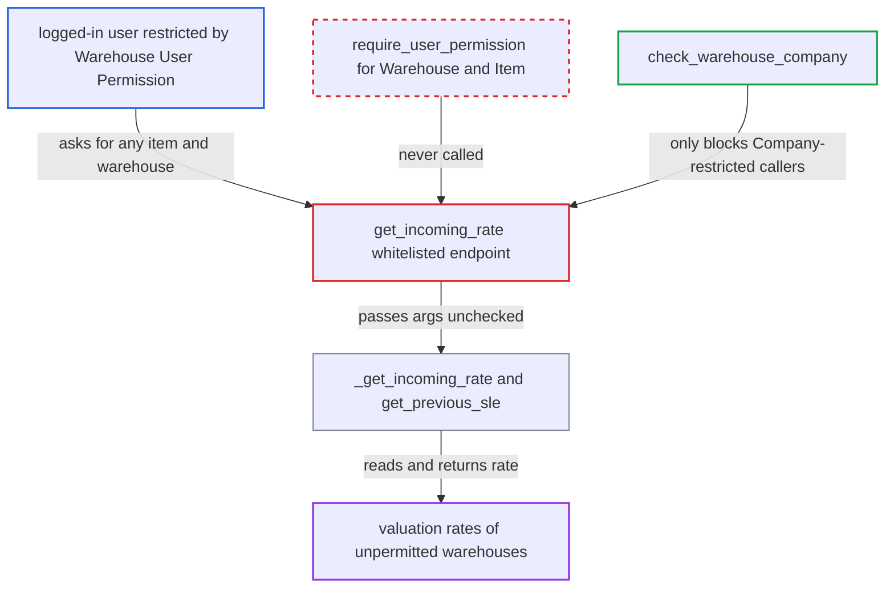

# get_incoming_rate discloses valuation rates of warehouses outside caller's User Permissions

| Field | Value |
|---|---|
| ID | `find_01RX1YCGewdhurknmYQ3Wxew` |
| Severity | **Medium** |
| Status | open |
| CWE | CWE-862 — Missing Authorization |
| Created | 2026-10-27T21:13:40.224582Z |
| Claude Security | https://claude.ai/security/findings/find_01RX1YCGewdhurknmYQ3Wxew |

## Description

Any logged-in user whose access is limited by Warehouse User Permissions can read the current and historical valuation (cost) rate of any item in any warehouse, including warehouses they are barred from. The user needs a role that grants Item `select`. The whitelisted `get_incoming_rate` never checks the requested `warehouse` or `item_code` against User Permissions. Only valuation rates leak, not quantities or documents.

1. **logged-in user** calls the whitelisted endpoint with a warehouse they are not permitted to see. The request goes to `/api/method/erpnext.stock.utils.get_incoming_rate` with `args` holding `item_code`, the unpermitted `warehouse`, `posting_date`, `posting_time` and `qty` set to -1. ([`erpnext/stock/utils.py:347-361`](https://github.com/cx-benchmark/erpnext/blob/90e7aefca73da3c440d2e8da7472fcb67838e678/erpnext/stock/utils.py#L347-L361))
2. **the function `get_incoming_rate`** runs only two checks and lets the call through. It checks Item `select` at doctype level and calls `check_warehouse_company`. It does not check Warehouse or Item User Permissions. ([`erpnext/stock/utils.py:347-361`](https://github.com/cx-benchmark/erpnext/blob/90e7aefca73da3c440d2e8da7472fcb67838e678/erpnext/stock/utils.py#L347-L361))
3. **the function `check_warehouse_company`** does nothing for this caller. It blocks only callers whose Company User Permissions apply to Item, and it never looks at Warehouse User Permissions. ([`erpnext/stock/utils.py:101-114`](https://github.com/cx-benchmark/erpnext/blob/90e7aefca73da3c440d2e8da7472fcb67838e678/erpnext/stock/utils.py#L101-L114))
4. **the function `_get_incoming_rate`** computes the rate for the caller's item, warehouse and date. It takes the previous Stock Ledger Entry and returns the FIFO/LIFO queue rate or the moving-average `valuation_rate`. It falls back to `get_valuation_rate`. ([`erpnext/stock/utils.py:455-487`](https://github.com/cx-benchmark/erpnext/blob/90e7aefca73da3c440d2e8da7472fcb67838e678/erpnext/stock/utils.py#L455-L487))
5. **the function `get_previous_sle`** reads the ledger entry with raw SQL. The query is filtered by the caller's `item_code` and `warehouse`, and no User Permission filter is applied. ([`erpnext/stock/stock_ledger.py:2497-2515`](https://github.com/cx-benchmark/erpnext/blob/90e7aefca73da3c440d2e8da7472fcb67838e678/erpnext/stock/stock_ledger.py#L2497-L2515))
6. **the endpoint** returns the cost rate as a float to the caller. The caller can repeat this for other items, warehouses and dates to list the rates.

## Assessment

The attacker is any authenticated desk user whose role grants Item `select` (sales, purchase, stock and accounts roles) and whose access is limited by Warehouse User Permissions. They call the whitelisted method through `/api/method`, which any logged-in user can reach. Company-restricted users are still blocked by `check_warehouse_company`, but only when their Company permission applies to Item. The project guards the same data in `get_stock_balance` and in `get_item_details.get_valuation_rate`, and a test in `erpnext/stock/tests/test_utils.py` expects a Stock User scoped to one warehouse to be refused another warehouse's rate.

Impact: The attacker can read the current and historical valuation (cost) rate for any item, date, batch or serial in warehouses they are restricted from. They can enumerate these across items and warehouses. The call is read-only: quantities, ledgers and documents are not exposed and nothing is modified.

## Recommendation

The whitelisted `get_incoming_rate` authorizes the Item doctype and Company-restricted callers. It does not check the caller-chosen `warehouse` or `item_code` against User Permissions, so warehouse-scoped users read rates they are denied elsewhere.

Fix criteria: The whitelisted entry raises PermissionError when the caller's User Permissions do not allow `args.warehouse` or `args.item_code`, matching `get_stock_balance`. A user with a Warehouse User Permission for WH-A who calls `get_incoming_rate` with `warehouse=WH-B` gets a permission error and no rate. In-process callers of `_get_incoming_rate` behave as before.

## Evidence

**https://github.com/cx-benchmark/erpnext**

- [`erpnext/stock/utils.py:347-361`](https://github.com/cx-benchmark/erpnext/blob/90e7aefca73da3c440d2e8da7472fcb67838e678/erpnext/stock/utils.py#L347-L361)
- [`erpnext/stock/utils.py:101-114`](https://github.com/cx-benchmark/erpnext/blob/90e7aefca73da3c440d2e8da7472fcb67838e678/erpnext/stock/utils.py#L101-L114)
- [`erpnext/stock/utils.py:455-487`](https://github.com/cx-benchmark/erpnext/blob/90e7aefca73da3c440d2e8da7472fcb67838e678/erpnext/stock/utils.py#L455-L487)
- [`erpnext/stock/stock_ledger.py:2497-2515`](https://github.com/cx-benchmark/erpnext/blob/90e7aefca73da3c440d2e8da7472fcb67838e678/erpnext/stock/stock_ledger.py#L2497-L2515)
- [`erpnext/stock/stock_ledger.py:2652-2700`](https://github.com/cx-benchmark/erpnext/blob/90e7aefca73da3c440d2e8da7472fcb67838e678/erpnext/stock/stock_ledger.py#L2652-L2700)
- [`erpnext/stock/utils.py:117-130`](https://github.com/cx-benchmark/erpnext/blob/90e7aefca73da3c440d2e8da7472fcb67838e678/erpnext/stock/utils.py#L117-L130)
- [`erpnext/stock/get_item_details.py:1958-1969`](https://github.com/cx-benchmark/erpnext/blob/90e7aefca73da3c440d2e8da7472fcb67838e678/erpnext/stock/get_item_details.py#L1958-L1969)
- [`erpnext/stock/tests/test_utils.py:321-326`](https://github.com/cx-benchmark/erpnext/blob/90e7aefca73da3c440d2e8da7472fcb67838e678/erpnext/stock/tests/test_utils.py#L321-L326)
- [`erpnext/__init__.py:206-224`](https://github.com/cx-benchmark/erpnext/blob/90e7aefca73da3c440d2e8da7472fcb67838e678/erpnext/__init__.py#L206-L224)

