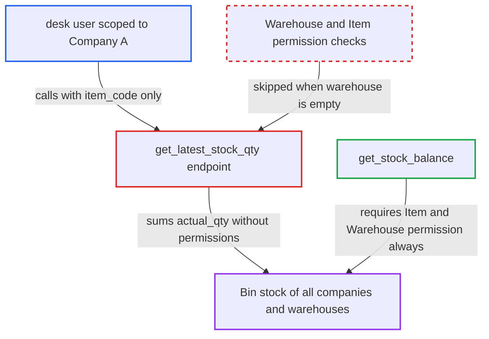

# get_latest_stock_qty without warehouse returns stock across all companies and warehouses

| Field | Value |
|---|---|
| ID | `find_013LdHgDHi3xd8hNmLy62X69` |
| Severity | **Medium** |
| Status | open |
| CWE | CWE-862 — Missing Authorization |
| Created | 2026-10-27T21:15:50.384751Z |
| Claude Security | https://claude.ai/security/findings/find_013LdHgDHi3xd8hNmLy62X69 |

## Description

A logged-in desk user limited to one company or warehouse can read the total on-hand quantity of any item across all companies and warehouses. This works when the user has Item read and calls the endpoint without a warehouse. The whitelisted `get_latest_stock_qty` only checks warehouse permissions when `warehouse` is given, and it never checks `item_code` at record level.

1. **authenticated desk user** calls `/api/method/erpnext.stock.utils.get_latest_stock_qty` with only `item_code`. The user holds Item read, is scoped by Company or Warehouse User Permissions, and leaves `warehouse` out or empty. ([`erpnext/stock/utils.py:225-241`](https://github.com/cx-benchmark/erpnext/blob/90e7aefca73da3c440d2e8da7472fcb67838e678/erpnext/stock/utils.py#L225-L241))
2. **the endpoint `get_latest_stock_qty`** checks only doctype-level Item read. The Warehouse permission check runs only `if warehouse:`, and `item_code` is never checked against Item User Permissions or the Item Company Restriction hook. ([`erpnext/stock/utils.py:225-241`](https://github.com/cx-benchmark/erpnext/blob/90e7aefca73da3c440d2e8da7472fcb67838e678/erpnext/stock/utils.py#L225-L241))
3. **the helper `check_warehouse_company`** returns at once for the empty warehouse. The caller's Company restriction is therefore never applied. ([`erpnext/stock/utils.py:101-114`](https://github.com/cx-benchmark/erpnext/blob/90e7aefca73da3c440d2e8da7472fcb67838e678/erpnext/stock/utils.py#L101-L114))
4. **the endpoint `get_latest_stock_qty`** returns `SUM(Bin.actual_qty)` for the item over every warehouse. The query goes through `frappe.qb`, which applies no permissions, so the sum covers all companies. ([`erpnext/stock/utils.py:225-241`](https://github.com/cx-benchmark/erpnext/blob/90e7aefca73da3c440d2e8da7472fcb67838e678/erpnext/stock/utils.py#L225-L241))
5. **authenticated desk user** subtracts their own company's total from the result. The difference is the stock held by companies they are isolated from.

## Assessment

The attacker is an authenticated desk user with Item read, for example a Stock, Sales, Purchase, Accounts, Maintenance or Manufacturing User. Their access is scoped by Company or Warehouse User Permissions. They send the request with `item_code` set to any item, including items restricted to other companies, and with `warehouse` omitted or empty. They can repeat this for any item code. Some of these roles have no `Bin` read at all, so they could not get this data through `/api/resource/Bin`.

Impact: The attacker learns each item's combined on-hand quantity across companies and warehouses they are isolated from. Subtracting their own company's total gives the other companies' holdings. This is read-only. It exposes no valuation and no per-warehouse breakdown, and nothing is modified.

## Recommendation

The whitelisted `get_latest_stock_qty` checks Warehouse and Company permissions only when `warehouse` is supplied, and never authorises `item_code` at record level. Omitting the warehouse gives an unscoped `Bin` sum over all companies.

Fix criteria: The entry point returns no quantities for warehouses, companies or items outside the caller's User Permissions and Company restrictions. It either refuses an empty warehouse, as `get_stock_balance` does, or limits the sum to permitted warehouses. It also authorises the item at record level. A user restricted to Company A, or to warehouse WH-A, who calls it with only `item_code` gets an error or a sum over permitted warehouses only. The shipped callers that pass a permitted warehouse keep working.

## Evidence

**https://github.com/cx-benchmark/erpnext**

- [`erpnext/stock/utils.py:225-241`](https://github.com/cx-benchmark/erpnext/blob/90e7aefca73da3c440d2e8da7472fcb67838e678/erpnext/stock/utils.py#L225-L241)
- [`erpnext/stock/utils.py:101-114`](https://github.com/cx-benchmark/erpnext/blob/90e7aefca73da3c440d2e8da7472fcb67838e678/erpnext/stock/utils.py#L101-L114)
- [`erpnext/stock/utils.py:117-130`](https://github.com/cx-benchmark/erpnext/blob/90e7aefca73da3c440d2e8da7472fcb67838e678/erpnext/stock/utils.py#L117-L130)
- [`erpnext/__init__.py:206-224`](https://github.com/cx-benchmark/erpnext/blob/90e7aefca73da3c440d2e8da7472fcb67838e678/erpnext/__init__.py#L206-L224)
- [`erpnext/accounts/doctype/pricing_rule/pricing_rule.py:784-790`](https://github.com/cx-benchmark/erpnext/blob/90e7aefca73da3c440d2e8da7472fcb67838e678/erpnext/accounts/doctype/pricing_rule/pricing_rule.py#L784-L790)

