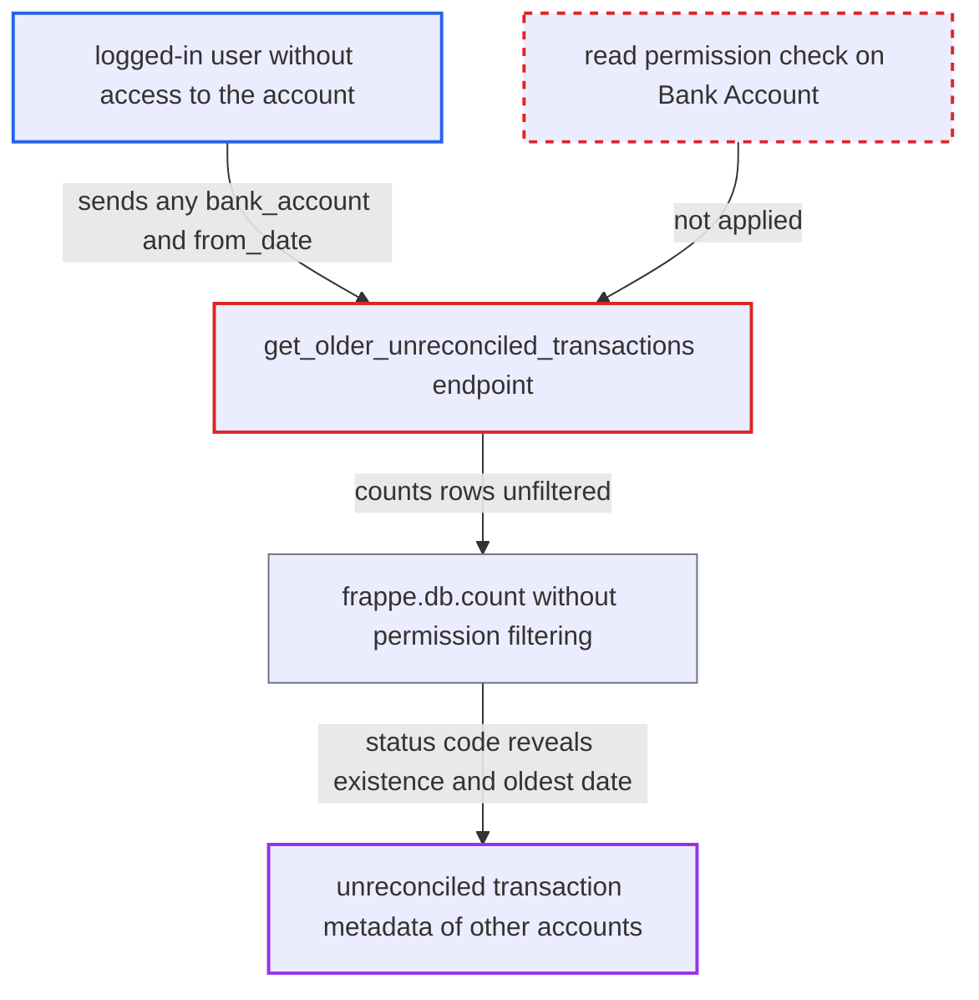

# get_older_unreconciled_transactions counts bank transactions of any bank account without permission check

| Field | Value |
|---|---|
| ID | `find_01QGujVW3zLTe8JLU8o9TZmF` |
| Severity | **Medium** |
| Status | open |
| CWE | CWE-862 — Missing Authorization |
| Created | 2026-10-27T21:23:00.777800Z |
| Claude Security | https://claude.ai/security/findings/find_01QGujVW3zLTe8JLU8o9TZmF |

## Description

Any logged-in user can learn whether a bank account they may not read has unreconciled bank transactions before a chosen date. By repeating the request, they can find the exact date of the oldest one. Only metadata leaks, not amounts, descriptions or parties. The cause is the whitelisted method `get_older_unreconciled_transactions`. It never checks read permission on the `bank_account` it receives, and it counts rows with `frappe.db.count`, which applies no permissions.

1. **logged-in user** sends a GET request to the `get_older_unreconciled_transactions` endpoint. The request names a `bank_account` the user may not read and a `from_date`. Bank Account names follow a predictable pattern, `account_name + " - " + bank`. ([`erpnext/accounts/doctype/bank_reconciliation_tool/bank_reconciliation_tool.py:424-454`](https://github.com/cx-benchmark/erpnext/blob/90e7aefca73da3c440d2e8da7472fcb67838e678/erpnext/accounts/doctype/bank_reconciliation_tool/bank_reconciliation_tool.py#L424-L454))
2. **the method `get_older_unreconciled_transactions`** counts submitted Bank Transactions with `unallocated_amount > 0` before `from_date`. The count uses `frappe.db.count`. The report assumes this call ignores roles and User Permissions, and no check on the Bank Account runs first. ([`erpnext/accounts/doctype/bank_reconciliation_tool/bank_reconciliation_tool.py:424-454`](https://github.com/cx-benchmark/erpnext/blob/90e7aefca73da3c440d2e8da7472fcb67838e678/erpnext/accounts/doctype/bank_reconciliation_tool/bank_reconciliation_tool.py#L424-L454))
3. **the method `get_older_unreconciled_transactions`** calls the permission-aware `frappe.db.get_list` only when the count is above zero. For a caller without permission, this raises `PermissionError` (403) if the caller has no Bank Transaction read role. It returns an empty list if User Permissions hide the rows, so `oldest_transaction[0]` raises `IndexError` (500). ([`erpnext/accounts/doctype/bank_reconciliation_tool/bank_reconciliation_tool.py:424-454`](https://github.com/cx-benchmark/erpnext/blob/90e7aefca73da3c440d2e8da7472fcb67838e678/erpnext/accounts/doctype/bank_reconciliation_tool/bank_reconciliation_tool.py#L424-L454))
4. **logged-in user** reads the status code to tell whether unreconciled transactions exist before `from_date`. A 200 reply with `{count: 0, oldest_date: None}` means none exist. A 403 or 500 means some do. ([`erpnext/accounts/doctype/bank_reconciliation_tool/bank_reconciliation_tool.py:424-454`](https://github.com/cx-benchmark/erpnext/blob/90e7aefca73da3c440d2e8da7472fcb67838e678/erpnext/accounts/doctype/bank_reconciliation_tool/bank_reconciliation_tool.py#L424-L454))
5. **logged-in user** repeats the request with different `from_date` values in a binary search. This narrows the search to the exact date of the oldest unreconciled transaction.

## Assessment

The attacker is any logged-in user. Examples are an Accounts User restricted to Company A, or a Sales User with no Bank Transaction role. They need no special setting and no victim. They send a GET request to `/api/method/erpnext.accounts.doctype.bank_reconciliation_tool.bank_reconciliation_tool.get_older_unreconciled_transactions` with `bank_account` and `from_date`. The report assumes Frappe `>=17.0.0-dev,<18`, which is pinned in `pyproject.toml` and not in the checkout, where `frappe.db.count` ignores permissions. A caller who passes the list check but whose User Permissions hide some matching rows also gets the raw, unfiltered `count`.

Impact: The attacker learns whether accounts they may not read have unreconciled transactions before a given date, and the date of the oldest one. Partly permitted callers also get the unfiltered count. Amounts, descriptions and parties stay hidden, and nothing is modified.

## Recommendation

The endpoint trusts the caller-supplied `bank_account` and counts with the permission-bypassing `frappe.db.count`. It does not check the caller's permission on the Bank Account first. Cross-company transaction metadata leaks through the count and through the differing error behaviour.

Fix criteria: The method checks `read` permission on the supplied Bank Account before querying, and throws a permission error otherwise. The count uses the same permission filtering as the list query, or is derived from the permitted list, so no unauthorised row influences the response. To verify, call it as a company-restricted user with another company's bank account. The result must be a permission error whether or not that account has transactions.

## Evidence

**https://github.com/cx-benchmark/erpnext**

- [`erpnext/accounts/doctype/bank_reconciliation_tool/bank_reconciliation_tool.py:424-454`](https://github.com/cx-benchmark/erpnext/blob/90e7aefca73da3c440d2e8da7472fcb67838e678/erpnext/accounts/doctype/bank_reconciliation_tool/bank_reconciliation_tool.py#L424-L454)
- [`erpnext/accounts/doctype/bank_reconciliation_tool/bank_reconciliation_tool.py:104-108`](https://github.com/cx-benchmark/erpnext/blob/90e7aefca73da3c440d2e8da7472fcb67838e678/erpnext/accounts/doctype/bank_reconciliation_tool/bank_reconciliation_tool.py#L104-L108)

