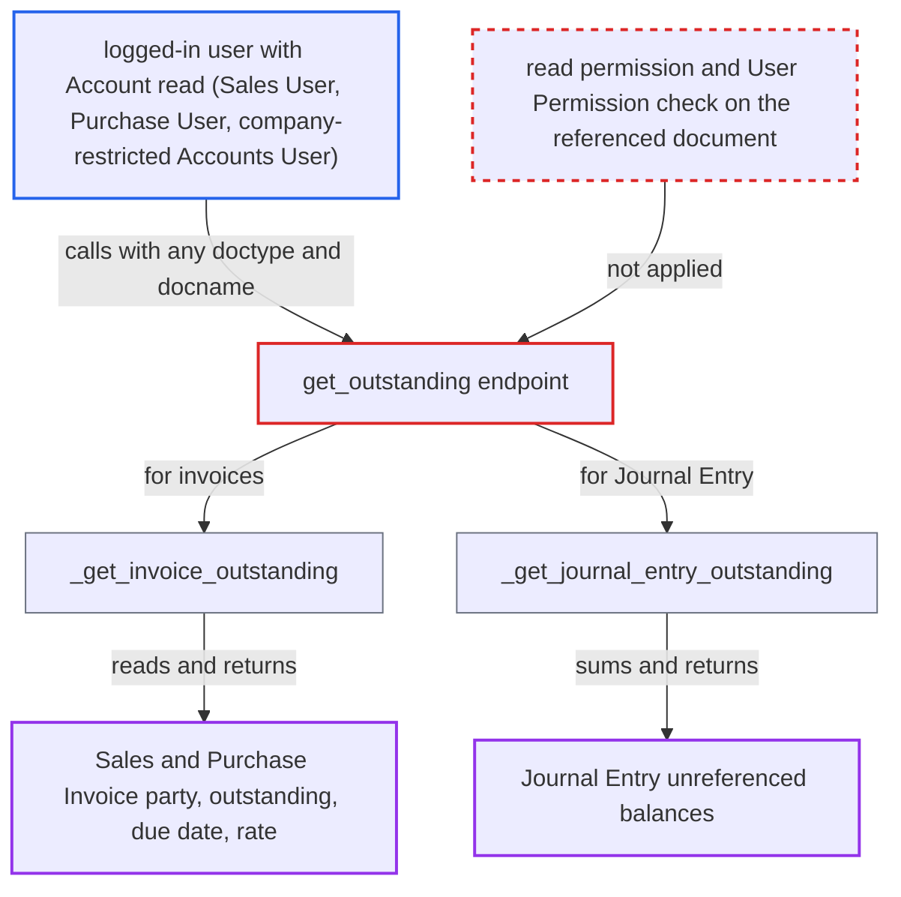

# get_outstanding leaks any invoice's party, outstanding and due date across companies

| Field | Value |
|---|---|
| ID | `find_01Xi7aF6BCdtkRyd42EHnamA` |
| Severity | **Medium** |
| Status | open |
| CWE | CWE-639 — Insecure Direct Object Reference |
| Created | 2026-10-27T21:18:10.628899Z |
| Claude Security | https://claude.ai/security/findings/find_01Xi7aF6BCdtkRyd42EHnamA |

## Description

Any logged-in user whose role can read `Account` can read other people's invoice data. That covers a Sales User, a Purchase User, or an Accounts User limited to one company. They get the customer or supplier, the outstanding amount, the due date and the exchange rate of invoices they may not see, and balances of Journal Entries. The endpoint `get_outstanding` checks only `frappe.has_permission("Account")`, then reads the named document with no permission check.

1. **attacker (logged-in desk user)** calls the `get_outstanding` endpoint with a chosen `doctype` and `docname`. The request also carries any company and `account_currency`, and `doctype` is `Sales Invoice`, `Purchase Invoice` or `Journal Entry`. ([`erpnext/accounts/doctype/journal_entry/journal_entry.py:1143-1176`](https://github.com/cx-benchmark/erpnext/blob/90e7aefca73da3c440d2e8da7472fcb67838e678/erpnext/accounts/doctype/journal_entry/journal_entry.py#L1143-L1176))
2. **the endpoint `get_outstanding`** checks only that the caller can read the `Account` doctype. This check says nothing about the referenced document, and `Account` read is granted to Accounts User, Accounts Manager, Auditor, Sales User and Purchase User. ([`erpnext/accounts/doctype/journal_entry/journal_entry.py:1143-1176`](https://github.com/cx-benchmark/erpnext/blob/90e7aefca73da3c440d2e8da7472fcb67838e678/erpnext/accounts/doctype/journal_entry/journal_entry.py#L1143-L1176))
3. **the endpoint `get_outstanding`** unpacks `doctype` and `docname` from the named parameters or from the legacy `args` JSON. The legacy `args` path has no type checks, so `docname` can be a filter dict, which lets the attacker find invoices by other fields instead of guessing names. ([`erpnext/accounts/doctype/journal_entry/journal_entry.py:1143-1176`](https://github.com/cx-benchmark/erpnext/blob/90e7aefca73da3c440d2e8da7472fcb67838e678/erpnext/accounts/doctype/journal_entry/journal_entry.py#L1143-L1176))
4. **the helper `_get_invoice_outstanding`** reads the invoice with `frappe.db.get_value` and returns the values. It returns `outstanding_amount`, `conversion_rate`, `customer` or `supplier`, and `due_date`, and `frappe.db.get_value` applies no role permission or Company User Permission. ([`erpnext/accounts/doctype/journal_entry/journal_entry.py:1200-1229`](https://github.com/cx-benchmark/erpnext/blob/90e7aefca73da3c440d2e8da7472fcb67838e678/erpnext/accounts/doctype/journal_entry/journal_entry.py#L1200-L1229))
5. **the helper `_get_journal_entry_outstanding`** sums debit and credit for the named entry, account and party through `frappe.qb`, for a `Journal Entry` request. This helper has no permission check on that Journal Entry either. ([`erpnext/accounts/doctype/journal_entry/journal_entry.py:1179-1197`](https://github.com/cx-benchmark/erpnext/blob/90e7aefca73da3c440d2e8da7472fcb67838e678/erpnext/accounts/doctype/journal_entry/journal_entry.py#L1179-L1197))
6. **attacker** repeats the call over predictable invoice names. Names follow the series `ACC-SINV-.YYYY.-` and `ACC-PINV-.YYYY.-`, so sequential names can be walked, for example `ACC-SINV-2025-00001`.

## Assessment

The attacker is any logged-in desk user whose role can read `Account`. Examples are a Sales User, a Purchase User, or an Accounts User restricted by User Permission to Company A. They send a request to `/api/method/erpnext.accounts.doctype.journal_entry.journal_entry.get_outstanding` with `doctype` set to `Sales Invoice` or `Purchase Invoice`, a `docname`, and any company and `account_currency`. No victim action is needed. A Purchase User has no read right on Sales Invoice. A Sales User has no read right on either invoice type or on Journal Entry. Both can still read them this way. The legacy `args` JSON is a second way in, and there `docname` can be a filter dict.

Impact: The attacker reads the counterparty, outstanding balance, due date and exchange rate of any Sales or Purchase Invoice. They also read the unreferenced balance of any Journal Entry, account and party. This works across companies and for roles with no read right on those doctypes. The leak is limited to these fields, and the report describes no write path.

## Recommendation

`get_outstanding` authorizes against the `Account` doctype instead of the referenced document. It then reads that document with permission-free `frappe.db.get_value` and `frappe.qb`, so role permissions and Company User Permissions on the invoice or journal are never applied. `docname` is also not checked to be a plain string, and `doctype` is not limited to a supported set.

Fix criteria: Before returning anything, the endpoint confirms the caller can read the specific referenced document, honouring User Permissions. `docname` must be a plain string name, and `doctype` is limited to the supported set. A Sales User gets a permission error and no fields. So does a Purchase User asking for a Sales Invoice. So does a user restricted to Company A asking for a Company B invoice or Journal Entry.

## Evidence

**https://github.com/cx-benchmark/erpnext**

- [`erpnext/accounts/doctype/journal_entry/journal_entry.py:1200-1229`](https://github.com/cx-benchmark/erpnext/blob/90e7aefca73da3c440d2e8da7472fcb67838e678/erpnext/accounts/doctype/journal_entry/journal_entry.py#L1200-L1229)
- [`erpnext/accounts/doctype/journal_entry/journal_entry.py:1143-1176`](https://github.com/cx-benchmark/erpnext/blob/90e7aefca73da3c440d2e8da7472fcb67838e678/erpnext/accounts/doctype/journal_entry/journal_entry.py#L1143-L1176)
- [`erpnext/accounts/doctype/journal_entry/journal_entry.py:1179-1197`](https://github.com/cx-benchmark/erpnext/blob/90e7aefca73da3c440d2e8da7472fcb67838e678/erpnext/accounts/doctype/journal_entry/journal_entry.py#L1179-L1197)
- [`erpnext/accounts/doctype/account/account.json`](https://github.com/cx-benchmark/erpnext/blob/90e7aefca73da3c440d2e8da7472fcb67838e678/erpnext/accounts/doctype/account/account.json)

