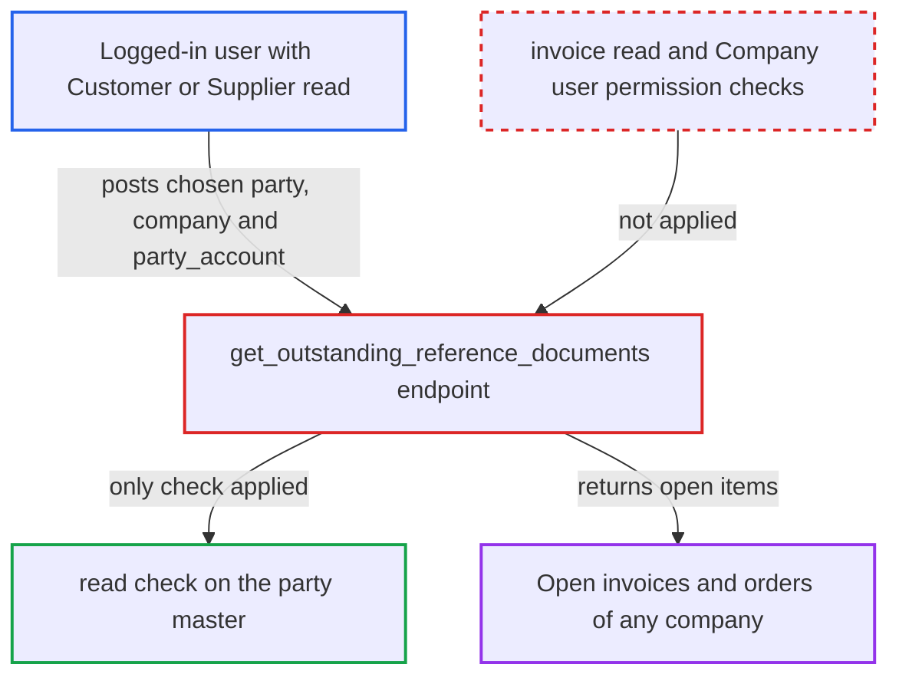

# get_outstanding_reference_documents returns any company's open invoices to anyone who can read the party

| Field | Value |
|---|---|
| ID | `find_01MLLXhdCQPwS4HwWFgoTek8` |
| Severity | **Medium** |
| Status | open |
| CWE | CWE-863 — Incorrect Authorization |
| Created | 2026-10-27T21:23:41.019665Z |
| Claude Security | https://claude.ai/security/findings/find_01MLLXhdCQPwS4HwWFgoTek8 |

## Description

A logged-in desk user can read other companies' open receivables and payables, and can read them even when their role is denied invoice access. The data is invoice and order numbers, amounts, outstanding amounts and due dates. The attacker needs only read access to a Customer or Supplier, such as a Stock User or Sales User. The whitelisted `get_outstanding_reference_documents` checks only read on the party and never checks the invoices, the ledger or the `company` it returns data for.

1. **attacker** lists customers or suppliers they may read. Roles such as Sales User, Sales Manager, Sales Master Manager, Stock User and Stock Manager can read Customer, and Stock roles and Purchase Master Manager can read Supplier, but they cannot read Sales or Purchase Invoice. ([`erpnext/selling/doctype/customer/customer.json:821-884`](https://github.com/cx-benchmark/erpnext/blob/90e7aefca73da3c440d2e8da7472fcb67838e678/erpnext/selling/doctype/customer/customer.json#L821-L884))
2. **attacker** posts `args` to `/api/method/erpnext.accounts.doctype.payment_entry.payment_entry.get_outstanding_reference_documents`. The `args` hold `party_type`, `party`, `party_account`, `company`, `get_outstanding_invoices` and `get_orders_to_be_billed`, and the attacker chooses the `company` and `party_account`. ([`erpnext/accounts/doctype/payment_entry/payment_entry.py:2131-2140`](https://github.com/cx-benchmark/erpnext/blob/90e7aefca73da3c440d2e8da7472fcb67838e678/erpnext/accounts/doctype/payment_entry/payment_entry.py#L2131-L2140))
3. **the endpoint `get_outstanding_reference_documents`** checks only that the caller can read the party. The `frappe.has_permission(args['party_type'], 'read', party)` check passes for the attacker, and no check on Payment Entry, the invoice doctypes, Payment Ledger Entry or the `company` follows. ([`erpnext/accounts/doctype/payment_entry/payment_entry.py:2131-2140`](https://github.com/cx-benchmark/erpnext/blob/90e7aefca73da3c440d2e8da7472fcb67838e678/erpnext/accounts/doctype/payment_entry/payment_entry.py#L2131-L2140))
4. **the endpoint `get_outstanding_reference_documents`** builds its filters straight from the caller's `args` and queries the data. It calls `get_outstanding_invoices`, `get_negative_outstanding_invoices` and `get_orders_to_be_billed`, and none of them applies permission conditions. ([`erpnext/accounts/doctype/payment_entry/payment_entry.py:2155-2270`](https://github.com/cx-benchmark/erpnext/blob/90e7aefca73da3c440d2e8da7472fcb67838e678/erpnext/accounts/doctype/payment_entry/payment_entry.py#L2155-L2270))
5. **`get_outstanding_invoices`** reads Payment Ledger Entry rows for the party, account and company. The query adds no user-permission match conditions, unlike the Accounts Receivable report, which applies `build_qb_match_conditions('Payment Ledger Entry')`. ([`erpnext/accounts/utils.py:1270-1346`](https://github.com/cx-benchmark/erpnext/blob/90e7aefca73da3c440d2e8da7472fcb67838e678/erpnext/accounts/utils.py#L1270-L1346))
6. **the endpoint `get_outstanding_reference_documents`** returns the open items to the attacker. The rows hold voucher numbers, invoice amounts, outstanding amounts, posting and due dates, the account, supplier `bill_no` and exchange rates. ([`erpnext/accounts/doctype/payment_entry/payment_entry.py:2155-2270`](https://github.com/cx-benchmark/erpnext/blob/90e7aefca73da3c440d2e8da7472fcb67838e678/erpnext/accounts/doctype/payment_entry/payment_entry.py#L2155-L2270))

## Assessment

The attacker is an authenticated desk user who can read a Customer or Supplier, for example a Stock User or Sales User. A second attacker is an Accounts User limited to one company by user permissions. Both work with the default configuration and need no victim. The attacker lists the parties they can read and posts `args` with `party_type`, `party`, `party_account` (for example 'Debtors - X'), `company` and the flags `get_outstanding_invoices` and `get_orders_to_be_billed` set to 1. A company-restricted user also passes the party check for any customer or supplier not marked `restrict_to_companies`, because the `has_permission` hook in `company_restriction.py` returns True for it. That user can pass another company's `company` and `party_account` and read that company's ledger items for the party.

Impact: The attacker reads open receivables and payables, with invoice and order numbers, totals, outstanding amounts, due dates and supplier bill numbers. This covers any party they can read in any company, including companies they are restricted from. The data is read-only summary data of open items, with no line items or full documents, and nothing is written.

## Recommendation

The endpoint authorizes on the party master instead of on the financial data and the company it returns. Role permissions on Sales/Purchase Invoice, Payment Ledger Entry and Payment Entry, and Company user permissions, are never applied to the caller-supplied `company` and `party_account` or to the returned rows.

Fix criteria: The method requires at least Payment Entry access, plus read on the `company` in `args` with user permissions honoured. It rejects a `party_account` that does not belong to that company. The ledger, invoice and order rows are filtered by the caller's user permissions. A Stock User or Sales User (Customer read, no Sales Invoice read) gets a permission error or no rows. An Accounts User limited to Company A who asks for Company B also gets a permission error or no rows.

## Evidence

**https://github.com/cx-benchmark/erpnext**

- [`erpnext/accounts/doctype/payment_entry/payment_entry.py:2131-2140`](https://github.com/cx-benchmark/erpnext/blob/90e7aefca73da3c440d2e8da7472fcb67838e678/erpnext/accounts/doctype/payment_entry/payment_entry.py#L2131-L2140)
- [`erpnext/accounts/doctype/payment_entry/payment_entry.py:2155-2270`](https://github.com/cx-benchmark/erpnext/blob/90e7aefca73da3c440d2e8da7472fcb67838e678/erpnext/accounts/doctype/payment_entry/payment_entry.py#L2155-L2270)
- [`erpnext/accounts/utils.py:1270-1346`](https://github.com/cx-benchmark/erpnext/blob/90e7aefca73da3c440d2e8da7472fcb67838e678/erpnext/accounts/utils.py#L1270-L1346)
- [`erpnext/accounts/doctype/payment_entry/payment_entry.py:2391-2537`](https://github.com/cx-benchmark/erpnext/blob/90e7aefca73da3c440d2e8da7472fcb67838e678/erpnext/accounts/doctype/payment_entry/payment_entry.py#L2391-L2537)
- [`erpnext/selling/doctype/customer/customer.json:821-884`](https://github.com/cx-benchmark/erpnext/blob/90e7aefca73da3c440d2e8da7472fcb67838e678/erpnext/selling/doctype/customer/customer.json#L821-L884)
- [`erpnext/accounts/doctype/sales_invoice/sales_invoice.json:2418-2456`](https://github.com/cx-benchmark/erpnext/blob/90e7aefca73da3c440d2e8da7472fcb67838e678/erpnext/accounts/doctype/sales_invoice/sales_invoice.json#L2418-L2456)
- [`erpnext/accounts/party.py:954-957`](https://github.com/cx-benchmark/erpnext/blob/90e7aefca73da3c440d2e8da7472fcb67838e678/erpnext/accounts/party.py#L954-L957)
- [`erpnext/accounts/report/accounts_receivable/accounts_receivable.py:894-895`](https://github.com/cx-benchmark/erpnext/blob/90e7aefca73da3c440d2e8da7472fcb67838e678/erpnext/accounts/report/accounts_receivable/accounts_receivable.py#L894-L895)
- [`erpnext/stock/doctype/company_restriction/company_restriction.py`](https://github.com/cx-benchmark/erpnext/blob/90e7aefca73da3c440d2e8da7472fcb67838e678/erpnext/stock/doctype/company_restriction/company_restriction.py)

