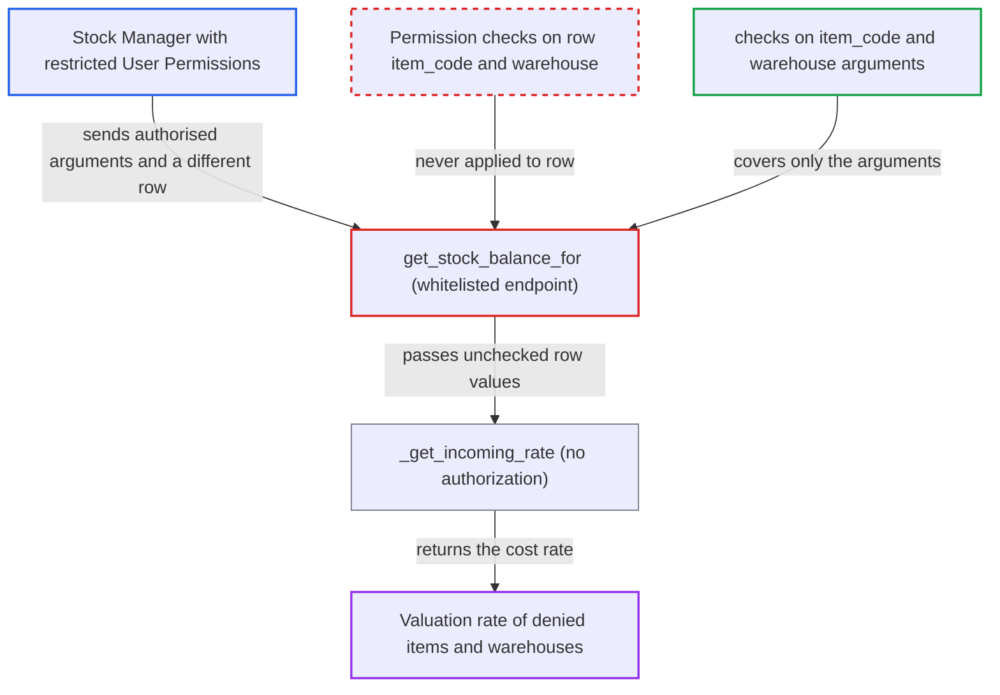

# get_stock_balance_for authorises argument item/warehouse but returns valuation rate of caller-chosen row values

| Field | Value |
|---|---|
| ID | `find_01CdNwHXZGw15sJjpZdAcHxm` |
| Severity | **Medium** |
| Status | open |
| CWE | CWE-863 — Incorrect Authorization |
| Created | 2026-10-27T21:20:02.002960Z |
| Claude Security | https://claude.ai/security/findings/find_01CdNwHXZGw15sJjpZdAcHxm |

## Description

A Stock Manager whose User Permissions limit them to certain warehouses or items can read the valuation (cost) rate of any item in any warehouse, including ones they are denied. Quantities are not exposed and nothing is changed. The cause is the whitelisted `get_stock_balance_for`. It checks only its `item_code` and `warehouse` arguments, then prices the unchecked `row` argument.

1. **Stock Manager with restricted User Permissions** sends a request to `get_stock_balance_for` with a mismatched `row`. The `item_code` and `warehouse` arguments are ones the caller is allowed to use. The `row` names a denied item and warehouse, with a made-up `batch_no`, `use_serial_batch_fields` set to 1 and `current_qty` set to 1. ([`erpnext/stock/doctype/stock_reconciliation/stock_reconciliation.py:1832-1862`](https://github.com/cx-benchmark/erpnext/blob/90e7aefca73da3c440d2e8da7472fcb67838e678/erpnext/stock/doctype/stock_reconciliation/stock_reconciliation.py#L1832-L1862))
2. **the handler `get_stock_balance_for`** checks only the `item_code` and `warehouse` arguments. It checks Stock Reconciliation `write`, Item and Warehouse `read`, `_require_reconciliation_permission` and `check_warehouse_company`, all against the arguments. `row` is passed on unchecked. ([`erpnext/stock/doctype/stock_reconciliation/stock_reconciliation.py:1832-1862`](https://github.com/cx-benchmark/erpnext/blob/90e7aefca73da3c440d2e8da7472fcb67838e678/erpnext/stock/doctype/stock_reconciliation/stock_reconciliation.py#L1832-L1862))
3. **the function `_get_stock_balance_for`** parses `row` into a `frappe._dict` that the caller fully controls. Every field in `row` comes from the request, including its item, warehouse and batch. ([`erpnext/stock/doctype/stock_reconciliation/stock_reconciliation.py:1877-1880`](https://github.com/cx-benchmark/erpnext/blob/90e7aefca73da3c440d2e8da7472fcb67838e678/erpnext/stock/doctype/stock_reconciliation/stock_reconciliation.py#L1877-L1880))
4. **the function `_get_stock_balance_for`** calls `_get_incoming_rate` with `row.item_code`, `row.warehouse` and `row.batch_no`. This happens when `row.use_serial_batch_fields`, `row.batch_no` and either the batch qty or `row.current_qty` are truthy. The only check on these values is `check_warehouse_company(row.warehouse)`, which returns at once for users without Company User Permissions that apply to Item. ([`erpnext/stock/doctype/stock_reconciliation/stock_reconciliation.py:1949-1966`](https://github.com/cx-benchmark/erpnext/blob/90e7aefca73da3c440d2e8da7472fcb67838e678/erpnext/stock/doctype/stock_reconciliation/stock_reconciliation.py#L1949-L1966))
5. **the function `_get_incoming_rate`** returns the cost rate for the denied item and warehouse. It has no authorization of its own. A batch name that is not real or not valued batch-wise falls back to the pooled warehouse rate from the last Stock Ledger Entry. ([`erpnext/stock/utils.py:364-487`](https://github.com/cx-benchmark/erpnext/blob/90e7aefca73da3c440d2e8da7472fcb67838e678/erpnext/stock/utils.py#L364-L487))

## Assessment

The attacker is a Stock Manager, the only role with Stock Reconciliation `write`, whose User Permissions restrict them to some warehouses or items. They POST to `/api/method/erpnext.stock.doctype.stock_reconciliation.stock_reconciliation.get_stock_balance_for` with an authorised batched `item_code`, an authorised `warehouse`, and a crafted `row`. The `row` holds a denied item and warehouse, any `batch_no`, `use_serial_batch_fields` set to 1 and `current_qty` set to 1. No victim is involved. The shipped form in `stock_reconciliation.js` always sends a `row` that matches the arguments, so no legitimate use needs the mismatch.

Impact: The attacker reads the current or back-dated valuation (cost) rate of any item in warehouses, or of items, that their User Permissions deny. Each call returns one scalar, and the attacker can enumerate. Quantities from the denied warehouse are not returned, and nothing is modified.

## Recommendation

`get_stock_balance_for` authorises the `item_code` and `warehouse` arguments. But `_get_stock_balance_for` prices the unchecked `row.item_code`, `row.warehouse` and `row.batch_no` through the unguarded `_get_incoming_rate`. This breaks the User Permission isolation the wrapper is meant to enforce.

Fix criteria: The returned value is computed only for an item and warehouse the caller is authorised for. Either the row's item and warehouse equal the authorised arguments and a mismatch is rejected, or they pass the same `read`, `_require_reconciliation_permission` and company checks. To verify, a Stock Manager restricted to WH-A who sends a `row` naming WH-B or a denied item gets a PermissionError, not a rate.

## Evidence

**https://github.com/cx-benchmark/erpnext**

- [`erpnext/stock/doctype/stock_reconciliation/stock_reconciliation.py:1949-1966`](https://github.com/cx-benchmark/erpnext/blob/90e7aefca73da3c440d2e8da7472fcb67838e678/erpnext/stock/doctype/stock_reconciliation/stock_reconciliation.py#L1949-L1966)
- [`erpnext/stock/doctype/stock_reconciliation/stock_reconciliation.py:1832-1862`](https://github.com/cx-benchmark/erpnext/blob/90e7aefca73da3c440d2e8da7472fcb67838e678/erpnext/stock/doctype/stock_reconciliation/stock_reconciliation.py#L1832-L1862)
- [`erpnext/stock/doctype/stock_reconciliation/stock_reconciliation.py:1877-1880`](https://github.com/cx-benchmark/erpnext/blob/90e7aefca73da3c440d2e8da7472fcb67838e678/erpnext/stock/doctype/stock_reconciliation/stock_reconciliation.py#L1877-L1880)
- [`erpnext/stock/doctype/stock_reconciliation/stock_reconciliation.py:1988-1997`](https://github.com/cx-benchmark/erpnext/blob/90e7aefca73da3c440d2e8da7472fcb67838e678/erpnext/stock/doctype/stock_reconciliation/stock_reconciliation.py#L1988-L1997)
- [`erpnext/stock/utils.py:101-114`](https://github.com/cx-benchmark/erpnext/blob/90e7aefca73da3c440d2e8da7472fcb67838e678/erpnext/stock/utils.py#L101-L114)
- [`erpnext/stock/utils.py:364-487`](https://github.com/cx-benchmark/erpnext/blob/90e7aefca73da3c440d2e8da7472fcb67838e678/erpnext/stock/utils.py#L364-L487)
- [`erpnext/stock/deprecated_serial_batch.py:271-296`](https://github.com/cx-benchmark/erpnext/blob/90e7aefca73da3c440d2e8da7472fcb67838e678/erpnext/stock/deprecated_serial_batch.py#L271-L296)
- [`erpnext/stock/doctype/stock_reconciliation/stock_reconciliation.js:198-212`](https://github.com/cx-benchmark/erpnext/blob/90e7aefca73da3c440d2e8da7472fcb67838e678/erpnext/stock/doctype/stock_reconciliation/stock_reconciliation.js#L198-L212)

