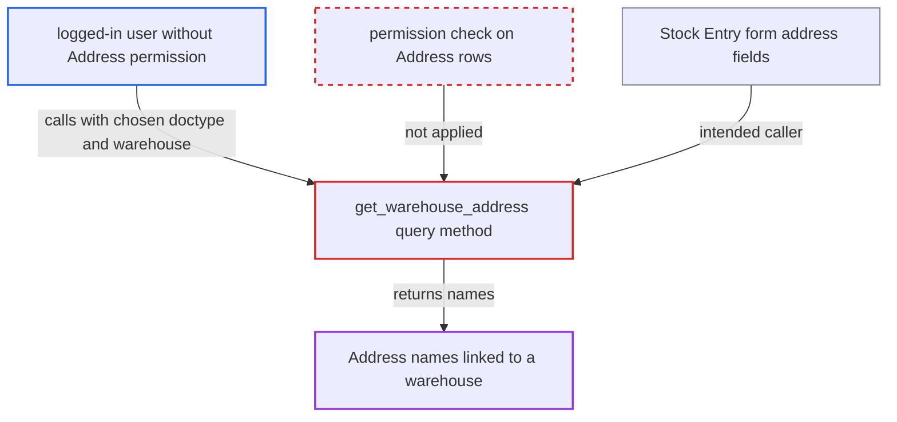

# get_warehouse_address lists warehouse-linked Address names without any permission check

| Field | Value |
|---|---|
| ID | `find_01M5iLbdRqgZ7N6eQuYsKZry` |
| Severity | **Medium** |
| Status | open |
| CWE | CWE-862 — Missing authorization |
| Created | 2026-10-27T21:28:00.349102Z |
| Claude Security | https://claude.ai/security/findings/find_01M5iLbdRqgZ7N6eQuYsKZry |

## Description

Any logged-in user can list the names of Address records linked to a warehouse, including employees with no Address permission and portal Customer/Supplier users. Only address titles and types leak, not street fields. The whitelisted `get_warehouse_address` runs a raw query on a caller-chosen doctype and applies no role, User Permission or permission-query check.

1. **logged-in user** calls the whitelisted method `get_warehouse_address` over the API. The request goes to `/api/method/erpnext.controllers.queries.get_warehouse_address` with `doctype=Address`, `txt=''`, `searchfield=name`, `start=0`, `page_len=100` and `filters={"warehouse": "<name>"}`, where the warehouse name is one the attacker knows. ([`erpnext/controllers/queries.py:1357-1377`](https://github.com/cx-benchmark/erpnext/blob/90e7aefca73da3c440d2e8da7472fcb67838e678/erpnext/controllers/queries.py#L1357-L1377))
2. **the handler `get_warehouse_address`** takes `doctype` from the request and builds a raw `frappe.qb` select on that table. The only limit on `doctype` is that the DocType must exist, and no check asks whether the caller may read it. ([`erpnext/controllers/queries.py:1357-1377`](https://github.com/cx-benchmark/erpnext/blob/90e7aefca73da3c440d2e8da7472fcb67838e678/erpnext/controllers/queries.py#L1357-L1377))
3. **the handler `get_warehouse_address`** joins `Dynamic Link` rows that point at the given warehouse and filters the result. It keeps rows where `parenttype` equals `doctype`, `link_doctype` is 'Warehouse', `link_name` equals `filters['warehouse']`, `disabled` is 0 and `name` matches `txt`. It applies no role check, no User Permission and no permission-query condition. ([`erpnext/controllers/queries.py:1357-1377`](https://github.com/cx-benchmark/erpnext/blob/90e7aefca73da3c440d2e8da7472fcb67838e678/erpnext/controllers/queries.py#L1357-L1377))
4. **the handler `get_warehouse_address`** returns the matching Address names to the caller. The names have the form `<address_title>-<address_type>`. The attacker can probe them by substring through `txt`, even though Address read access is limited by role. ([`erpnext/setup/install.py:56-107`](https://github.com/cx-benchmark/erpnext/blob/90e7aefca73da3c440d2e8da7472fcb67838e678/erpnext/setup/install.py#L56-L107))

## Assessment

The attacker is any logged-in user. That includes an employee with no Address permission and a portal Customer or Supplier. No victim action is needed. The attacker must know a warehouse name. These follow default patterns such as `Stores - <abbr>`, or can be seen elsewhere. The intended caller is the Stock Entry form, which uses this query for `source_warehouse_address` and `target_warehouse_address`. The API route lets any user call it directly. ERPNext limits Address read access by role, for example to Accounts Manager.

Impact: The attacker can read the names (address title and type) of Address records linked to a warehouse whose exact name they supply. This bypasses the Address role, select and User Permission controls. No other column is returned, nothing is modified, and `page_len` caps the number of rows. Other doctypes return rows only if they have a `disabled` column and Dynamic Link rows pointing at a Warehouse. The report found no such doctype in the checkout.

## Recommendation

`get_warehouse_address` reads a doctype the caller chooses with a raw query-builder select and no permission check. This bypasses role, select and User Permission rules on Address.

Fix criteria: `doctype` is limited to Address, or to the doctypes the endpoint is meant to serve, and any other `doctype` is rejected. The caller's permissions apply to the returned rows, for example through a permission-aware base query or a `has_permission` check plus match conditions. A user with no read or select access on Address gets a PermissionError or no rows.

## Evidence

**https://github.com/cx-benchmark/erpnext**

- [`erpnext/controllers/queries.py:1357-1377`](https://github.com/cx-benchmark/erpnext/blob/90e7aefca73da3c440d2e8da7472fcb67838e678/erpnext/controllers/queries.py#L1357-L1377)
- [`erpnext/controllers/queries.py:1060-1070`](https://github.com/cx-benchmark/erpnext/blob/90e7aefca73da3c440d2e8da7472fcb67838e678/erpnext/controllers/queries.py#L1060-L1070)
- [`erpnext/stock/doctype/stock_entry/stock_entry.js:50-66`](https://github.com/cx-benchmark/erpnext/blob/90e7aefca73da3c440d2e8da7472fcb67838e678/erpnext/stock/doctype/stock_entry/stock_entry.js#L50-L66)
- [`erpnext/setup/install.py:56-107`](https://github.com/cx-benchmark/erpnext/blob/90e7aefca73da3c440d2e8da7472fcb67838e678/erpnext/setup/install.py#L56-L107)

