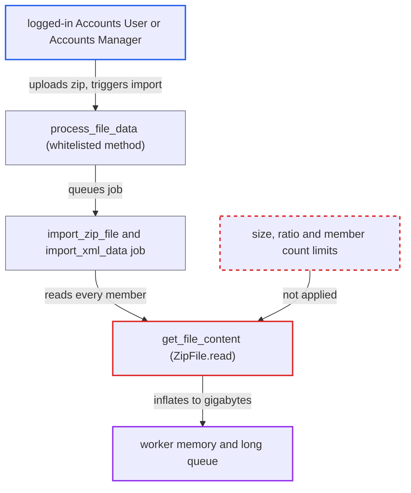

# Import Supplier Invoice inflates uploaded zip members in memory without size limits (zip bomb)

| Field | Value |
|---|---|
| ID | `find_01D4sj5xRQd3xfAQWxCPj3eF` |
| Severity | **Medium** |
| Status | open |
| CWE | CWE-409 — Decompression bomb |
| Created | 2026-10-27T21:10:06.648108Z |
| Claude Security | https://claude.ai/security/findings/find_01D4sj5xRQd3xfAQWxCPj3eF |

## Description

A logged-in user with the Accounts User or Accounts Manager role can crash and repeatedly knock out the background worker by uploading a small zip file that expands to gigabytes. This applies on sites that have a company with country Italy. The importer `get_file_content` inflates each zip member fully into memory with `ZipFile.read()` and never checks size, ratio or member count.

1. **attacker** attaches a small zip to an Import Supplier Invoice and calls `process_file_data`. The zip holds one highly compressible member that inflates to gigabytes, and the method checks only that the caller has `write` permission on the document. ([`erpnext/regional/doctype/import_supplier_invoice/import_supplier_invoice.py:193-198`](https://github.com/cx-benchmark/erpnext/blob/90e7aefca73da3c440d2e8da7472fcb67838e678/erpnext/regional/doctype/import_supplier_invoice/import_supplier_invoice.py#L193-L198))
2. **`process_file_data`** queues `import_xml_data` on the shared `long` queue. The job has a 3600 s timeout, and every call queues another job. ([`erpnext/regional/doctype/import_supplier_invoice/import_supplier_invoice.py:193-198`](https://github.com/cx-benchmark/erpnext/blob/90e7aefca73da3c440d2e8da7472fcb67838e678/erpnext/regional/doctype/import_supplier_invoice/import_supplier_invoice.py#L193-L198))
3. **the function `import_zip_file`** loops over every member of the attached zip and parses each one. Nothing caps the member count or the total uncompressed size, and each non-`.p7m` member goes to `get_file_content` and then `bs(content, "xml")`. ([`erpnext/regional/doctype/import_supplier_invoice/import_supplier_invoice.py:77-96`](https://github.com/cx-benchmark/erpnext/blob/90e7aefca73da3c440d2e8da7472fcb67838e678/erpnext/regional/doctype/import_supplier_invoice/import_supplier_invoice.py#L77-L96))
4. **the function `get_file_content`** calls `zip_file_object.read(file_name)` on the member. The read inflates the whole member into one bytes object, bounded only by the attacker-declared `file_size`, and the bytes are then decoded into a second full-size `str`. ([`erpnext/regional/doctype/import_supplier_invoice/import_supplier_invoice.py:219-231`](https://github.com/cx-benchmark/erpnext/blob/90e7aefca73da3c440d2e8da7472fcb67838e678/erpnext/regional/doctype/import_supplier_invoice/import_supplier_invoice.py#L219-L231))
5. **the background worker** runs out of memory and is OOM-killed. The `except Exception` around the read only helps if one allocation fails cleanly, but the decompressor's output grows step by step, so the process is usually killed instead. ([`erpnext/regional/doctype/import_supplier_invoice/import_supplier_invoice.py:77-96`](https://github.com/cx-benchmark/erpnext/blob/90e7aefca73da3c440d2e8da7472fcb67838e678/erpnext/regional/doctype/import_supplier_invoice/import_supplier_invoice.py#L77-L96))

## Assessment

The attacker is a logged-in desk user with the Accounts User or Accounts Manager role. These roles get write and create on Import Supplier Invoice when a company's country is Italy, because `add_permissions` in `italy/setup.py` grants them from `install_country_fixtures`. They create an Import Supplier Invoice, attach the zip and call the whitelisted `process_file_data`. No victim action is needed. The attacker can call the method again to queue more jobs. Frappe's upload limit only bounds the compressed archive. Deflate reaches about 1000:1, and bzip2 and LZMA members, which `zipfile` also reads, compress repetitive data even more. CPython's overlapped-entry check only stops overlapping-file bombs, so a plain single-member bomb passes it.

Impact: The attacker can exhaust the worker's memory up to the host's available memory, so the job is OOM-killed and co-located processes come under memory pressure. By repeating the call, they can keep long-queue background processing, and anything sharing the worker host, denied. No data is disclosed or modified.

## Recommendation

Zip members from a user upload are inflated whole with `ZipFile.read()` and then parsed. Nothing limits the declared or actual uncompressed size, the compression ratio, the member count or the total expanded size.

Fix criteria: Before decompressing, the importer rejects archives whose members declare an implausible uncompressed size or ratio, or that have too many members or too large a total. It also stops a member whose actual decompressed output passes the cap, whatever its declared size or compression method (deflate, bzip2, LZMA). Check: a zip with a member that inflates to gigabytes, declared truthfully or falsely, ends with a logged validation error. The worker's memory does not grow beyond the cap.

## Evidence

**https://github.com/cx-benchmark/erpnext**

- [`erpnext/regional/doctype/import_supplier_invoice/import_supplier_invoice.py:219-231`](https://github.com/cx-benchmark/erpnext/blob/90e7aefca73da3c440d2e8da7472fcb67838e678/erpnext/regional/doctype/import_supplier_invoice/import_supplier_invoice.py#L219-L231)
- [`erpnext/regional/doctype/import_supplier_invoice/import_supplier_invoice.py:77-96`](https://github.com/cx-benchmark/erpnext/blob/90e7aefca73da3c440d2e8da7472fcb67838e678/erpnext/regional/doctype/import_supplier_invoice/import_supplier_invoice.py#L77-L96)
- [`erpnext/regional/doctype/import_supplier_invoice/import_supplier_invoice.py:193-198`](https://github.com/cx-benchmark/erpnext/blob/90e7aefca73da3c440d2e8da7472fcb67838e678/erpnext/regional/doctype/import_supplier_invoice/import_supplier_invoice.py#L193-L198)
- [`erpnext/regional/italy/setup.py:480-496`](https://github.com/cx-benchmark/erpnext/blob/90e7aefca73da3c440d2e8da7472fcb67838e678/erpnext/regional/italy/setup.py#L480-L496)

