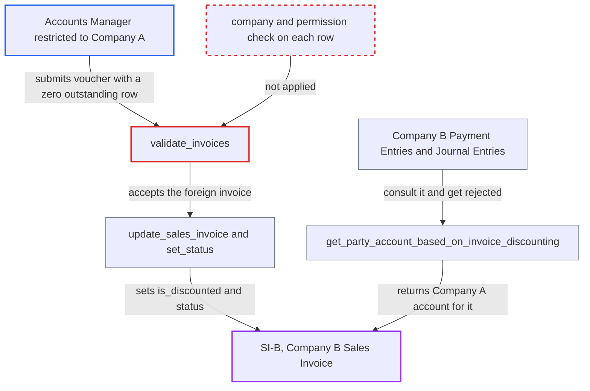

# Invoice Discounting flags and re-routes another company's Sales Invoice via zero-outstanding row

| Field | Value |
|---|---|
| ID | `find_01LtpZtUceXRADbrcnLZtQfP` |
| Severity | **Medium** |
| Status | open |
| CWE | CWE-862 — Missing Authorization |
| Created | 2026-10-27T21:58:48.509370Z |
| Claude Security | https://claude.ai/security/findings/find_01LtpZtUceXRADbrcnLZtQfP |

## Description

A Company A Accounts Manager can flag another company's Sales Invoice as discounted and change its status. This blocks Company B from recording payments against that invoice. The attack needs only a submitted Invoice Discounting voucher in Company A with a row whose `outstanding_amount` is 0. `validate_invoices` never checks that the invoice belongs to the voucher's company.

1. **Accounts Manager of Company A** saves a draft Invoice Discounting that names Company B's `SI-B`. `Discounted Invoice.sales_invoice` is a plain Link to Sales Invoice, and Company User Permissions restrict only Link fields that target `Company`, so any company's invoice can be named.
2. **Accounts Manager of Company A** edits the row's `outstanding_amount` to 0 and submits through the ordinary submit API. `fetch_from` values are refreshed on insert and draft save but not when the in-memory document is already submitted, so the edited 0 is kept.
3. **the validator `validate_invoices`** accepts the row. It only checks that the invoice is not already discounted and that the row's `outstanding_amount` is not above the actual one. It never compares company, customer or user permission. ([`erpnext/accounts/doctype/invoice_discounting/invoice_discounting.py:63-90`](https://github.com/cx-benchmark/erpnext/blob/90e7aefca73da3c440d2e8da7472fcb67838e678/erpnext/accounts/doctype/invoice_discounting/invoice_discounting.py#L63-L90))
4. **the GL posting `make_gl_entries`** skips the row. GL rows are built only when `d.outstanding_amount` is truthy. A 0 row therefore never reaches the account check that would have rejected the foreign `debit_to`. ([`erpnext/accounts/doctype/invoice_discounting/invoice_discounting.py:130-145`](https://github.com/cx-benchmark/erpnext/blob/90e7aefca73da3c440d2e8da7472fcb67838e678/erpnext/accounts/doctype/invoice_discounting/invoice_discounting.py#L130-L145))
5. **the handler `update_sales_invoice`** stores `is_discounted` = 1 on `SI-B`. `frappe.db.set_value` runs for every invoice named on the voucher, whatever its company. ([`erpnext/accounts/doctype/invoice_discounting/invoice_discounting.py:119-128`](https://github.com/cx-benchmark/erpnext/blob/90e7aefca73da3c440d2e8da7472fcb67838e678/erpnext/accounts/doctype/invoice_discounting/invoice_discounting.py#L119-L128))
6. **the attacker's disbursement Journal Entry** moves the voucher to Disbursed, which makes `set_status` rewrite `SI-B`'s status. The status change calls `set_status(update=True)` on every named Sales Invoice. `SI-B`'s status then gains the `and Discounted` suffix. ([`erpnext/accounts/doctype/invoice_discounting/invoice_discounting.py:101-116`](https://github.com/cx-benchmark/erpnext/blob/90e7aefca73da3c440d2e8da7472fcb67838e678/erpnext/accounts/doctype/invoice_discounting/invoice_discounting.py#L101-L116))
7. **the function `get_party_account_based_on_invoice_discounting`** returns Company A's receivable accounts for `SI-B`. Once the voucher is Disbursed or Settled, the function answers with the attacker voucher's `accounts_receivable_discounted` or `accounts_receivable_unpaid` account. ([`erpnext/accounts/doctype/invoice_discounting/invoice_discounting.py:360-378`](https://github.com/cx-benchmark/erpnext/blob/90e7aefca73da3c440d2e8da7472fcb67838e678/erpnext/accounts/doctype/invoice_discounting/invoice_discounting.py#L360-L378))
8. **Company B's Payment Entry or Journal Entry against `SI-B`** is rejected with a party-account mismatch. The validation compares the account returned for the invoice with the party account and throws when they differ. ([`erpnext/accounts/doctype/payment_entry/payment_entry.py:800-822`](https://github.com/cx-benchmark/erpnext/blob/90e7aefca73da3c440d2e8da7472fcb67838e678/erpnext/accounts/doctype/payment_entry/payment_entry.py#L800-L822))

## Assessment

The attacker is an Accounts Manager restricted by User Permission to Company A. Invoice Discounting is limited to the Accounts Manager role. They need no victim action. They save a draft voucher in Company A whose row names Company B's `SI-B`, and they may add a genuine Company A row as well. They submit it with that row's `outstanding_amount` set to 0. They can then create and submit the disbursement Journal Entry that the form offers. The report assumes that Company User Permissions restrict only Link fields targeting `Company`. It also assumes the pinned frappe version (>=17.0.0-dev,\<18) behaves as described, but that code is not in the checkout.

Impact: The attacker changes another company's Sales Invoice: `is_discounted` is set and `status` is rewritten. Company B's Payment Entries and Journal Entries against that invoice are rejected, or built with a Company A account, until Company B finds and cancels a Company A voucher it cannot see. The error in `validate_invoices` also reveals the foreign invoice's exact outstanding amount. The damage is limited to flags, status and blocked workflows, and no money moves.

## Recommendation

`validate_invoices` never checks that each `Discounted Invoice.sales_invoice` belongs to the voucher's company or that the user may act on it. It relies on GL account validation to reject foreign invoices, and a row with zero `outstanding_amount` bypasses that validation.

Fix criteria: Every row is rejected unless the Sales Invoice's `company` equals the Invoice Discounting `company` and the user has read and write permission on it. Rows with zero or negative `outstanding_amount` are also rejected. Test: a Company A Accounts Manager submits a voucher naming a Company B invoice, at any outstanding value. The submit gets a validation error, and the Company B invoice's `is_discounted` and `status` stay unchanged.

## Evidence

**https://github.com/cx-benchmark/erpnext**

- [`erpnext/accounts/doctype/invoice_discounting/invoice_discounting.py:63-90`](https://github.com/cx-benchmark/erpnext/blob/90e7aefca73da3c440d2e8da7472fcb67838e678/erpnext/accounts/doctype/invoice_discounting/invoice_discounting.py#L63-L90)
- [`erpnext/accounts/doctype/invoice_discounting/invoice_discounting.py:119-128`](https://github.com/cx-benchmark/erpnext/blob/90e7aefca73da3c440d2e8da7472fcb67838e678/erpnext/accounts/doctype/invoice_discounting/invoice_discounting.py#L119-L128)
- [`erpnext/accounts/doctype/invoice_discounting/invoice_discounting.py:101-116`](https://github.com/cx-benchmark/erpnext/blob/90e7aefca73da3c440d2e8da7472fcb67838e678/erpnext/accounts/doctype/invoice_discounting/invoice_discounting.py#L101-L116)
- [`erpnext/accounts/doctype/invoice_discounting/invoice_discounting.py:130-145`](https://github.com/cx-benchmark/erpnext/blob/90e7aefca73da3c440d2e8da7472fcb67838e678/erpnext/accounts/doctype/invoice_discounting/invoice_discounting.py#L130-L145)
- [`erpnext/accounts/doctype/invoice_discounting/invoice_discounting.py:360-378`](https://github.com/cx-benchmark/erpnext/blob/90e7aefca73da3c440d2e8da7472fcb67838e678/erpnext/accounts/doctype/invoice_discounting/invoice_discounting.py#L360-L378)
- [`erpnext/accounts/doctype/payment_entry/payment_entry.py:800-822`](https://github.com/cx-benchmark/erpnext/blob/90e7aefca73da3c440d2e8da7472fcb67838e678/erpnext/accounts/doctype/payment_entry/payment_entry.py#L800-L822)
- [`erpnext/accounts/doctype/journal_entry/journal_entry.py:421-449`](https://github.com/cx-benchmark/erpnext/blob/90e7aefca73da3c440d2e8da7472fcb67838e678/erpnext/accounts/doctype/journal_entry/journal_entry.py#L421-L449)

