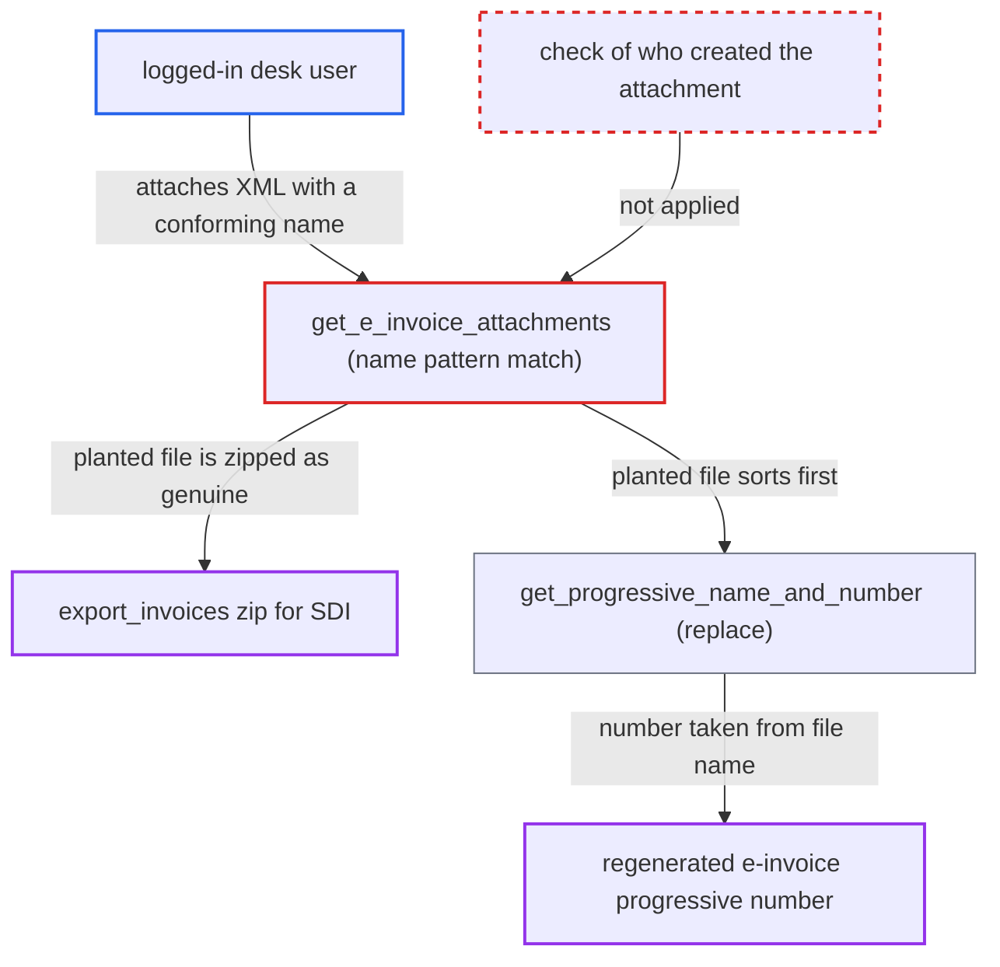

# Italian e-invoice export and regeneration trust any attachment named like a FatturaPA file

| Field | Value |
|---|---|
| ID | `find_01UXzkgjCVJiq1wcifyuMJVa` |
| Severity | **Medium** |
| Status | open |
| CWE | CWE-345 — Insufficient Verification of Data Authenticity |
| Created | 2026-10-27T22:12:31.029700Z |
| Claude Security | https://claude.ai/security/findings/find_01UXzkgjCVJiq1wcifyuMJVa |

## Description

A logged-in desk user, such as an Accounts User, can get a forged FatturaPA XML into the company's e-invoice export batch. They can also make a regenerated e-invoice take a progressive number they chose. The code `get_e_invoice_attachments` treats any attachment named `IT<company tax id>` plus `.xml` as the genuine e-invoice and never checks who created it.

1. **attacker (desk user)** attaches a crafted XML to a submitted Sales Invoice. The file is named `IT<taxid>_<n>.xml`, using the company's public VAT number, so it matches the pattern the code looks for. ([`erpnext/regional/italy/test_utils.py:110-124`](https://github.com/cx-benchmark/erpnext/blob/90e7aefca73da3c440d2e8da7472fcb67838e678/erpnext/regional/italy/test_utils.py#L110-L124))
2. **the function `get_e_invoice_attachments`** selects attachments by `File.file_name` alone. It returns every attached `File` whose name starts with `IT<company tax id>` and ends with `.xml`, with no check of owner, provenance or link to the generated document. ([`erpnext/regional/italy/utils.py:405-436`](https://github.com/cx-benchmark/erpnext/blob/90e7aefca73da3c440d2e8da7472fcb67838e678/erpnext/regional/italy/utils.py#L405-L436))
3. **the genuine generator `prepare_and_attach_invoice`** saves the real e-invoice XML as a plain private `File`. It carries no marker, so it looks the same as a user upload. ([`erpnext/regional/italy/utils.py:348-375`](https://github.com/cx-benchmark/erpnext/blob/90e7aefca73da3c440d2e8da7472fcb67838e678/erpnext/regional/italy/utils.py#L348-L375))
4. **accountant** runs Export E-Invoices through `export_invoices`. The action passes every pattern-matching attachment of the submitted invoices in scope to `download_zip`. ([`erpnext/regional/italy/utils.py:33-46`](https://github.com/cx-benchmark/erpnext/blob/90e7aefca73da3c440d2e8da7472fcb67838e678/erpnext/regional/italy/utils.py#L33-L46))
5. **the function `download_zip`** writes the planted file's own bytes into the zip. The forged XML sits next to the genuine e-invoices in the batch meant for the Sistema di Interscambio. ([`erpnext/regional/italy/utils.py:128-141`](https://github.com/cx-benchmark/erpnext/blob/90e7aefca73da3c440d2e8da7472fcb67838e678/erpnext/regional/italy/utils.py#L128-L141))
6. **a user clicking Generate E-Invoice** regenerates the XML through `generate_single_invoice`. The button is shown on every submitted invoice, so this is a routine action. ([`erpnext/accounts/doctype/sales_invoice/regional/italy.js:1-23`](https://github.com/cx-benchmark/erpnext/blob/90e7aefca73da3c440d2e8da7472fcb67838e678/erpnext/accounts/doctype/sales_invoice/regional/italy.js#L1-L23))
7. **the function `get_progressive_name_and_number`** removes only the first match and takes the progressive number from its name. The planted file is newer, so it sorts first. The regenerated XML gets the attacker's number, taken with `split("_")[1]`, and the genuine XML stays attached. ([`erpnext/regional/italy/utils.py:463-468`](https://github.com/cx-benchmark/erpnext/blob/90e7aefca73da3c440d2e8da7472fcb67838e678/erpnext/regional/italy/utils.py#L463-L468))

## Assessment

The attacker is a logged-in desk user. This can be an Accounts User with write on the invoice, who attaches the file through the desk upload. Under the Frappe behaviour the report assumes, it can also be any user with File create, who inserts a `File` directly. The attacker needs the name of a submitted invoice, which comes from a sequential series, and the company's public VAT number. The forged XML reaches the tax authority only if an accountant exports the batch and uploads it. The numbering effect needs someone to regenerate that invoice's XML. The report relies on Frappe behaviour that is not in the checkout. Desk upload needs write on the invoice. A direct `File` insert checks only File create. Desk users face no MIME-type restriction. A name that collides on disk gets a suffix and still matches. `frappe.get_all` without `order_by` sorts descending.

Impact: The fiscal export the company transmits can contain a document with content the attacker chose, such as other amounts, another IBAN in `DatiPagamento` or a fake credit note. A regenerated e-invoice can get a duplicate or out-of-sequence progressive number. The ledger, stock and the invoice record are not changed and nothing is disclosed.

## Recommendation

(1) E-invoice attachments are recognised by file-name pattern. Any user-uploaded attachment with a conforming name is treated as the system-generated fiscal document by the export, cancel and regenerate paths.

Fix criteria: The system records which `File` it generated for each Sales Invoice, and only the e-invoice generation code sets that record. `export_invoices`, `sales_invoice_on_cancel` and the regenerate path use only that record. Test: a user-uploaded `IT<taxid>_99999.xml` attached to a submitted invoice is absent from the export zip. Regeneration neither removes nor reuses it.

(2) The progressive number of a regenerated e-invoice is parsed from the name of whichever matching attachment sorts first. A file named by the attacker therefore chooses the number.

Fix criteria: The progressive number comes from a value the system stored when the invoice's e-invoice was first generated, never from attachment names. Test: after planting a matching attachment with another number, `generate_single_invoice` produces an XML with the invoice's original number. It replaces only the recorded file.

## Evidence

**https://github.com/cx-benchmark/erpnext**

- [`erpnext/regional/italy/utils.py:405-436`](https://github.com/cx-benchmark/erpnext/blob/90e7aefca73da3c440d2e8da7472fcb67838e678/erpnext/regional/italy/utils.py#L405-L436)
- [`erpnext/regional/italy/utils.py:33-46`](https://github.com/cx-benchmark/erpnext/blob/90e7aefca73da3c440d2e8da7472fcb67838e678/erpnext/regional/italy/utils.py#L33-L46)
- [`erpnext/regional/italy/utils.py:128-141`](https://github.com/cx-benchmark/erpnext/blob/90e7aefca73da3c440d2e8da7472fcb67838e678/erpnext/regional/italy/utils.py#L128-L141)
- [`erpnext/regional/italy/utils.py:463-468`](https://github.com/cx-benchmark/erpnext/blob/90e7aefca73da3c440d2e8da7472fcb67838e678/erpnext/regional/italy/utils.py#L463-L468)
- [`erpnext/regional/italy/utils.py:378-384`](https://github.com/cx-benchmark/erpnext/blob/90e7aefca73da3c440d2e8da7472fcb67838e678/erpnext/regional/italy/utils.py#L378-L384)
- [`erpnext/accounts/doctype/sales_invoice/regional/italy.js:1-23`](https://github.com/cx-benchmark/erpnext/blob/90e7aefca73da3c440d2e8da7472fcb67838e678/erpnext/accounts/doctype/sales_invoice/regional/italy.js#L1-L23)
- [`erpnext/regional/italy/utils.py:348-375`](https://github.com/cx-benchmark/erpnext/blob/90e7aefca73da3c440d2e8da7472fcb67838e678/erpnext/regional/italy/utils.py#L348-L375)
- [`erpnext/regional/italy/setup.py:468-477`](https://github.com/cx-benchmark/erpnext/blob/90e7aefca73da3c440d2e8da7472fcb67838e678/erpnext/regional/italy/setup.py#L468-L477)
- [`erpnext/regional/italy/test_utils.py:110-124`](https://github.com/cx-benchmark/erpnext/blob/90e7aefca73da3c440d2e8da7472fcb67838e678/erpnext/regional/italy/test_utils.py#L110-L124)

