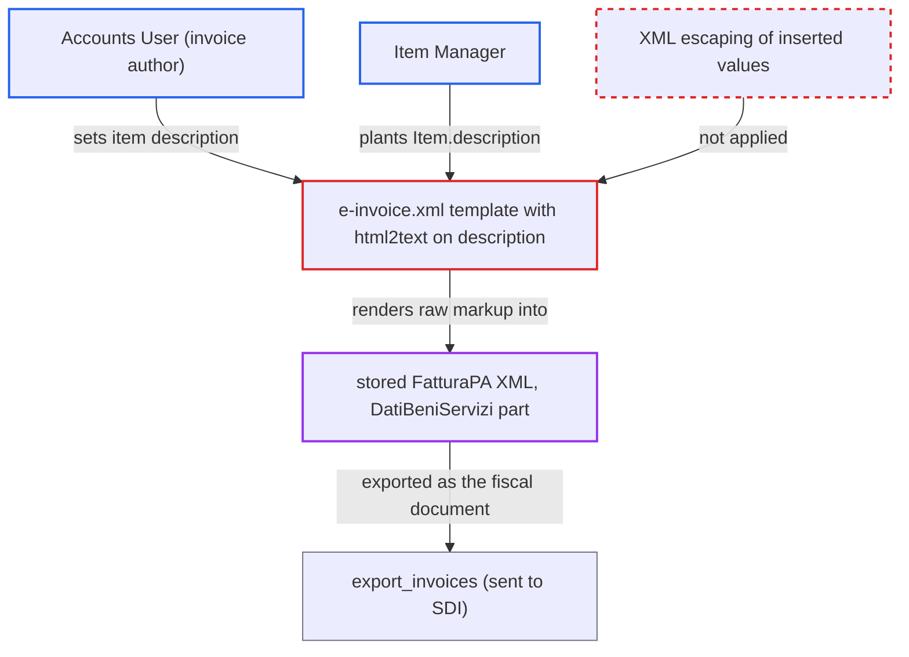

# Italian e-invoice XML built without escaping lets item descriptions inject FatturaPA elements

| Field | Value |
|---|---|
| ID | `find_016BNTMMtsKLHQjEoZ7k3EeJ` |
| Severity | **Medium** |
| Status | open |
| CWE | CWE-91 — XML Injection |
| Created | 2026-10-27T21:21:36.965955Z |
| Claude Security | https://claude.ai/security/findings/find_016BNTMMtsKLHQjEoZ7k3EeJ |

## Description

A user who can set an item description on an Italian company's Sales Invoice can forge the line items and VAT summary of the FatturaPA e-invoice. The forged file is stored and exported for SDI, so it no longer matches the ERP invoice. The cause is the template `e-invoice.xml`, which puts values into the XML without escaping, and `html2text` turns stored entities back into raw `<` and `>`. The header, `ImportoTotaleDocumento` and `<DatiPagamento>` cannot be changed.

1. **Attacker (Accounts User or Item Manager)** saves a description containing closing and opening XML tags. The payload looks like `x</Descrizione>…</DettaglioLinee><DettaglioLinee>…<Descrizione>y`. It goes into the invoice item description, or into `Item.description`, which is copied into the invoice row. ([`erpnext/stock/get_item_details.py:640`](https://github.com/cx-benchmark/erpnext/blob/90e7aefca73da3c440d2e8da7472fcb67838e678/erpnext/stock/get_item_details.py#L640))
2. **Frappe's save-time sanitizer** stores the typed tags as `&lt;` and `&gt;` entities. This is an assumption about Frappe, which is not in the checkout. Text with no tag, such as `<!--` or `-->`, is stored unchanged.
3. **the hook `sales_invoice_on_submit`** calls `prepare_and_attach_invoice` when the invoice is submitted. This happens for any company whose country is Italy, so the author's own submit is enough. ([`erpnext/regional/italy/utils.py:321-345`](https://github.com/cx-benchmark/erpnext/blob/90e7aefca73da3c440d2e8da7472fcb67838e678/erpnext/regional/italy/utils.py#L321-L345))
4. **the template `e-invoice.xml`** decodes the description with `html2text` and inserts it without escaping. The entities become raw `<` and `>`, so the typed text becomes live XML elements inside `<DatiBeniServizi>`. ([`erpnext/regional/italy/e-invoice.xml:191`](https://github.com/cx-benchmark/erpnext/blob/90e7aefca73da3c440d2e8da7472fcb67838e678/erpnext/regional/italy/e-invoice.xml#L191))
5. **`prepare_and_attach_invoice`** replaces only `&` and saves the string as the invoice's e-invoice attachment. `<` and `>` are left alone, and the result is never parsed or checked against a schema. ([`erpnext/regional/italy/utils.py:354-374`](https://github.com/cx-benchmark/erpnext/blob/90e7aefca73da3c440d2e8da7472fcb67838e678/erpnext/regional/italy/utils.py#L354-L374))
6. **`export_invoices`** zips the stored XML files for download and transmission to SDI. The forged document is the one that leaves the system. ([`erpnext/regional/italy/utils.py:33-46`](https://github.com/cx-benchmark/erpnext/blob/90e7aefca73da3c440d2e8da7472fcb67838e678/erpnext/regional/italy/utils.py#L33-L46))

## Assessment

The attacker is a logged-in desk user in a company whose country is Italy. They either hold Sales Invoice create/submit rights (Accounts User) and set the item `description` through the form or `/api/resource`, or they are an Item Manager who can write `Item.description` without any Sales Invoice permission. The tax row `description`, copied through `append_row_as_charges`, reaches the same `html2text` sink. A value with no tag, such as `<!--` or `-->`, passes the sanitizer unchanged and is emitted raw from any field, including `tax_exemption_law`. This can close a comment opened in the last item description and hide the genuine lines and VAT summaries. No victim step is needed when the author submits the invoice. The report assumes, without checking, that Frappe's Jinja environment does not autoescape, that its sanitizer escapes disallowed tags as entities, and that `html2text` decodes entities.

Impact: The attacker controls the XML structure inside `<DatiBeniServizi>`. They can add `<DettaglioLinee>` and `<DatiRiepilogo>` rows with chosen quantities, prices, VAT rates and `Natura` exemption codes, or comment out the real ones. The file stays well-formed, but it no longer matches the ERP invoice and its GL entries. The header, `ImportoTotaleDocumento` and `<DatiPagamento>` cannot be changed, and there is no data disclosure or availability impact.

## Recommendation

`e-invoice.xml` inserts document values into XML text without escaping. `prepare_and_attach_invoice` replaces only `&`. The `html2text` call on `description` also turns stored entities back into raw `<` and `>`.

Fix criteria: Every value placed into the e-invoice is XML-escaped (`<`, `>`, `&`, quotes) where it is inserted, after any `html2text` conversion. Alternatively, the document is built with an XML library instead of string templating. To verify, submit an Italian Sales Invoice whose item description, Item master description, tax row description and `tax_exemption_law` contain `</Descrizione><DettaglioLinee>` and `<!--`/`-->`. The stored XML must parse to the template's element structure, with that text present only as character data.

## Evidence

**https://github.com/cx-benchmark/erpnext**

- [`erpnext/regional/italy/e-invoice.xml:191`](https://github.com/cx-benchmark/erpnext/blob/90e7aefca73da3c440d2e8da7472fcb67838e678/erpnext/regional/italy/e-invoice.xml#L191)
- [`erpnext/regional/italy/utils.py:354-374`](https://github.com/cx-benchmark/erpnext/blob/90e7aefca73da3c440d2e8da7472fcb67838e678/erpnext/regional/italy/utils.py#L354-L374)
- [`erpnext/regional/italy/e-invoice.xml:216`](https://github.com/cx-benchmark/erpnext/blob/90e7aefca73da3c440d2e8da7472fcb67838e678/erpnext/regional/italy/e-invoice.xml#L216)
- [`erpnext/regional/italy/utils.py:321-345`](https://github.com/cx-benchmark/erpnext/blob/90e7aefca73da3c440d2e8da7472fcb67838e678/erpnext/regional/italy/utils.py#L321-L345)
- [`erpnext/stock/get_item_details.py:640`](https://github.com/cx-benchmark/erpnext/blob/90e7aefca73da3c440d2e8da7472fcb67838e678/erpnext/stock/get_item_details.py#L640)
- [`erpnext/regional/italy/utils.py:195-206`](https://github.com/cx-benchmark/erpnext/blob/90e7aefca73da3c440d2e8da7472fcb67838e678/erpnext/regional/italy/utils.py#L195-L206)
- [`erpnext/regional/italy/utils.py:33-46`](https://github.com/cx-benchmark/erpnext/blob/90e7aefca73da3c440d2e8da7472fcb67838e678/erpnext/regional/italy/utils.py#L33-L46)

