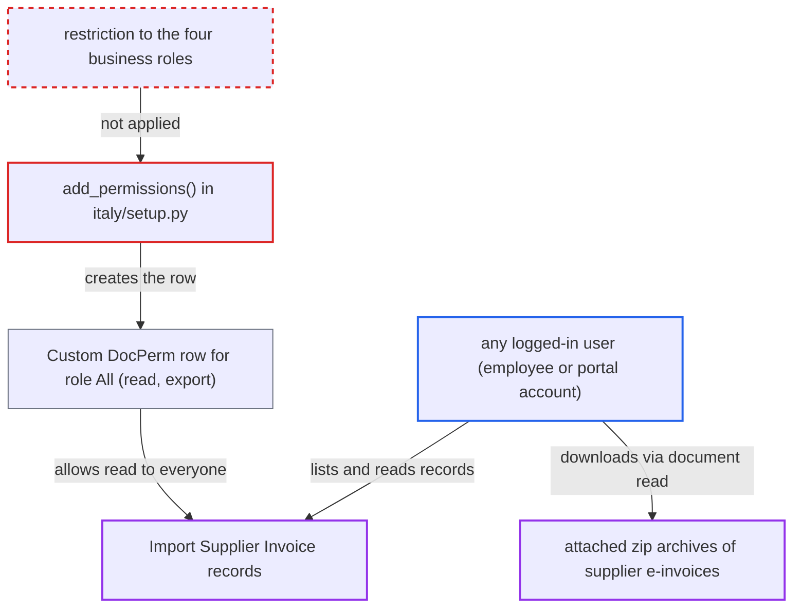

# Italy regional setup grants Import Supplier Invoice read to every user via role All

| Field | Value |
|---|---|
| ID | `find_01KvN6jikcn4XnmfghmrP4nG` |
| Severity | **Medium** |
| Status | open |
| CWE | CWE-732 — Incorrect Permission Assignment |
| Created | 2026-10-27T22:21:45.555627Z |
| Claude Security | https://claude.ai/security/findings/find_01KvN6jikcn4XnmfghmrP4nG |

## Description

Any logged-in user on a site with an Italian company can read and export every `Import Supplier Invoice` record and download the uploaded archives of supplier e-invoices. That includes portal accounts with no business role. The cause is `add_permissions()` in `erpnext/regional/italy/setup.py`, which grants read on this doctype to the automatic role `All` at line 482. The grant also carries export, which Custom DocPerm turns on by default.

1. **the Company `on_update` hook** runs the Italy fixture setup. `install_country_fixtures` runs `erpnext.regional.italy.setup.setup` whenever a Company's country becomes Italy, and the upgrade patch `set_italian_import_supplier_invoice_permissions.py` applies it too. ([`erpnext/setup/doctype/company/company.py:995-998`](https://github.com/cx-benchmark/erpnext/blob/90e7aefca73da3c440d2e8da7472fcb67838e678/erpnext/setup/doctype/company/company.py#L995-L998))
2. **the function `add_permissions()`** creates a permlevel-0 `Custom DocPerm` row for role `All` on `Import Supplier Invoice`. The call `add_permission("Import Supplier Invoice", "All", 0)` passes no `ptype`, so it defaults to read, and the row also gets `export` = 1 by default. The doctype ships `"permissions": []`, so this row is its only access rule. ([`erpnext/regional/italy/setup.py:480-496`](https://github.com/cx-benchmark/erpnext/blob/90e7aefca73da3c440d2e8da7472fcb67838e678/erpnext/regional/italy/setup.py#L480-L496))
3. **attacker** signs in with any account on the site. Every logged-in user holds the role `All`. That includes low-privilege employees and Website Users, such as the Supplier-role accounts that `RequestForQuotation.create_user` creates. ([`erpnext/buying/doctype/request_for_quotation/request_for_quotation.py:286-305`](https://github.com/cx-benchmark/erpnext/blob/90e7aefca73da3c440d2e8da7472fcb67838e678/erpnext/buying/doctype/request_for_quotation/request_for_quotation.py#L286-L305))
4. **attacker** lists all import records through the API or the desk list. A request such as `GET /api/resource/Import Supplier Invoice?fields=["*"]` passes the read check and returns each record with its `zip_file` URL, which sits at permlevel 0. ([`erpnext/regional/doctype/import_supplier_invoice/import_supplier_invoice.json:57-61`](https://github.com/cx-benchmark/erpnext/blob/90e7aefca73da3c440d2e8da7472fcb67838e678/erpnext/regional/doctype/import_supplier_invoice/import_supplier_invoice.json#L57-L61))
5. **attacker** downloads each archive from `/private/files/<file>.zip`. The archive is a `File` attached to the record, and Frappe grants read on a private attached file when the user can read the parent document. The archive holds supplier VAT and fiscal codes, addresses, IBANs, prices and payment amounts. ([`erpnext/regional/doctype/import_supplier_invoice/import_supplier_invoice.py:77-81`](https://github.com/cx-benchmark/erpnext/blob/90e7aefca73da3c440d2e8da7472fcb67838e678/erpnext/regional/doctype/import_supplier_invoice/import_supplier_invoice.py#L77-L81))

## Assessment

The attacker needs only an authenticated account on a site that has, or once had, a Company with country Italy. A low-privilege employee with no Accounts or Purchase role works. So does a Customer or Supplier portal Website User, such as those created for Request for Quotation or portal signup. No victim action is needed. The report relies on three Frappe behaviours that are not in the checkout: `add_permission` defaults `ptype` to `read`, `get_roles()` gives `All` to every non-Guest user whatever their `user_type`, and `File.has_permission` resolves read on a private attached file to read on the document it is attached to.

Impact: The attacker can read and export every `Import Supplier Invoice` record and download every uploaded archive of supplier e-invoices. These hold supplier identities, VAT and fiscal codes, addresses, IBANs, prices, totals and payment terms. The grant is read and export only. Write, create and delete stay with the Accounts roles.

## Recommendation

(1) `add_permissions()` in `erpnext/regional/italy/setup.py` (line 482) grants `Import Supplier Invoice` read, and export by Custom DocPerm default, to the implicit role `All`. Every logged-in user, including Website Users, holds that role.

Fix criteria: After running `erpnext.regional.italy.setup.setup`, no `Custom DocPerm` row for `Import Supplier Invoice` has role `All` or `Guest`. Only Accounts Manager, Accounts User, Purchase User and Auditor hold read. A user with none of those roles, such as a Website User with the Customer or Supplier role, gets a PermissionError from `frappe.get_list("Import Supplier Invoice")`, from `frappe.get_doc(...)` and when downloading the attached `/private/files/*.zip`. A regression test for this doctype exists, mirroring `test_regional_setup_does_not_share_the_settings_with_all_users`.

(2) Sites where the Italy fixture or `patches/v12_0/set_italian_import_supplier_invoice_permissions.py` already ran keep the `All` Custom DocPerm row in their database. Changing `setup.py` alone leaves them exposed.

Fix criteria: A migration removes the permlevel-0 `Custom DocPerm` rows for `Import Supplier Invoice` with role `All` on existing sites, as `remove_all_role_from_payment_terms_template.py` does for Payment Terms Template. It also clears the doctype cache. After `bench migrate`, a non-Accounts user can no longer list the doctype or fetch its attachments.

## Evidence

**https://github.com/cx-benchmark/erpnext**

- [`erpnext/regional/italy/setup.py:480-496`](https://github.com/cx-benchmark/erpnext/blob/90e7aefca73da3c440d2e8da7472fcb67838e678/erpnext/regional/italy/setup.py#L480-L496)
- [`erpnext/regional/doctype/import_supplier_invoice/import_supplier_invoice.json:57-61`](https://github.com/cx-benchmark/erpnext/blob/90e7aefca73da3c440d2e8da7472fcb67838e678/erpnext/regional/doctype/import_supplier_invoice/import_supplier_invoice.json#L57-L61)
- [`erpnext/regional/doctype/import_supplier_invoice/import_supplier_invoice.py:77-81`](https://github.com/cx-benchmark/erpnext/blob/90e7aefca73da3c440d2e8da7472fcb67838e678/erpnext/regional/doctype/import_supplier_invoice/import_supplier_invoice.py#L77-L81)
- [`erpnext/setup/doctype/company/company.py:995-998`](https://github.com/cx-benchmark/erpnext/blob/90e7aefca73da3c440d2e8da7472fcb67838e678/erpnext/setup/doctype/company/company.py#L995-L998)
- [`erpnext/patches/v16_0/mirror_select_perms_to_custom_docperm.py:462-463`](https://github.com/cx-benchmark/erpnext/blob/90e7aefca73da3c440d2e8da7472fcb67838e678/erpnext/patches/v16_0/mirror_select_perms_to_custom_docperm.py#L462-L463)
- [`erpnext/regional/doctype/uae_vat_settings/test_uae_vat_settings.py:41-48`](https://github.com/cx-benchmark/erpnext/blob/90e7aefca73da3c440d2e8da7472fcb67838e678/erpnext/regional/doctype/uae_vat_settings/test_uae_vat_settings.py#L41-L48)
- [`erpnext/buying/doctype/request_for_quotation/request_for_quotation.py:286-305`](https://github.com/cx-benchmark/erpnext/blob/90e7aefca73da3c440d2e8da7472fcb67838e678/erpnext/buying/doctype/request_for_quotation/request_for_quotation.py#L286-L305)

