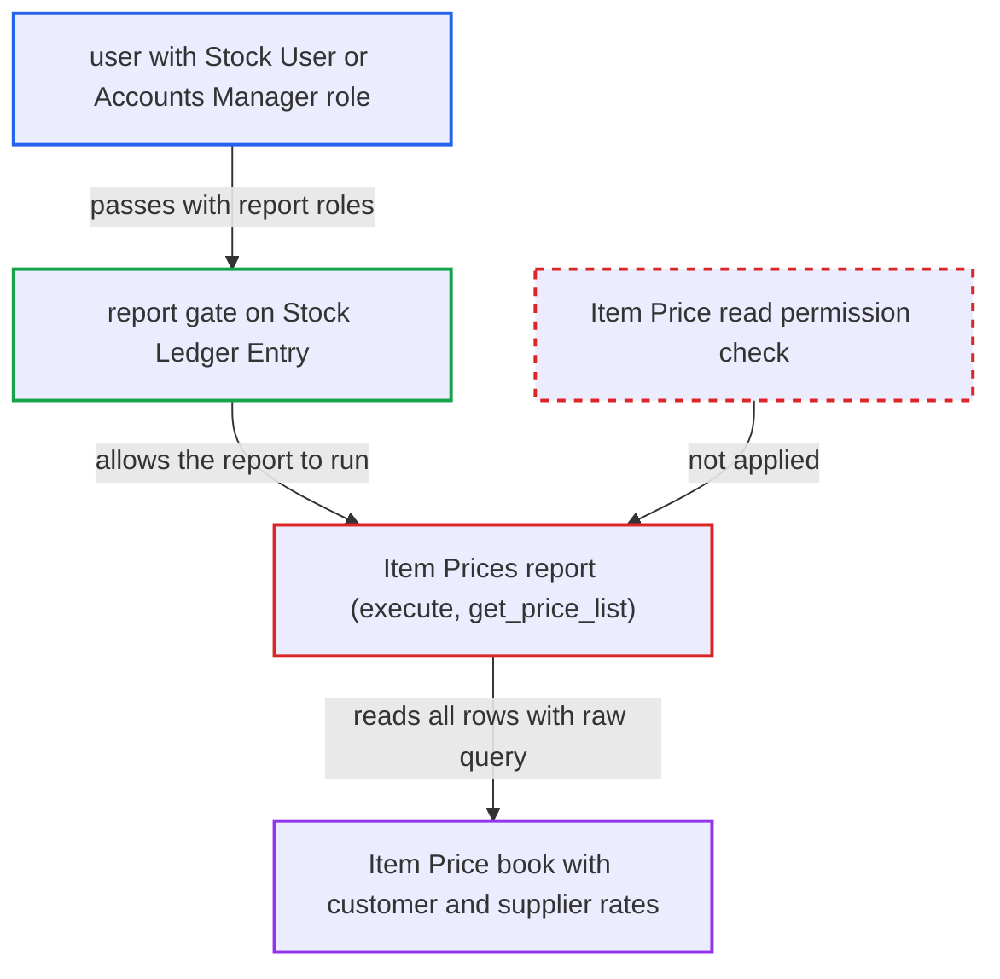

# Item Prices report exposes the full Item Price book to roles without Item Price read

| Field | Value |
|---|---|
| ID | `find_01WNmugQYPBhhPinSLDskf64` |
| Severity | **Medium** |
| Status | open |
| CWE | CWE-862 — Missing authorization |
| Created | 2026-10-27T21:20:01.921260Z |
| Claude Security | https://claude.ai/security/findings/find_01WNmugQYPBhhPinSLDskf64 |

## Description

A logged-in user with the Stock User or Accounts Manager role can read the whole Item Price book, including customer- and supplier-specific negotiated rates, even though the Item Price doctype denies them read access. The Item Prices report in `item_prices.py` never checks read permission on `Item Price`. It also never applies Price List user permissions.

1. **attacker with Stock User or Accounts Manager role** calls the report endpoint `/api/method/frappe.desk.query_report.run` with `report_name=Item Prices`. No filters are needed. The framework only checks report access on `Stock Ledger Entry`, which both roles hold. ([`erpnext/stock/report/item_prices/item_prices.json:15-25`](https://github.com/cx-benchmark/erpnext/blob/90e7aefca73da3c440d2e8da7472fcb67838e678/erpnext/stock/report/item_prices/item_prices.json#L15-L25))
2. **the report function `execute`** calls `get_price_list` without checking permission on `Item Price`. There is no `frappe.has_permission("Item Price", "read")` call on this path. ([`erpnext/stock/report/item_prices/item_prices.py:17-26`](https://github.com/cx-benchmark/erpnext/blob/90e7aefca73da3c440d2e8da7472fcb67838e678/erpnext/stock/report/item_prices/item_prices.py#L17-L26))
3. **the function `get_price_list`** selects every active `Item Price` row through raw `frappe.qb`. Raw queries apply no doctype or user permissions. The rows include rate, currency, price list, UOM and the `customer`, `supplier` or `batch_no` the price applies to. ([`erpnext/stock/report/item_prices/item_prices.py:98-159`](https://github.com/cx-benchmark/erpnext/blob/90e7aefca73da3c440d2e8da7472fcb67838e678/erpnext/stock/report/item_prices/item_prices.py#L98-L159))
4. **the function `get_price_label`** puts the price details into the Sales and Purchase Price List columns. The columns are untyped Data, so the report's row post-filter on Link columns filters nothing. This is an assumption about the pinned Frappe version. ([`erpnext/stock/report/item_prices/item_prices.py:98-159`](https://github.com/cx-benchmark/erpnext/blob/90e7aefca73da3c440d2e8da7472fcb67838e678/erpnext/stock/report/item_prices/item_prices.py#L98-L159))
5. **the report endpoint** returns the full price book to the caller. The doctype grants read only to `Sales Master Manager` and `Purchase Master Manager`, so this caller should not see it. ([`erpnext/stock/doctype/item_price/item_price.json:236-270`](https://github.com/cx-benchmark/erpnext/blob/90e7aefca73da3c440d2e8da7472fcb67838e678/erpnext/stock/doctype/item_price/item_price.json#L236-L270))

## Assessment

The attacker is an authenticated desk user who has the Stock User or Accounts Manager role but not read permission on `Item Price`. They need no special configuration and no other user's action. They call the report through `frappe.desk.query_report.run` with `report_name=Item Prices` and no filters. The report's `ref_doctype` is `Stock Ledger Entry`, so the framework only checks access to that doctype.

Impact: The attacker can read every active item's selling and buying prices, including prices tied to a specific customer, supplier or batch. The disclosure is read-only. The report does not allow changing data and does not affect availability.

## Recommendation

The report exposes Item Price data under the ref_doctype `Stock Ledger Entry` without checking the caller's permission on `Item Price`. Doctype-level access control on pricing is therefore bypassed.

Fix criteria: Price columns are produced only for users who hold read permission on `Item Price`, and the rows respect Item Price user permissions. Users without it get an error or a report with no price data. Running the report as a Stock User without Item Price read returns no price list values.

## Evidence

**https://github.com/cx-benchmark/erpnext**

- [`erpnext/stock/report/item_prices/item_prices.py:17-26`](https://github.com/cx-benchmark/erpnext/blob/90e7aefca73da3c440d2e8da7472fcb67838e678/erpnext/stock/report/item_prices/item_prices.py#L17-L26)
- [`erpnext/stock/report/item_prices/item_prices.py:98-159`](https://github.com/cx-benchmark/erpnext/blob/90e7aefca73da3c440d2e8da7472fcb67838e678/erpnext/stock/report/item_prices/item_prices.py#L98-L159)
- [`erpnext/stock/report/item_prices/item_prices.json:15-25`](https://github.com/cx-benchmark/erpnext/blob/90e7aefca73da3c440d2e8da7472fcb67838e678/erpnext/stock/report/item_prices/item_prices.json#L15-L25)
- [`erpnext/stock/doctype/item_price/item_price.json:236-270`](https://github.com/cx-benchmark/erpnext/blob/90e7aefca73da3c440d2e8da7472fcb67838e678/erpnext/stock/doctype/item_price/item_price.json#L236-L270)
- [`erpnext/stock/report/item_price_stock/item_price_stock.py:14-15`](https://github.com/cx-benchmark/erpnext/blob/90e7aefca73da3c440d2e8da7472fcb67838e678/erpnext/stock/report/item_price_stock/item_price_stock.py#L14-L15)
- [`erpnext/stock/doctype/item/item.py:1959-1967`](https://github.com/cx-benchmark/erpnext/blob/90e7aefca73da3c440d2e8da7472fcb67838e678/erpnext/stock/doctype/item/item.py#L1959-L1967)

