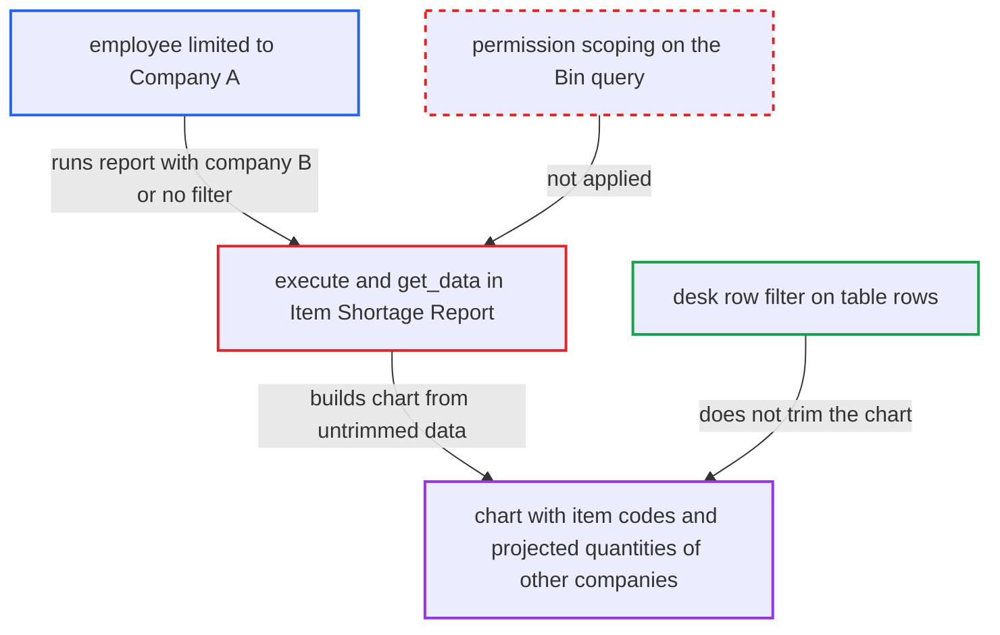

# Item Shortage Report chart discloses other companies' shortage items and projected quantities

| Field | Value |
|---|---|
| ID | `find_01VnphnS39Sd3RbKd2ZTe23h` |
| Severity | **Medium** |
| Status | open |
| CWE | CWE-862 — Missing authorization |
| Created | 2026-10-27T21:21:54.583282Z |
| Claude Security | https://claude.ai/security/findings/find_01VnphnS39Sd3RbKd2ZTe23h |

## Description

A logged-in employee with the Sales User, Purchase User or Stock User role, restricted by User Permissions to one company, can read other companies' or warehouses' worst shortage item codes and projected quantities. It needs no victim action. The cause is `execute` in the Item Shortage Report, which builds the chart from the result of `get_data`, a query with no permission check, before the desk trims the table rows.

1. **restricted employee** calls the report runner for the Item Shortage Report with a foreign scope. The call goes to `/api/method/frappe.desk.query_report.run` with `company=B`, a Company B warehouse in `warehouse`, or no filter at all. ([`erpnext/stock/report/item_shortage_report/item_shortage_report.json:18-31`](https://github.com/cx-benchmark/erpnext/blob/90e7aefca73da3c440d2e8da7472fcb67838e678/erpnext/stock/report/item_shortage_report/item_shortage_report.json#L18-L31))
2. **the report JSON** lets the `company` filter through unchecked. The report declares no `filters` table, so Frappe does not validate `company` against the user's permissions. ([`erpnext/stock/report/item_shortage_report/item_shortage_report.json:18-31`](https://github.com/cx-benchmark/erpnext/blob/90e7aefca73da3c440d2e8da7472fcb67838e678/erpnext/stock/report/item_shortage_report/item_shortage_report.json#L18-L31))
3. **the function `get_data`** reads Bin joined to Warehouse and Item with `frappe.qb`. The query has no User Permission or Company Restriction condition, and only the caller's optional `warehouse` and `company` filters narrow it. ([`erpnext/stock/report/item_shortage_report/item_shortage_report.py:22-62`](https://github.com/cx-benchmark/erpnext/blob/90e7aefca73da3c440d2e8da7472fcb67838e678/erpnext/stock/report/item_shortage_report/item_shortage_report.py#L22-L62))
4. **the function `execute`** builds the chart from the untrimmed `data`. `get_chart_data` puts the `item_code` and `projected_qty` of the 10 most negative Bins into the chart labels and dataset. ([`erpnext/stock/report/item_shortage_report/item_shortage_report.py:10-19`](https://github.com/cx-benchmark/erpnext/blob/90e7aefca73da3c440d2e8da7472fcb67838e678/erpnext/stock/report/item_shortage_report/item_shortage_report.py#L10-L19))
5. **Frappe report runner** trims the table rows but returns the chart unchanged. The row filter works on the Link columns `warehouse`, `item_code` and `company` of the table only, so the chart still holds the foreign items. ([`erpnext/stock/report/item_shortage_report/item_shortage_report.py:90-178`](https://github.com/cx-benchmark/erpnext/blob/90e7aefca73da3c440d2e8da7472fcb67838e678/erpnext/stock/report/item_shortage_report/item_shortage_report.py#L90-L178))

## Assessment

The attacker is a logged-in employee with Sales User, Purchase User or Stock User whose User Permissions limit them to Company A. They call the report runner with `report_name=Item Shortage Report` and `company=B`, a Company B warehouse in `warehouse`, or no filter. No victim action is needed. Each query returns at most 10 items, but the attacker can repeat it for each company or warehouse.

Impact: The attacker reads the item IDs and projected shortage quantities of the 10 worst-short items of other companies or warehouses, per query. This is read-only. Other quantity columns, item names and descriptions of foreign rows are trimmed by the desk filter. The report also does not apply Item Company Restriction (`restrict_to_companies`), so table rows for restricted items in the user's own company's warehouses stay visible.

## Recommendation

`get_data` reads Bin through a `frappe.qb` query that ignores permissions, and `execute` builds the chart from that result. The chart therefore reflects companies, warehouses and items outside the caller's User Permissions and Company Restrictions, even though the desk trims the table rows.

Fix criteria: Every value in the returned rows and the chart comes only from Bins in warehouses and companies the caller may see, and from items not restricted away from them, whatever filters are supplied. To verify, a user restricted to Company A runs the report with `company=B`, with a Company B warehouse, and with no filter. Then `chart` and `result` contain no Company B item codes or quantities.

## Evidence

**https://github.com/cx-benchmark/erpnext**

- [`erpnext/stock/report/item_shortage_report/item_shortage_report.py:22-62`](https://github.com/cx-benchmark/erpnext/blob/90e7aefca73da3c440d2e8da7472fcb67838e678/erpnext/stock/report/item_shortage_report/item_shortage_report.py#L22-L62)
- [`erpnext/stock/report/item_shortage_report/item_shortage_report.py:10-19`](https://github.com/cx-benchmark/erpnext/blob/90e7aefca73da3c440d2e8da7472fcb67838e678/erpnext/stock/report/item_shortage_report/item_shortage_report.py#L10-L19)
- [`erpnext/stock/report/item_shortage_report/item_shortage_report.py:73-87`](https://github.com/cx-benchmark/erpnext/blob/90e7aefca73da3c440d2e8da7472fcb67838e678/erpnext/stock/report/item_shortage_report/item_shortage_report.py#L73-L87)
- [`erpnext/stock/report/item_shortage_report/item_shortage_report.py:90-178`](https://github.com/cx-benchmark/erpnext/blob/90e7aefca73da3c440d2e8da7472fcb67838e678/erpnext/stock/report/item_shortage_report/item_shortage_report.py#L90-L178)
- [`erpnext/stock/report/item_shortage_report/item_shortage_report.json:18-31`](https://github.com/cx-benchmark/erpnext/blob/90e7aefca73da3c440d2e8da7472fcb67838e678/erpnext/stock/report/item_shortage_report/item_shortage_report.json#L18-L31)
- [`erpnext/stock/report/items_to_be_requested/items_to_be_requested.py:55-59`](https://github.com/cx-benchmark/erpnext/blob/90e7aefca73da3c440d2e8da7472fcb67838e678/erpnext/stock/report/items_to_be_requested/items_to_be_requested.py#L55-L59)
- [`erpnext/manufacturing/report/work_order_summary/work_order_summary.py:68`](https://github.com/cx-benchmark/erpnext/blob/90e7aefca73da3c440d2e8da7472fcb67838e678/erpnext/manufacturing/report/work_order_summary/work_order_summary.py#L68)

