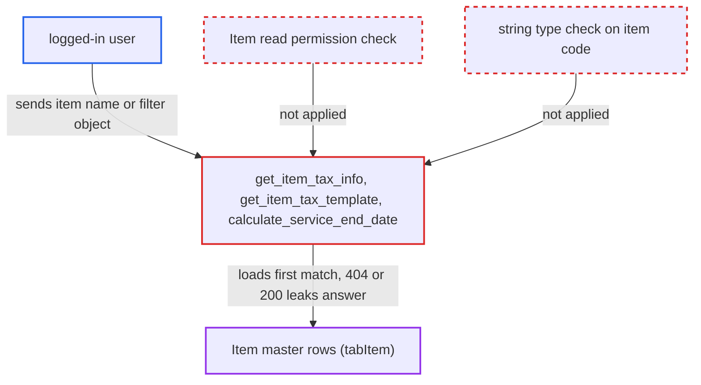

# Item tax/deferred helpers load caller-chosen Item without permission; dict name gives oracle

| Field | Value |
|---|---|
| ID | `find_01RUWhVMh4scQ5KkdrdDNJ91` |
| Severity | **Medium** |
| Status | open |
| CWE | CWE-639 — Improper Authorization |
| Created | 2026-10-27T22:03:03.713976Z |
| Claude Security | https://claude.ai/security/findings/find_01RUWhVMh4scQ5KkdrdDNJ91 |

## Description

Any logged-in user can read Item master data they are not allowed to see, including Items hidden by Item User Permissions or Company Restriction. With a plain Item name they get its tax and deferred-accounting details. With a filter object in place of the name they can read any `tabItem` column one bit at a time. The whitelisted helpers `get_item_tax_info`, `get_item_tax_template` and `calculate_service_end_date` load the Item with `frappe.get_cached_doc` without a permission check or a string check.

1. **logged-in user** posts a crafted request to `get_item_tax_info`. The `item_codes` value holds a JSON object such as a `valuation_rate` condition in the name position, and `item_tax_templates` holds a matching key. ([`erpnext/stock/get_item_details.py:854-880`](https://github.com/cx-benchmark/erpnext/blob/90e7aefca73da3c440d2e8da7472fcb67838e678/erpnext/stock/get_item_details.py#L854-L880))
2. **the helper `get_item_tax_info`** passes the first element of the parsed `item_codes` entry to `frappe.get_cached_doc("Item", ...)`. No `check_permission` or `has_permission` call and no string check runs before the load. ([`erpnext/stock/get_item_details.py:854-880`](https://github.com/cx-benchmark/erpnext/blob/90e7aefca73da3c440d2e8da7472fcb67838e678/erpnext/stock/get_item_details.py#L854-L880))
3. **Frappe** treats the object as a filter set and loads the first matching Item. This is the report's stated assumption, since Frappe is not in the checkout: `get_cached_doc` falls back to `get_doc` for a non-string name. The repo relies on the same behaviour elsewhere.
4. **logged-in user** reads the HTTP status of the response. A miss raises `DoesNotExistError` (404) and a hit returns 200, so each request answers one yes/no question about the Item table. ([`erpnext/stock/get_item_details.py:854-880`](https://github.com/cx-benchmark/erpnext/blob/90e7aefca73da3c440d2e8da7472fcb67838e678/erpnext/stock/get_item_details.py#L854-L880))
5. **logged-in user** repeats the request with narrower conditions. Binary search over the conditions recovers values of any `tabItem` column, including Item names restricted to other companies.

## Assessment

The attacker is any logged-in user. A desk user whose only Item access is `select` (the `Desk User` role in `item.json`) is enough. Users fenced by Item User Permissions or Company Restriction (`hooks.py:358-370`) are enough too. They call `/api/method/erpnext.stock.get_item_details.get_item_tax_info` with `item_codes` and `item_tax_templates` set as in the steps. `get_item_tax_template` and `calculate_service_end_date` accept the same input through `ctx.item_code`. No victim action is needed. The same filter-object trick also reaches `get_item_details`, where a miss gives 404 and a restricted hit gives 403 from `check_permission`, so that endpoint also tells the attacker whether a matching Item exists.

Impact: The attacker gets a blind yes/no read of every column of every Item row. This covers costing and pricing fields such as `valuation_rate`, `standard_rate`, `last_purchase_rate` and `max_discount`, plus defaults, restriction flags and names of company-restricted Items. With an exact Item name they also get its tax template or tax map, and its deferred-accounting flag, months and account. The read is limited to the Item master and yields one bit per request. The report names no write or availability effect.

## Recommendation

(1) `get_item_tax_info`, `get_item_tax_template` and `calculate_service_end_date` pass a caller-supplied value as the Item name to `frappe.get_cached_doc` without checking it is a string. A dict is therefore treated as a filter set and selects any row.

Fix criteria: Every whitelisted path that loads an Item from caller input accepts only a plain string docname and rejects any other type. Sending a dict or list as the item code returns the same validation error whether or not any Item matches.

(2) The three helpers never check that the caller may read the Item they load. Item User Permissions and the Company Restriction `has_permission` hook are bypassed, unlike `get_item_details`.

Fix criteria: Before any Item data is used or returned, the caller passes a record-level Item read check, or a select check where the role holds only select, so User Permissions and Company Restriction apply. A user scoped to company A gets a PermissionError for an Item restricted to company B from all three endpoints, while permitted Items still work.

## Evidence

**https://github.com/cx-benchmark/erpnext**

- [`erpnext/stock/get_item_details.py:854-880`](https://github.com/cx-benchmark/erpnext/blob/90e7aefca73da3c440d2e8da7472fcb67838e678/erpnext/stock/get_item_details.py#L854-L880)
- [`erpnext/stock/get_item_details.py:900-926`](https://github.com/cx-benchmark/erpnext/blob/90e7aefca73da3c440d2e8da7472fcb67838e678/erpnext/stock/get_item_details.py#L900-L926)
- [`erpnext/stock/get_item_details.py:1059-1082`](https://github.com/cx-benchmark/erpnext/blob/90e7aefca73da3c440d2e8da7472fcb67838e678/erpnext/stock/get_item_details.py#L1059-L1082)
- [`erpnext/stock/get_item_details.py:130-131`](https://github.com/cx-benchmark/erpnext/blob/90e7aefca73da3c440d2e8da7472fcb67838e678/erpnext/stock/get_item_details.py#L130-L131)
- [`erpnext/hooks.py:358-370`](https://github.com/cx-benchmark/erpnext/blob/90e7aefca73da3c440d2e8da7472fcb67838e678/erpnext/hooks.py#L358-L370)
- [`erpnext/__init__.py:204-243`](https://github.com/cx-benchmark/erpnext/blob/90e7aefca73da3c440d2e8da7472fcb67838e678/erpnext/__init__.py#L204-L243)

