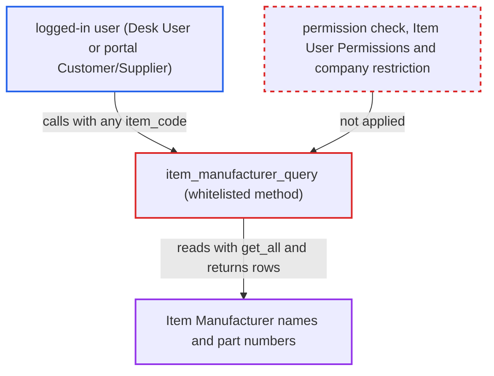

# item_manufacturer_query discloses Item Manufacturer rows without permission checks

| Field | Value |
|---|---|
| ID | `find_01NN6pbZZmjKZw3W7KydK34A` |
| Severity | **Medium** |
| Status | open |
| CWE | CWE-862 — Missing authorization |
| Created | 2026-10-27T21:28:00.199310Z |
| Claude Security | https://claude.ai/security/findings/find_01NN6pbZZmjKZw3W7KydK34A |

## Description

Any logged-in user can read the manufacturer names and manufacturer part numbers recorded for any item they name. This includes a desk user with only the automatic `Desk User` role and a portal Customer or Supplier user. The whitelisted method `item_manufacturer_query` reads `Item Manufacturer` with `frappe.get_all`, which ignores permissions, and does no permission check of its own. Only these two columns are exposed, and nothing can be changed.

1. **attacker (any logged-in user)** obtains an item code. A `Desk User` can list item codes because that role has `select` on `Item`, and a portal user can read them from their own documents.
2. **attacker** calls `/api/method/erpnext.controllers.queries.item_manufacturer_query` directly. The attacker sends `txt=""` and `filters={"item_code": "<item>"}`. The only shipped caller is the picker in `buying.js`, but the `item_code` filter can be set to any value by whoever calls the method. ([`erpnext/public/js/controllers/buying.js:112-118`](https://github.com/cx-benchmark/erpnext/blob/90e7aefca73da3c440d2e8da7472fcb67838e678/erpnext/public/js/controllers/buying.js#L112-L118))
3. **the method `item_manufacturer_query`** reads `Item Manufacturer` with `frappe.get_all`. `frappe.get_all` ignores permissions. The method only sanitizes the search arguments with `validate_and_sanitize_search_inputs` and runs no `has_permission` check. ([`erpnext/controllers/queries.py:1076-1094`](https://github.com/cx-benchmark/erpnext/blob/90e7aefca73da3c440d2e8da7472fcb67838e678/erpnext/controllers/queries.py#L1076-L1094))
4. **the hook in `hooks.py`** is never applied to this query. The wildcard `permission_query_conditions` hook adds company restrictions inherited from `Item`. `frappe.get_all` skips it, so rows for items restricted to other companies are also returned. ([`erpnext/hooks.py:363`](https://github.com/cx-benchmark/erpnext/blob/90e7aefca73da3c440d2e8da7472fcb67838e678/erpnext/hooks.py#L363))
5. **the method `item_manufacturer_query`** returns every manufacturer and manufacturer part number for that item. `item_manufacturer.json` grants read only to Stock User, Stock Manager and Item Manager, but the caller does not need any of these roles. ([`erpnext/stock/doctype/item_manufacturer/item_manufacturer.json`](https://github.com/cx-benchmark/erpnext/blob/90e7aefca73da3c440d2e8da7472fcb67838e678/erpnext/stock/doctype/item_manufacturer/item_manufacturer.json))

## Assessment

The attacker is any logged-in user. This can be an employee with only the automatic `Desk User` role or a portal Customer or Supplier user. No special setting or victim action is needed. The attacker needs an item code. A `Desk User` can list item codes through `select` on `Item`. A portal user can read them from their own documents. The attacker then calls the method over the network with that item code.

Impact: The attacker reads every manufacturer name and manufacturer part number recorded for any item they name. This includes items restricted to companies the attacker may not see. The exposure is read-only, limited to those two columns, and is catalogue sourcing data rather than financial data.

## Recommendation

`item_manufacturer_query` reads `Item Manufacturer` with the permission-ignoring `frappe.get_all` and checks nothing itself. Role permissions, Item User Permissions and the inherited company restriction are all skipped for any logged-in caller.

Fix criteria: Rows are returned only to a caller authorised for that item's manufacturer data. That means `Item Manufacturer` select/read, or a deliberately chosen equivalent such as read on the named `Item`, with User Permissions and company restrictions on the Item honoured. A portal Customer/Supplier user and a desk user holding only `Desk User` get a PermissionError or no rows. A company-restricted user gets no rows for an item restricted to another company. Purchase users who use the picker still get their results.

## Evidence

**https://github.com/cx-benchmark/erpnext**

- [`erpnext/controllers/queries.py:1076-1094`](https://github.com/cx-benchmark/erpnext/blob/90e7aefca73da3c440d2e8da7472fcb67838e678/erpnext/controllers/queries.py#L1076-L1094)
- [`erpnext/stock/doctype/item_manufacturer/item_manufacturer.json`](https://github.com/cx-benchmark/erpnext/blob/90e7aefca73da3c440d2e8da7472fcb67838e678/erpnext/stock/doctype/item_manufacturer/item_manufacturer.json)
- [`erpnext/hooks.py:363`](https://github.com/cx-benchmark/erpnext/blob/90e7aefca73da3c440d2e8da7472fcb67838e678/erpnext/hooks.py#L363)
- [`erpnext/public/js/controllers/buying.js:112-118`](https://github.com/cx-benchmark/erpnext/blob/90e7aefca73da3c440d2e8da7472fcb67838e678/erpnext/public/js/controllers/buying.js#L112-L118)

