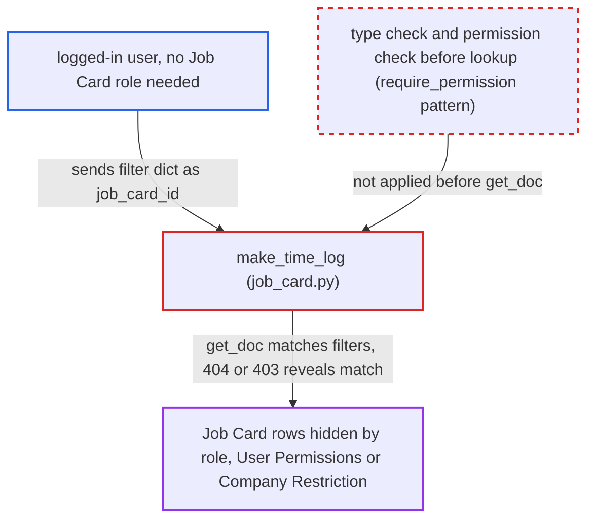

# Job Card make_time_log loads a caller filter dict before authorization, a blind Job Card oracle

| Field | Value |
|---|---|
| ID | `find_01KgAjKEEcykSuDtFrRFEDKX` |
| Severity | **Medium** |
| Status | open |
| CWE | CWE-943 — Query logic injection |
| Created | 2026-10-27T22:03:58.376578Z |
| Claude Security | https://claude.ai/security/findings/find_01KgAjKEEcykSuDtFrRFEDKX |

## Description

Any logged-in user can learn whether a Job Card matching a condition of their choice exists. This includes cards hidden from them by role, User Permissions or Company Restriction, and it works on columns such as `hour_rate`, `employee` and `remarks`. Each request leaks one bit, and no write goes beyond the caller's rights. The cause is `make_time_log`, which passes a caller-supplied `job_card_id` to `frappe.get_doc` before it checks permission.

1. **logged-in attacker** posts a filter dict as `job_card_id` to `make_time_log`. The `kwargs` value is sent as a JSON string, for example one with `company` and an `hour_rate` condition, which passes Frappe's `str | dict` annotation check. ([`erpnext/manufacturing/doctype/job_card/job_card.py:2279-2290`](https://github.com/cx-benchmark/erpnext/blob/90e7aefca73da3c440d2e8da7472fcb67838e678/erpnext/manufacturing/doctype/job_card/job_card.py#L2279-L2290))
2. **the handler `make_time_log`** parses `kwargs` and reads `kwargs.job_card_id` without a type check. `frappe.parse_json` returns a dict, and nothing requires `job_card_id` to be a string. ([`erpnext/manufacturing/doctype/job_card/job_card.py:2279-2290`](https://github.com/cx-benchmark/erpnext/blob/90e7aefca73da3c440d2e8da7472fcb67838e678/erpnext/manufacturing/doctype/job_card/job_card.py#L2279-L2290))
3. **`frappe.get_doc`** treats the dict as a set of filters and loads the first matching Job Card. The pinned Frappe resolves a dict in the name position as filters, operators included, and this lookup has no permission check. ([`erpnext/support/doctype/service_level_agreement/service_level_agreement.py:220`](https://github.com/cx-benchmark/erpnext/blob/90e7aefca73da3c440d2e8da7472fcb67838e678/erpnext/support/doctype/service_level_agreement/service_level_agreement.py#L220))
4. **the handler `make_time_log`** answers differently for no match and for a matched card the caller cannot write. No match raises `DoesNotExistError` (404). A matched card the caller cannot write makes `frappe.has_permission` at `:2285` raise `PermissionError` (403), which comes only after the lookup. ([`erpnext/manufacturing/doctype/job_card/job_card.py:2279-2290`](https://github.com/cx-benchmark/erpnext/blob/90e7aefca73da3c440d2e8da7472fcb67838e678/erpnext/manufacturing/doctype/job_card/job_card.py#L2279-L2290))
5. **logged-in attacker** repeats the request with narrower filters and reads each status code. Using `like` or `>` conditions, the attacker reads column values back one bit at a time.

## Assessment

The attacker is any logged-in user. No Job Card role is needed, because the lookup runs before any check. They POST to `/api/method/erpnext.manufacturing.doctype.job_card.job_card.make_time_log` with `kwargs={"job_card_id":{"company":"Other Co","hour_rate":[">",100]}}`. No victim is involved and nothing else stands in the way. A 404 means no card matches, and a 403 means a hidden card matched. The report also says the 403 message may name the matched card, but this is unverified. The report adds a caveat: if the pinned `frappe.client.get(filters=…)` also loads before checking, the framework offers a similar oracle.

Impact: The attacker gets a blind yes/no read of any `tabJob Card` column, one bit per request. The columns include `company`, `production_item`, `work_order`, `workstation`, `employee`, `for_quantity`, `total_completed_qty`, `hour_rate`, `remarks` and `status`. This exposes other companies' production items, quantities, hour rates, employees and remarks. It covers one table only, and no write goes beyond the caller's existing rights.

## Recommendation

`make_time_log` passes a caller-parsed `job_card_id` to `frappe.get_doc` before any type check or authorisation. A dict therefore acts as a database filter, and the miss and refusal outcomes reveal whether it matched.

Fix criteria: `job_card_id` must be a non-empty plain string, and write permission on that named card must be checked before any lookup. Missing, malformed and forbidden names must all get the same refusal. To verify, send a dict `job_card_id` as a user with no access to the matching card. The response must not differ between a filter that matches and one that does not.

## Evidence

**https://github.com/cx-benchmark/erpnext**

- [`erpnext/manufacturing/doctype/job_card/job_card.py:2279-2290`](https://github.com/cx-benchmark/erpnext/blob/90e7aefca73da3c440d2e8da7472fcb67838e678/erpnext/manufacturing/doctype/job_card/job_card.py#L2279-L2290)
- [`erpnext/manufacturing/doctype/job_card/job_card.json`](https://github.com/cx-benchmark/erpnext/blob/90e7aefca73da3c440d2e8da7472fcb67838e678/erpnext/manufacturing/doctype/job_card/job_card.json)
- [`erpnext/support/doctype/service_level_agreement/service_level_agreement.py:220`](https://github.com/cx-benchmark/erpnext/blob/90e7aefca73da3c440d2e8da7472fcb67838e678/erpnext/support/doctype/service_level_agreement/service_level_agreement.py#L220)
- [`erpnext/__init__.py:227-256`](https://github.com/cx-benchmark/erpnext/blob/90e7aefca73da3c440d2e8da7472fcb67838e678/erpnext/__init__.py#L227-L256)
- [`erpnext/tests/permission_test_utils.py:53-116`](https://github.com/cx-benchmark/erpnext/blob/90e7aefca73da3c440d2e8da7472fcb67838e678/erpnext/tests/permission_test_utils.py#L53-L116)

