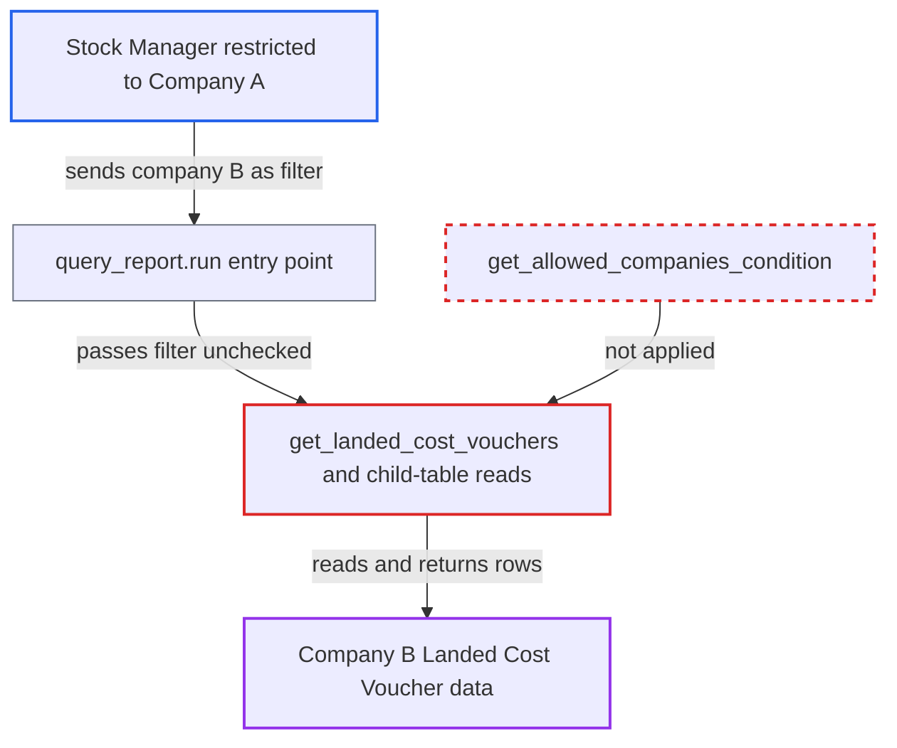

# Landed Cost Report ignores Company user permissions on the caller-chosen company

| Field | Value |
|---|---|
| ID | `find_01CREpAKqhovXuzTsScygH6q` |
| Severity | **Medium** |
| Status | open |
| CWE | CWE-862 — Missing authorization |
| Created | 2026-10-27T21:21:08.413710Z |
| Claude Security | https://claude.ai/security/findings/find_01CREpAKqhovXuzTsScygH6q |

## Description

A Stock Manager who is restricted by Company User Permissions to one company can read another company's Landed Cost Voucher data through the Landed Cost Report. They get voucher IDs, linked document names, allocated charges and vendor invoice IDs, but no document bodies. The report trusts the caller's `company` filter, and `get_landed_cost_vouchers` never checks it against the user's permitted companies.

1. **Attacker (Stock Manager restricted to Company A)** calls `frappe.desk.query_report.run` for the Landed Cost Report with another company. The request sets `report_name=Landed Cost Report` and `filters` with `company` set to "B", `from_date` 2000-01-01 and `to_date` 2099-12-31. Stock Manager is the only role that passes the report gate. ([`erpnext/stock/report/landed_cost_report/landed_cost_report.json:9-36`](https://github.com/cx-benchmark/erpnext/blob/90e7aefca73da3c440d2e8da7472fcb67838e678/erpnext/stock/report/landed_cost_report/landed_cost_report.json#L9-L36))
2. **Frappe report runner** lets the request through without checking the company. The role and `report` permission checks pass. The Report doc declares no filters (`filters: []`), so no Link filter is validated on the server. ([`erpnext/stock/report/landed_cost_report/landed_cost_report.json:9-36`](https://github.com/cx-benchmark/erpnext/blob/90e7aefca73da3c440d2e8da7472fcb67838e678/erpnext/stock/report/landed_cost_report/landed_cost_report.json#L9-L36))
3. **the function `get_landed_cost_vouchers`** queries submitted vouchers of the caller-chosen company. It uses raw `frappe.qb` and filters only on `lcv.company == filters.company` (line 113). No `get_allowed_companies_condition` limits it to the user's permitted companies. ([`erpnext/stock/report/landed_cost_report/landed_cost_report.py:100-134`](https://github.com/cx-benchmark/erpnext/blob/90e7aefca73da3c440d2e8da7472fcb67838e678/erpnext/stock/report/landed_cost_report/landed_cost_report.py#L100-L134))
4. **the functions `get_receipt_allocations` and `get_vendor_invoices`** add allocated charges and vendor invoice IDs for those vouchers. They read `applicable_charges` sums and the vendor Purchase Invoice IDs for the vouchers found, and apply no permission filtering. ([`erpnext/stock/report/landed_cost_report/landed_cost_report.py:137-173`](https://github.com/cx-benchmark/erpnext/blob/90e7aefca73da3c440d2e8da7472fcb67838e678/erpnext/stock/report/landed_cost_report/landed_cost_report.py#L137-L173))
5. **Frappe row filter** fails to drop Company B rows from the result. The output has no Company column, so the Link-column User Permission filter has nothing to test a Company restriction against. ([`erpnext/stock/report/landed_cost_report/landed_cost_report.py:19-61`](https://github.com/cx-benchmark/erpnext/blob/90e7aefca73da3c440d2e8da7472fcb67838e678/erpnext/stock/report/landed_cost_report/landed_cost_report.py#L19-L61))

## Assessment

The attacker is a logged-in Stock Manager on a multi-company site whose Company User Permission confines them to Company A. Stock Manager is the only report role that also has `report` permission on Landed Cost Voucher. Stock User, Purchase User and Purchase Manager are refused. The attacker needs no other setup. The `reqd` company filter and its default to the user's own company exist only in `landed_cost_report.js`, so a direct API call can set any company. The report's behaviour also rests on an assumption about Frappe (>=17.0.0-dev,\<18), which is not in the checkout. The assumption is that `frappe.desk.query_report.run` checks only the report roles and `ref_doctype` permission, validates only declared filters, and trims rows only by Link-column values.

Impact: The attacker gets a read-only list of another company's submitted Landed Cost Vouchers. It includes the Purchase Receipt, Purchase Invoice, Stock Entry or Subcontracting Receipt names they apply to, the landed cost allocated to each, and the vendor Purchase Invoice IDs. These are names and amounts only, with no document bodies, and there is no write or availability effect.

## Recommendation

`get_landed_cost_vouchers` takes its company scope from the caller's `company` filter without checking it against the companies the user's Company User Permissions allow. The allocation and vendor-invoice reads inherit that scope, so the Company restriction on Landed Cost Voucher is bypassed.

Fix criteria: The report returns only vouchers whose company the running user's Company User Permissions allow (applicable to Landed Cost Voucher). A `company` outside that set yields no rows or a PermissionError, including for the allocation and vendor-invoice rows. Check: a Stock Manager restricted to Company A who names Company B gets no Company B rows from `frappe.desk.query_report.run`.

## Evidence

**https://github.com/cx-benchmark/erpnext**

- [`erpnext/stock/report/landed_cost_report/landed_cost_report.py:100-134`](https://github.com/cx-benchmark/erpnext/blob/90e7aefca73da3c440d2e8da7472fcb67838e678/erpnext/stock/report/landed_cost_report/landed_cost_report.py#L100-L134)
- [`erpnext/stock/report/landed_cost_report/landed_cost_report.py:137-173`](https://github.com/cx-benchmark/erpnext/blob/90e7aefca73da3c440d2e8da7472fcb67838e678/erpnext/stock/report/landed_cost_report/landed_cost_report.py#L137-L173)
- [`erpnext/stock/report/landed_cost_report/landed_cost_report.py:19-61`](https://github.com/cx-benchmark/erpnext/blob/90e7aefca73da3c440d2e8da7472fcb67838e678/erpnext/stock/report/landed_cost_report/landed_cost_report.py#L19-L61)
- [`erpnext/stock/report/landed_cost_report/landed_cost_report.json:9-36`](https://github.com/cx-benchmark/erpnext/blob/90e7aefca73da3c440d2e8da7472fcb67838e678/erpnext/stock/report/landed_cost_report/landed_cost_report.json#L9-L36)
- [`erpnext/stock/doctype/landed_cost_voucher/landed_cost_voucher.json:174-188`](https://github.com/cx-benchmark/erpnext/blob/90e7aefca73da3c440d2e8da7472fcb67838e678/erpnext/stock/doctype/landed_cost_voucher/landed_cost_voucher.json#L174-L188)
- [`erpnext/stock/report/available_batch_report/available_batch_report.py:165-170`](https://github.com/cx-benchmark/erpnext/blob/90e7aefca73da3c440d2e8da7472fcb67838e678/erpnext/stock/report/available_batch_report/available_batch_report.py#L165-L170)

