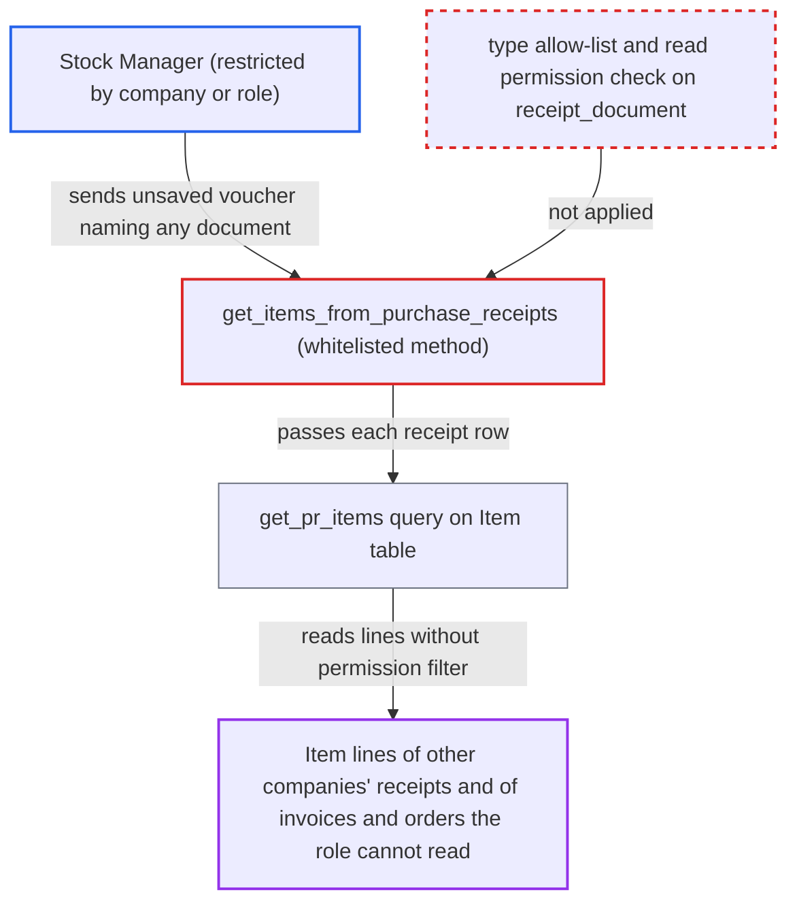

# Landed Cost Voucher item fetch returns line items of unreadable receipts and invoices

| Field | Value |
|---|---|
| ID | `find_019CTvu1jL1hoL7wwzvhabsx` |
| Severity | **Medium** |
| Status | open |
| CWE | CWE-862 — Missing authorization |
| Created | 2026-10-27T21:30:20.675310Z |
| Claude Security | https://claude.ai/security/findings/find_019CTvu1jL1hoL7wwzvhabsx |

## Description

A logged-in Stock Manager can read the stock and fixed-asset item lines of receipts, invoices and orders they are not allowed to see. That includes other companies' Purchase Receipts, and Purchase Invoice, Sales Invoice, POS Invoice and Purchase Order lines for a Stock Manager without accounting or buying roles. The whitelisted method `get_items_from_purchase_receipts` and its helper `get_pr_items` never check read permission, company or document type on the rows the caller supplies.

1. **Stock Manager** sends a `run_doc_method` request for `get_items_from_purchase_receipts` with a new, unsaved voucher. The voucher JSON carries the attacker's own allowed `company` and a receipt row with a chosen `receipt_document_type` and `receipt_document`, which can be guessed from the naming series. ([`erpnext/stock/doctype/landed_cost_voucher/landed_cost_voucher.js:47-58`](https://github.com/cx-benchmark/erpnext/blob/90e7aefca73da3c440d2e8da7472fcb67838e678/erpnext/stock/doctype/landed_cost_voucher/landed_cost_voucher.js#L47-L58))
2. **Frappe `run_doc_method`** accepts the call after checking read permission only on the posted voucher. Any Stock Manager passes this check by naming a company they may use, and the voucher is never validated or saved, so the `Select` options and `validate_receipt_documents` company and docstatus checks do not run. ([`erpnext/stock/doctype/landed_cost_voucher/landed_cost_voucher.json:174-188`](https://github.com/cx-benchmark/erpnext/blob/90e7aefca73da3c440d2e8da7472fcb67838e678/erpnext/stock/doctype/landed_cost_voucher/landed_cost_voucher.json#L174-L188))
3. **the method `get_items_from_purchase_receipts`** loops over the caller's receipt rows and calls `get_pr_items` for each. It does not check the row's document type, the caller's permission on `receipt_document`, or that document's company. ([`erpnext/stock/doctype/landed_cost_voucher/landed_cost_voucher.py:63-85`](https://github.com/cx-benchmark/erpnext/blob/90e7aefca73da3c440d2e8da7472fcb67838e678/erpnext/stock/doctype/landed_cost_voucher/landed_cost_voucher.py#L63-L85))
4. **the helper `get_pr_items`** queries the `<receipt_document_type> Item` table for the named parent with `frappe.qb`. `frappe.qb` applies no role or User Permission filter, and the unchecked type is also used as part of the table name. ([`erpnext/stock/doctype/landed_cost_voucher/landed_cost_voucher.py:630-678`](https://github.com/cx-benchmark/erpnext/blob/90e7aefca73da3c440d2e8da7472fcb67838e678/erpnext/stock/doctype/landed_cost_voucher/landed_cost_voucher.py#L630-L678))
5. **the method `get_items_from_purchase_receipts`** copies the returned lines into the voucher's `items` and returns them to the caller. The attacker receives item code, description, quantity, row name, cost centre, base net rate, base net amount and the fixed-asset flag.

## Assessment

The attacker is an authenticated Stock Manager, the only role with read access to Landed Cost Voucher. Either they are confined to one company by Company User Permissions, or they lack accounting or buying roles. They POST to `/api/method/run_doc_method` with `method=get_items_from_purchase_receipts` and a new voucher (`__islocal: 1`) with their own allowed `company`. The voucher has a row naming a `receipt_document_type` (`Purchase Receipt`, `Purchase Invoice`, `Sales Invoice`, `POS Invoice` or `Purchase Order`) and any document name. No victim is involved. The path assumes Frappe `>=17.0.0-dev,<18.0.0` behaves as the repository's tests and the note in `pick_list.py` rely on. That Frappe code is not in the checkout. It must check read only on the posted voucher, accept `__islocal` drafts, and return the document in `frappe.response.docs`.

Impact: For any named receipt, invoice or order in any company, the caller learns its stock and fixed-asset item lines. These are item code, description, quantity, base net rate, base net amount, cost centre and row name. The disclosure is partial. Header data such as party and totals is not returned, the join to `Item` filters out other items, and each request needs a document name. Nothing is written, because the voucher is never saved on this path.

## Recommendation

`get_items_from_purchase_receipts` trusts the receipt rows of a caller-built, unsaved voucher. It reads the referenced documents' lines without checking that their type is allowed, that the caller may read them, or that they belong to the voucher's company.

Fix criteria: Before any query, each row's `receipt_document_type` must be in `RECEIPT_DOCUMENT_TYPES`, which also keeps the value out of the SQL identifier. The caller must hold read permission, including User Permissions, on that specific `receipt_document`. The document's company must match the voucher's company. Verify that a Stock Manager restricted to Company A who names a Company B Purchase Receipt gets a permission error and no item rows. Verify the same for a Stock Manager who lacks Purchase Invoice read and names a Purchase Invoice or Sales Invoice.

## Evidence

**https://github.com/cx-benchmark/erpnext**

- [`erpnext/stock/doctype/landed_cost_voucher/landed_cost_voucher.py:63-85`](https://github.com/cx-benchmark/erpnext/blob/90e7aefca73da3c440d2e8da7472fcb67838e678/erpnext/stock/doctype/landed_cost_voucher/landed_cost_voucher.py#L63-L85)
- [`erpnext/stock/doctype/landed_cost_voucher/landed_cost_voucher.py:630-678`](https://github.com/cx-benchmark/erpnext/blob/90e7aefca73da3c440d2e8da7472fcb67838e678/erpnext/stock/doctype/landed_cost_voucher/landed_cost_voucher.py#L630-L678)
- [`erpnext/stock/doctype/landed_cost_voucher/landed_cost_voucher.js:47-58`](https://github.com/cx-benchmark/erpnext/blob/90e7aefca73da3c440d2e8da7472fcb67838e678/erpnext/stock/doctype/landed_cost_voucher/landed_cost_voucher.js#L47-L58)
- [`erpnext/stock/doctype/landed_cost_voucher/landed_cost_voucher.py:438-443`](https://github.com/cx-benchmark/erpnext/blob/90e7aefca73da3c440d2e8da7472fcb67838e678/erpnext/stock/doctype/landed_cost_voucher/landed_cost_voucher.py#L438-L443)
- [`erpnext/stock/doctype/purchase_receipt/purchase_receipt.py:593-622`](https://github.com/cx-benchmark/erpnext/blob/90e7aefca73da3c440d2e8da7472fcb67838e678/erpnext/stock/doctype/purchase_receipt/purchase_receipt.py#L593-L622)
- [`erpnext/stock/doctype/landed_cost_voucher/landed_cost_voucher.json:174-188`](https://github.com/cx-benchmark/erpnext/blob/90e7aefca73da3c440d2e8da7472fcb67838e678/erpnext/stock/doctype/landed_cost_voucher/landed_cost_voucher.json#L174-L188)
- [`erpnext/stock/doctype/landed_cost_purchase_receipt/landed_cost_purchase_receipt.json:18-33`](https://github.com/cx-benchmark/erpnext/blob/90e7aefca73da3c440d2e8da7472fcb67838e678/erpnext/stock/doctype/landed_cost_purchase_receipt/landed_cost_purchase_receipt.json#L18-L33)
- [`erpnext/stock/doctype/pick_list/pick_list.py:722-727`](https://github.com/cx-benchmark/erpnext/blob/90e7aefca73da3c440d2e8da7472fcb67838e678/erpnext/stock/doctype/pick_list/pick_list.py#L722-L727)

