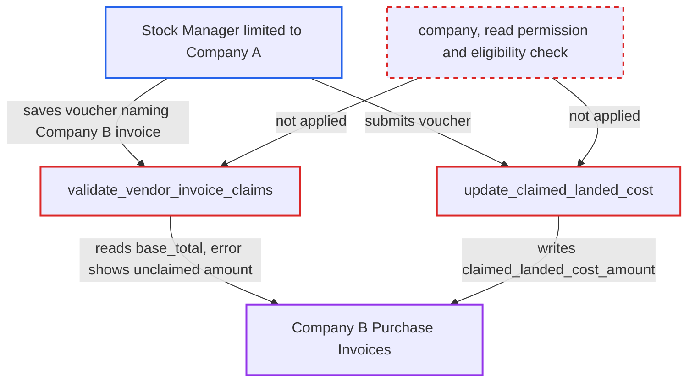

# Landed Cost Voucher vendor-invoice rows let a user write to and read amounts of any Purchase Invoice

| Field | Value |
|---|---|
| ID | `find_017Wg8fPqRkUs38djaSeDHWE` |
| Severity | **Medium** |
| Status | open |
| CWE | CWE-639 — Insecure direct object reference |
| Created | 2026-10-27T22:02:41.173360Z |
| Claude Security | https://claude.ai/security/findings/find_017Wg8fPqRkUs38djaSeDHWE |

## Description

A Stock Manager limited to one company can read the totals of other companies' Purchase Invoices and change their claimed landed cost amount. The attacker needs only a Stock Manager login and a saved Landed Cost Voucher. `validate_vendor_invoice_claims` and `update_claimed_landed_cost` trust any Purchase Invoice name in `vendor_invoices`, with no check of company, read permission or eligibility.

1. **Stock Manager limited to Company A** saves a Company-A Landed Cost Voucher whose `vendor_invoices` row names a Company-B Purchase Invoice. `vendor_invoice` is a plain Link with no filters, and `amount` is read-only only in the browser form, so the server stores the value the client sends. ([`erpnext/stock/doctype/landed_cost_vendor_invoice/landed_cost_vendor_invoice.json:12-28`](https://github.com/cx-benchmark/erpnext/blob/90e7aefca73da3c440d2e8da7472fcb67838e678/erpnext/stock/doctype/landed_cost_vendor_invoice/landed_cost_vendor_invoice.json#L12-L28))
2. **the method `validate_vendor_invoice_claims`** reads `base_total` of the named invoice and compares the claimed amount with its unclaimed amount. It never checks the invoice's company, the user's read permission, or whether the invoice is submitted, has `update_stock = 0` and is not a return. ([`erpnext/stock/doctype/landed_cost_voucher/landed_cost_voucher.py:492-510`](https://github.com/cx-benchmark/erpnext/blob/90e7aefca73da3c440d2e8da7472fcb67838e678/erpnext/stock/doctype/landed_cost_voucher/landed_cost_voucher.py#L492-L510))
3. **the method `validate_vendor_invoice_claims`** rejects an amount that is too large and puts the invoice's unclaimed amount in the error message. The attacker can read the invoice's amount this way, although Stock Manager has only `select` on Purchase Invoice and not `read`. ([`erpnext/stock/doctype/landed_cost_voucher/landed_cost_voucher.py:492-510`](https://github.com/cx-benchmark/erpnext/blob/90e7aefca73da3c440d2e8da7472fcb67838e678/erpnext/stock/doctype/landed_cost_voucher/landed_cost_voucher.py#L492-L510))
4. **Stock Manager limited to Company A** submits the voucher with an amount that fits. Receipt rows are checked against the voucher company with `IncorrectCompanyValidationError`, but vendor-invoice rows get no such check. ([`erpnext/stock/doctype/landed_cost_voucher/landed_cost_voucher.py:132-160`](https://github.com/cx-benchmark/erpnext/blob/90e7aefca73da3c440d2e8da7472fcb67838e678/erpnext/stock/doctype/landed_cost_voucher/landed_cost_voucher.py#L132-L160))
5. **the method `update_claimed_landed_cost`** writes `claimed_landed_cost_amount` on the Company-B invoice. It uses `frappe.db.set_value`, which skips all permission checks, and it runs on submit and cancel for every named invoice. ([`erpnext/stock/doctype/landed_cost_voucher/landed_cost_voucher.py:483-490`](https://github.com/cx-benchmark/erpnext/blob/90e7aefca73da3c440d2e8da7472fcb67838e678/erpnext/stock/doctype/landed_cost_voucher/landed_cost_voucher.py#L483-L490))

## Assessment

The attacker is a Stock Manager restricted by User Permission to Company A. They save a Company-A Landed Cost Voucher through the REST API. It uses a submitted Company-A receipt and a `vendor_invoices` row naming a Company-B Purchase Invoice. Invoice names come from a sequential series. If the amount is too large, the save fails and the error shows the unclaimed amount. If it fits, they submit the voucher. No victim action is needed. The report assumes that Frappe `>=17.0.0-dev,<18.0.0` enforces a Company User Permission only on Link fields that point to `Company`, and that Link validation on save only checks that the record exists. That code is not in the checkout. The fork's `validate_transaction_company` hook does not help, because it exempts Landed Cost Voucher.

Impact: The attacker can set `claimed_landed_cost_amount` on other companies' submitted Purchase Invoices, up to each invoice's full `base_total`. Company B can then no longer claim those invoices, because they vanish from `get_vendor_invoice_query` and validation refuses them, so its landed-cost tracking becomes wrong. The attacker can also read the totals of invoices they have no read permission for. No GL or stock-ledger entries are touched.

## Recommendation

`validate_vendor_invoice_claims` and `update_claimed_landed_cost` act on any Purchase Invoice name the client supplies. They never check its company, the user's read permission, or whether it is an eligible vendor invoice. The validation error also reports the invoice's unclaimed amount.

Fix criteria: Before any amount is compared, saving or submitting a Landed Cost Voucher rejects every `vendor_invoices` row whose Purchase Invoice belongs to another company, that the user cannot read, or that fails the eligibility rules of `get_vendor_invoice_query`. A Company-A Stock Manager who names a Company-B invoice, or any invoice they cannot read, gets an error that shows none of that invoice's amounts. The invoice's `claimed_landed_cost_amount` stays unchanged.

## Evidence

**https://github.com/cx-benchmark/erpnext**

- [`erpnext/stock/doctype/landed_cost_voucher/landed_cost_voucher.py:492-510`](https://github.com/cx-benchmark/erpnext/blob/90e7aefca73da3c440d2e8da7472fcb67838e678/erpnext/stock/doctype/landed_cost_voucher/landed_cost_voucher.py#L492-L510)
- [`erpnext/stock/doctype/landed_cost_voucher/landed_cost_voucher.py:483-490`](https://github.com/cx-benchmark/erpnext/blob/90e7aefca73da3c440d2e8da7472fcb67838e678/erpnext/stock/doctype/landed_cost_voucher/landed_cost_voucher.py#L483-L490)
- [`erpnext/stock/doctype/landed_cost_voucher/landed_cost_voucher.py:132-160`](https://github.com/cx-benchmark/erpnext/blob/90e7aefca73da3c440d2e8da7472fcb67838e678/erpnext/stock/doctype/landed_cost_voucher/landed_cost_voucher.py#L132-L160)
- [`erpnext/stock/doctype/landed_cost_vendor_invoice/landed_cost_vendor_invoice.json:12-28`](https://github.com/cx-benchmark/erpnext/blob/90e7aefca73da3c440d2e8da7472fcb67838e678/erpnext/stock/doctype/landed_cost_vendor_invoice/landed_cost_vendor_invoice.json#L12-L28)
- [`erpnext/stock/doctype/landed_cost_voucher/landed_cost_voucher.py:610-626`](https://github.com/cx-benchmark/erpnext/blob/90e7aefca73da3c440d2e8da7472fcb67838e678/erpnext/stock/doctype/landed_cost_voucher/landed_cost_voucher.py#L610-L626)
- [`erpnext/accounts/doctype/purchase_invoice/purchase_invoice.json:1769-1772`](https://github.com/cx-benchmark/erpnext/blob/90e7aefca73da3c440d2e8da7472fcb67838e678/erpnext/accounts/doctype/purchase_invoice/purchase_invoice.json#L1769-L1772)
- [`erpnext/stock/doctype/landed_cost_voucher/test_landed_cost_voucher.py:317-334`](https://github.com/cx-benchmark/erpnext/blob/90e7aefca73da3c440d2e8da7472fcb67838e678/erpnext/stock/doctype/landed_cost_voucher/test_landed_cost_voucher.py#L317-L334)

