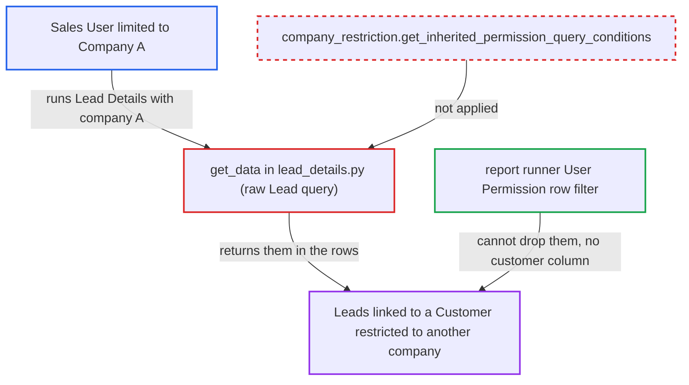

# Lead Details report shows Leads hidden by Company Restriction on their linked Customer

| Field | Value |
|---|---|
| ID | `find_01DHCPwDSH6mh8MAUYDPUa5P` |
| Severity | **Medium** |
| Status | open |
| CWE | CWE-863 — Missing authorization |
| Created | 2026-10-27T21:52:00.855785Z |
| Claude Security | https://claude.ai/security/findings/find_01DHCPwDSH6mh8MAUYDPUa5P |

## Description

A logged-in Sales User can read Leads that the Company Restriction feature is meant to hide from them, including name, email, phone and address. Only Leads with a blank company, or the user's own company, that are linked to a Customer restricted to another company are exposed. The cause is `get_data` in `lead_details.py`, which uses a raw query and never applies the user's Lead permission conditions.

1. **Sales User** calls `frappe.desk.query_report.run` for the `Lead Details` report. The user passes `company=A`, their permitted company, and a wide creation date range. No victim action is needed.
2. **the function `get_data`** runs a raw `frappe.qb` query on `Lead`. The query is limited only by the caller's filters: company equal to the filter or empty, creation date, territory and status. It adds no permission conditions. ([`erpnext/crm/report/lead_details/lead_details.py:76-112`](https://github.com/cx-benchmark/erpnext/blob/90e7aefca73da3c440d2e8da7472fcb67838e678/erpnext/crm/report/lead_details/lead_details.py#L76-L112))
3. **the hook `get_inherited_permission_query_conditions`** is never applied to this query. This hook hides documents whose Link to a Customer, Supplier or Item is restricted to other companies. For Lead the link field is `customer`. The raw query does not call the hook. ([`erpnext/stock/doctype/company_restriction/company_restriction.py:149-188`](https://github.com/cx-benchmark/erpnext/blob/90e7aefca73da3c440d2e8da7472fcb67838e678/erpnext/stock/doctype/company_restriction/company_restriction.py#L149-L188))
4. **Frappe report runner** filters rows only by User Permissions on Link columns. The Link columns are `name`, `lead_owner`, `territory`, `company` and `country`. There is no `customer` column, so Leads with a restricted Customer are not dropped. ([`erpnext/crm/report/lead_details/lead_details.py:17-73`](https://github.com/cx-benchmark/erpnext/blob/90e7aefca73da3c440d2e8da7472fcb67838e678/erpnext/crm/report/lead_details/lead_details.py#L17-L73))
5. **Sales User** receives the hidden Leads in the report output. The rows carry the Lead ID, `lead_name`, designation, status, lead owner, territory, source, `email_id`, `mobile_no`, `phone`, record owner, company and primary address. ([`erpnext/crm/report/lead_details/lead_details.py:17-73`](https://github.com/cx-benchmark/erpnext/blob/90e7aefca73da3c440d2e8da7472fcb67838e678/erpnext/crm/report/lead_details/lead_details.py#L17-L73))

## Assessment

The attacker is an authenticated Sales User, or a Sales Manager or System Manager, since the report is open to these roles. Their Company User Permission limits them to Company A. Some Customers are restricted to Company B. Leads linked to those Customers are hidden from the user's Lead list and form. The user calls `frappe.desk.query_report.run` for `Lead Details` with `company=A` and a wide date range. The report returns every Lead of Company A or with no company, hidden ones included. The report notes that this relies on Frappe behaviour not present in the checkout: the framework assumption is that `query_report.run` and `get_filtered_data` work as described.

Impact: The attacker can read Lead records that the fork's Company Restriction denies them. This covers Leads with a blank company, or the user's own company, linked to a restricted Customer. Other companies' Leads are still removed by the Company column. Nothing is modified. The loss is limited because the Contact and Address rows linked to such Leads are not themselves restricted.

## Recommendation

`get_data` in `lead_details.py` selects Leads with a raw query scoped only by the caller's filters. It skips the user's Lead permission conditions, including the fork's `*` Company Restriction hook on `Lead.customer` and Customer User Permissions. The output also lacks the column the runner would need to compensate.

Fix criteria: The report returns only Leads the running user may read, equivalent to the `frappe.get_list('Lead')` conditions (permission hooks and User Permissions) intersected with the filters. To verify, run it as a Sales User with a Company User Permission for Company A while a Customer is restricted to Company B. Leads whose `customer` is that Customer, with blank or Company A company, must not appear. Other Leads must be unchanged.

## Evidence

**https://github.com/cx-benchmark/erpnext**

- [`erpnext/crm/report/lead_details/lead_details.py:76-112`](https://github.com/cx-benchmark/erpnext/blob/90e7aefca73da3c440d2e8da7472fcb67838e678/erpnext/crm/report/lead_details/lead_details.py#L76-L112)
- [`erpnext/crm/report/lead_details/lead_details.py:17-73`](https://github.com/cx-benchmark/erpnext/blob/90e7aefca73da3c440d2e8da7472fcb67838e678/erpnext/crm/report/lead_details/lead_details.py#L17-L73)
- [`erpnext/stock/doctype/company_restriction/company_restriction.py:149-188`](https://github.com/cx-benchmark/erpnext/blob/90e7aefca73da3c440d2e8da7472fcb67838e678/erpnext/stock/doctype/company_restriction/company_restriction.py#L149-L188)
- [`erpnext/hooks.py:355-374`](https://github.com/cx-benchmark/erpnext/blob/90e7aefca73da3c440d2e8da7472fcb67838e678/erpnext/hooks.py#L355-L374)
- [`erpnext/stock/doctype/company_restriction/test_company_restriction.py:239-271`](https://github.com/cx-benchmark/erpnext/blob/90e7aefca73da3c440d2e8da7472fcb67838e678/erpnext/stock/doctype/company_restriction/test_company_restriction.py#L239-L271)
- [`erpnext/crm/report/campaign_efficiency/campaign_efficiency.py:43`](https://github.com/cx-benchmark/erpnext/blob/90e7aefca73da3c440d2e8da7472fcb67838e678/erpnext/crm/report/campaign_efficiency/campaign_efficiency.py#L43)

