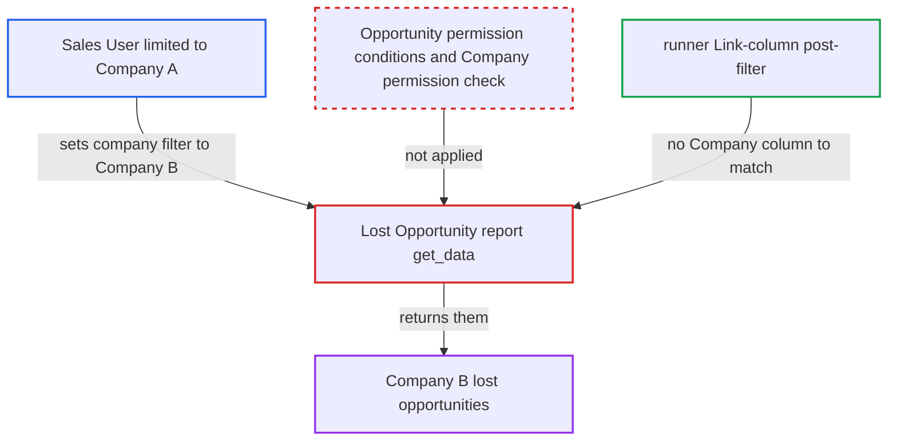

# Lost Opportunity report returns other companies' lost opportunities, ignoring user permissions

| Field | Value |
|---|---|
| ID | `find_01B6P2aNmn6GqL8C6ow4uKYz` |
| Severity | **Medium** |
| Status | open |
| CWE | CWE-862 — Missing authorization |
| Created | 2026-10-27T21:46:56.355489Z |
| Claude Security | https://claude.ai/security/findings/find_01B6P2aNmn6GqL8C6ow4uKYz |

## Description

A logged-in Sales User restricted to one company can read other companies' lost opportunities. The data includes opportunity IDs, customer or lead IDs and names, opportunity type, lost reasons, sales stage and territory. The attacker only needs to run the Lost Opportunity report with another company in the `company` filter. The cause is `get_data`, which runs a raw `frappe.qb` query and never applies the user's permission conditions.

1. **attacker (Sales User)** calls the report runner for another company. The attacker calls `/api/method/frappe.desk.query_report.run` with `report_name=Lost Opportunity` and `filters` holding `company` set to 'Company B' plus `from_date` and `to_date`, while their own Company User Permission covers only Company A.
2. **report function `get_data`** queries `tabOpportunity` with no permission conditions. The raw `frappe.qb` query is limited only by `status = Lost`, the caller's `filters.company`, the date range and optional filters, so it does not check whether the user may read that company. ([`erpnext/crm/report/lost_opportunity/lost_opportunity.py:74-106`](https://github.com/cx-benchmark/erpnext/blob/90e7aefca73da3c440d2e8da7472fcb67838e678/erpnext/crm/report/lost_opportunity/lost_opportunity.py#L74-L106))
3. **report runner** fails to remove the other company's rows. The runner filters rows only by Link-column values against User Permissions, and the report has no Company column to match, so the Company B rows stay in the result. ([`erpnext/crm/report/lost_opportunity/lost_opportunity.py:20-71`](https://github.com/cx-benchmark/erpnext/blob/90e7aefca73da3c440d2e8da7472fcb67838e678/erpnext/crm/report/lost_opportunity/lost_opportunity.py#L20-L71))
4. **attacker (Sales User)** receives Company B's lost opportunities. The response lists the opportunity IDs, party IDs and names, opportunity type, lost-reason master names, sales stage and territory.

## Assessment

The attacker is an authenticated desk user with the Sales User role whose Company User Permission confines them to one company. They call the report runner with another company in the `company` filter. No victim action or special configuration is needed. The report is a Script Report on Opportunity for the roles Sales User and Sales Manager. It has no `filters` table, so the framework's filter-permission validation has nothing to check. The report also skips the `*` Company Restriction hook, but the report calls this secondary because `validate_transaction_company` already stops an opportunity from pairing a company with a customer restricted away from it.

Impact: The attacker can read lost-opportunity records of any company they name. They see only the few Opportunity fields the report selects: no amounts, items or contacts, and no free-text lost reasons or competitors. Only lost opportunities are exposed, and nothing is modified.

## Recommendation

`get_data` limits the Opportunity query only by the company the caller chose. It applies neither the user's Opportunity permission conditions (User Permissions, the `*` Company Restriction hook) nor a permission check on the chosen Company. The output also has no column the runner could filter on.

Fix criteria: The report returns only opportunities the running user may read, with conditions equivalent to `frappe.get_list('Opportunity')`, combined with the caller's filters. A company the user may not read gives no rows or a permission error. To verify, run the report as a Sales User restricted to Company A with `company` set to Company B. No Company B opportunities may appear, and Company A results must be unchanged.

## Evidence

**https://github.com/cx-benchmark/erpnext**

- [`erpnext/crm/report/lost_opportunity/lost_opportunity.py:74-106`](https://github.com/cx-benchmark/erpnext/blob/90e7aefca73da3c440d2e8da7472fcb67838e678/erpnext/crm/report/lost_opportunity/lost_opportunity.py#L74-L106)
- [`erpnext/crm/report/lost_opportunity/lost_opportunity.py:20-71`](https://github.com/cx-benchmark/erpnext/blob/90e7aefca73da3c440d2e8da7472fcb67838e678/erpnext/crm/report/lost_opportunity/lost_opportunity.py#L20-L71)
- [`erpnext/crm/report/lost_opportunity/lost_opportunity.json`](https://github.com/cx-benchmark/erpnext/blob/90e7aefca73da3c440d2e8da7472fcb67838e678/erpnext/crm/report/lost_opportunity/lost_opportunity.json)
- [`erpnext/crm/doctype/opportunity/opportunity.json`](https://github.com/cx-benchmark/erpnext/blob/90e7aefca73da3c440d2e8da7472fcb67838e678/erpnext/crm/doctype/opportunity/opportunity.json)
- [`erpnext/crm/report/first_response_time_for_opportunity/first_response_time_for_opportunity.py:41-43`](https://github.com/cx-benchmark/erpnext/blob/90e7aefca73da3c440d2e8da7472fcb67838e678/erpnext/crm/report/first_response_time_for_opportunity/first_response_time_for_opportunity.py#L41-L43)

