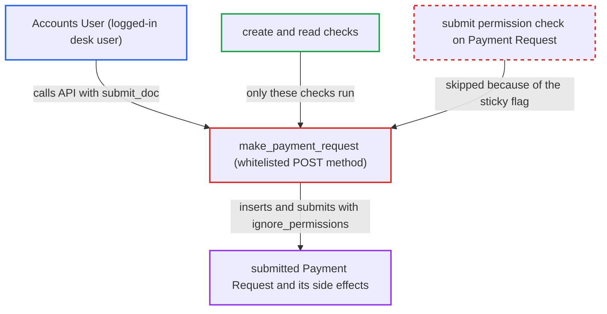

# make_payment_request lets Accounts User submit Payment Requests without submit permission

| Field | Value |
|---|---|
| ID | `find_01GKpmjv3P2Apjxbx1m14boK` |
| Severity | **Medium** |
| Status | open |
| CWE | CWE-285 — Improper Authorization |
| Created | 2026-10-27T21:26:47.411789Z |
| Claude Security | https://claude.ai/security/findings/find_01GKpmjv3P2Apjxbx1m14boK |

## Description

A logged-in user with the Accounts User role can submit Payment Requests, although the role matrix gives only Accounts Manager that right. The attacker needs a direct API call to `make_payment_request` with `submit_doc` set. Under the shipped default `create_pr_in_draft_status = 1`, the method inserts with `ignore_permissions=True`, and `pr.submit()` then skips the submit permission check. The impact is limited.

1. **Accounts User attacker** sends a POST to the `make_payment_request` API method. The request carries `dt`, `dn`, `submit_doc=1` and optionally `recipient_id`. The desk UI never sends `submit_doc`, but a direct API call can. ([`erpnext/accounts/doctype/payment_request/payment_request.py:797-809`](https://github.com/cx-benchmark/erpnext/blob/90e7aefca73da3c440d2e8da7472fcb67838e678/erpnext/accounts/doctype/payment_request/payment_request.py#L797-L809))
2. **the method `make_payment_request`** checks only create permission on Payment Request and read permission on the reference document. Accounts User holds both permissions, so the request passes. Nothing checks submit permission. ([`erpnext/accounts/doctype/payment_request/payment_request.py:797-809`](https://github.com/cx-benchmark/erpnext/blob/90e7aefca73da3c440d2e8da7472fcb67838e678/erpnext/accounts/doctype/payment_request/payment_request.py#L797-L809))
3. **the method `make_payment_request`** inserts the Payment Request with `ignore_permissions=True`. This branch runs by default because `create_pr_in_draft_status` ships with the value 1. ([`erpnext/accounts/doctype/payment_request/payment_request.py:994-999`](https://github.com/cx-benchmark/erpnext/blob/90e7aefca73da3c440d2e8da7472fcb67838e678/erpnext/accounts/doctype/payment_request/payment_request.py#L994-L999))
4. **the method `make_payment_request`** calls `pr.submit()` on the same document. The `ignore_permissions` flag stays set on the document, so the permission check for submit returns early. The report assumes this Frappe behaviour, because Frappe is not in the checkout. ([`erpnext/accounts/doctype/payment_request/payment_request.py:994-999`](https://github.com/cx-benchmark/erpnext/blob/90e7aefca73da3c440d2e8da7472fcb67838e678/erpnext/accounts/doctype/payment_request/payment_request.py#L994-L999))
5. **the submit hooks `before_submit` and `on_submit`** run the submission side effects. They set the status to Requested (Inward) or Initiated (Outward). With a gateway configured, they also create the payment URL and email the link and the reference print to `email_to`. They update `advance_payment_status` on the referenced order. ([`erpnext/accounts/doctype/payment_request/payment_request.py:294-320`](https://github.com/cx-benchmark/erpnext/blob/90e7aefca73da3c440d2e8da7472fcb67838e678/erpnext/accounts/doctype/payment_request/payment_request.py#L294-L320))

## Assessment

The attacker is a logged-in desk user with the Accounts User role. That role can create Payment Requests and read invoices or orders, but cannot submit Payment Requests. The attacker POSTs to `/api/method/erpnext.accounts.doctype.payment_request.payment_request.make_payment_request` with `dt`, `dn`, `submit_doc=1` and optionally `recipient_id`. Default settings are enough. No gateway is needed for the submit itself, and no victim action is required.

Impact: A role that is denied submit can create submitted Payment Requests. These become Requested or Initiated, which makes Outward ones eligible for a Payment Order. With a gateway configured, they can send payment links to addresses the caller chooses, and they change the advance payment status of the referenced order. No ledger entries are posted. The role can already submit Payment Entries and Payment Orders, so the impact is limited. The emailed print is a document the caller can already read and email.

## Recommendation

`make_payment_request` inserts with `ignore_permissions=True` for the webshop flow. The flag stays on the document and `pr.submit()` reuses it, so the caller's lack of submit permission on Payment Request is never checked.

Fix criteria: When `submit_doc` is honoured, the submit is authorized against the calling user's Payment Request submit permission. Any internal or webshop caller that needs the bypass opts in explicitly and does not inherit the sticky flag. An Accounts User with no submit right who calls the method with `submit_doc=1` gets a permission error and no submitted Payment Request results. An Accounts Manager still succeeds.

## Evidence

**https://github.com/cx-benchmark/erpnext**

- [`erpnext/accounts/doctype/payment_request/payment_request.py:994-999`](https://github.com/cx-benchmark/erpnext/blob/90e7aefca73da3c440d2e8da7472fcb67838e678/erpnext/accounts/doctype/payment_request/payment_request.py#L994-L999)
- [`erpnext/accounts/doctype/payment_request/payment_request.py:797-809`](https://github.com/cx-benchmark/erpnext/blob/90e7aefca73da3c440d2e8da7472fcb67838e678/erpnext/accounts/doctype/payment_request/payment_request.py#L797-L809)
- [`erpnext/accounts/doctype/payment_request/payment_request.json:490-520`](https://github.com/cx-benchmark/erpnext/blob/90e7aefca73da3c440d2e8da7472fcb67838e678/erpnext/accounts/doctype/payment_request/payment_request.json#L490-L520)
- [`erpnext/accounts/doctype/payment_request/payment_request.py:294-320`](https://github.com/cx-benchmark/erpnext/blob/90e7aefca73da3c440d2e8da7472fcb67838e678/erpnext/accounts/doctype/payment_request/payment_request.py#L294-L320)
- [`erpnext/accounts/doctype/accounts_settings/accounts_settings.json:503-509`](https://github.com/cx-benchmark/erpnext/blob/90e7aefca73da3c440d2e8da7472fcb67838e678/erpnext/accounts/doctype/accounts_settings/accounts_settings.json#L503-L509)
- [`erpnext/accounts/doctype/payment_request/payment_request.py:636-638`](https://github.com/cx-benchmark/erpnext/blob/90e7aefca73da3c440d2e8da7472fcb67838e678/erpnext/accounts/doctype/payment_request/payment_request.py#L636-L638)

