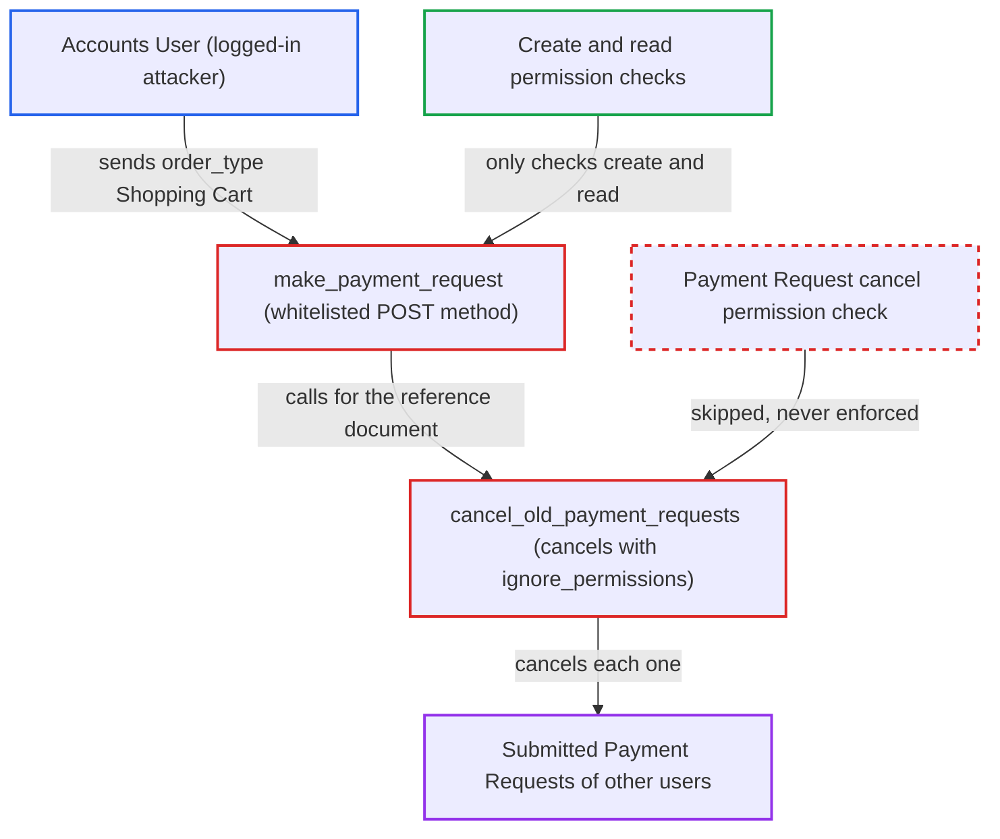

# make_payment_request Shopping Cart path cancels submitted Payment Requests without cancel permission

| Field | Value |
|---|---|
| ID | `find_019Lq1NrHKaaUV83DfyvqoVq` |
| Severity | **Medium** |
| Status | open |
| CWE | CWE-285 — Improper Authorization |
| Created | 2026-10-27T21:50:37.436693Z |
| Claude Security | https://claude.ai/security/findings/find_019Lq1NrHKaaUV83DfyvqoVq |

## Description

A logged-in Accounts User can cancel other users' submitted Payment Requests, which only an Accounts Manager is allowed to do. This voids payment links already sent to customers. The attack works with default settings on any Sales Order, Sales Invoice or POS Invoice the caller can read. The cause is `make_payment_request`, which accepts `order_type` "Shopping Cart" from any caller. It then calls `cancel_old_payment_requests`, which cancels with permissions ignored.

1. **Attacker (Accounts User)** posts a request to the whitelisted `make_payment_request` method. The request names a readable reference document through `dt` and `dn` that has submitted Payment Requests in `Requested` status, and sets `order_type` to "Shopping Cart". ([`erpnext/accounts/doctype/payment_request/payment_request.py:798-809`](https://github.com/cx-benchmark/erpnext/blob/90e7aefca73da3c440d2e8da7472fcb67838e678/erpnext/accounts/doctype/payment_request/payment_request.py#L798-L809))
2. **the method `make_payment_request`** checks only create permission on Payment Request and read permission on the reference document. The attacker passes both checks, and the method never asks for cancel permission. ([`erpnext/accounts/doctype/payment_request/payment_request.py:798-809`](https://github.com/cx-benchmark/erpnext/blob/90e7aefca73da3c440d2e8da7472fcb67838e678/erpnext/accounts/doctype/payment_request/payment_request.py#L798-L809))
3. **the method `make_payment_request`** enters the Shopping Cart branch and calls `cancel_old_payment_requests`. This happens when a submitted request with outstanding amount exists and none is Initiated, Partially Paid, Payment Ordered or Paid. ([`erpnext/accounts/doctype/payment_request/payment_request.py:889-898`](https://github.com/cx-benchmark/erpnext/blob/90e7aefca73da3c440d2e8da7472fcb67838e678/erpnext/accounts/doctype/payment_request/payment_request.py#L889-L898))
4. **the helper `cancel_old_payment_requests`** cancels every submitted Draft or Requested Payment Request on the document with `flags.ignore_permissions` set to True. It refuses only when a request has an Authorized or Completed Integration Request. Otherwise the cancel permission check is skipped, and the queued Integration Requests are marked `Cancelled`. ([`erpnext/accounts/doctype/payment_request/payment_request.py:1121-1143`](https://github.com/cx-benchmark/erpnext/blob/90e7aefca73da3c440d2e8da7472fcb67838e678/erpnext/accounts/doctype/payment_request/payment_request.py#L1121-L1143))
5. **the hook `on_cancel`** sets each request's status to `Cancelled` and recomputes the reference's `advance_payment_status`. It refuses only `Paid` requests that have a Payment Entry. ([`erpnext/accounts/doctype/payment_request/payment_request.py:491-494`](https://github.com/cx-benchmark/erpnext/blob/90e7aefca73da3c440d2e8da7472fcb67838e678/erpnext/accounts/doctype/payment_request/payment_request.py#L491-L494))
6. **the method `make_payment_request`** creates a replacement request and commits the transaction. The explicit commit happens before `get_payment_url()` is called, so the cancellations persist even if building the gateway URL fails. ([`erpnext/accounts/doctype/payment_request/payment_request.py:1001-1003`](https://github.com/cx-benchmark/erpnext/blob/90e7aefca73da3c440d2e8da7472fcb67838e678/erpnext/accounts/doctype/payment_request/payment_request.py#L1001-L1003))

## Assessment

The attacker is a logged-in desk user with the Accounts User role. That role can create Payment Requests and read Sales Orders and Invoices, but cannot submit, cancel or amend Payment Requests. Only Accounts Manager can cancel them. The attacker needs a readable reference document that has manager-submitted Payment Requests in `Requested` status, and none that is already in an advanced payment state. Default settings are enough, and no victim action is needed. The report says the branch exists for the webshop app, but nothing ties `order_type` to that context. Outward requests move to `Initiated` on submit, which closes the branch. In practice the targets are Inward requests on Sales Orders, Sales Invoices and POS Invoices. The report also notes that the Frappe behaviour it relies on is an assumption for the pinned `frappe >=17.0.0-dev,<18`, which is not in the checkout. That behaviour is that `Document.cancel()` reaches `check_permission("cancel")`, which returns early when `flags.ignore_permissions` is set.

Impact: A role that is denied cancel permission can set submitted Payment Requests to `Cancelled`. This voids payment links already sent to customers, marks their queued Integration Requests `Cancelled`, and changes the order's advance payment status. A replacement request for the full amount is put in place, as a draft under the shipped default `create_pr_in_draft_status = 1`. Only requests on documents the attacker can read, and not yet in an advanced payment state, are affected. No ledger entries change, so the impact is limited.

## Recommendation

`cancel_old_payment_requests` cancels other users' submitted Payment Requests with `ignore_permissions`. It can be reached from the whitelisted `make_payment_request` through the caller-controlled `order_type` parameter, so the Payment Request cancel permission is never enforced.

Fix criteria: Cancelling existing Payment Requests through `make_payment_request` requires the caller to hold cancel permission on each affected Payment Request. Alternatively, the Shopping Cart branch cannot be reached from arbitrary API callers, for example only from the server-side webshop flow. To verify, send the same request as an Accounts User against a document with a manager-submitted `Requested` Payment Request. It must be refused, and the existing requests must keep docstatus 1 and status `Requested`.

## Evidence

**https://github.com/cx-benchmark/erpnext**

- [`erpnext/accounts/doctype/payment_request/payment_request.py:889-898`](https://github.com/cx-benchmark/erpnext/blob/90e7aefca73da3c440d2e8da7472fcb67838e678/erpnext/accounts/doctype/payment_request/payment_request.py#L889-L898)
- [`erpnext/accounts/doctype/payment_request/payment_request.py:1121-1143`](https://github.com/cx-benchmark/erpnext/blob/90e7aefca73da3c440d2e8da7472fcb67838e678/erpnext/accounts/doctype/payment_request/payment_request.py#L1121-L1143)
- [`erpnext/accounts/doctype/payment_request/payment_request.py:798-809`](https://github.com/cx-benchmark/erpnext/blob/90e7aefca73da3c440d2e8da7472fcb67838e678/erpnext/accounts/doctype/payment_request/payment_request.py#L798-L809)
- [`erpnext/accounts/doctype/payment_request/payment_request.json:491-503`](https://github.com/cx-benchmark/erpnext/blob/90e7aefca73da3c440d2e8da7472fcb67838e678/erpnext/accounts/doctype/payment_request/payment_request.json#L491-L503)
- [`erpnext/accounts/doctype/payment_request/payment_request.py:491-494`](https://github.com/cx-benchmark/erpnext/blob/90e7aefca73da3c440d2e8da7472fcb67838e678/erpnext/accounts/doctype/payment_request/payment_request.py#L491-L494)
- [`erpnext/accounts/doctype/payment_request/payment_request.py:1001-1003`](https://github.com/cx-benchmark/erpnext/blob/90e7aefca73da3c440d2e8da7472fcb67838e678/erpnext/accounts/doctype/payment_request/payment_request.py#L1001-L1003)

