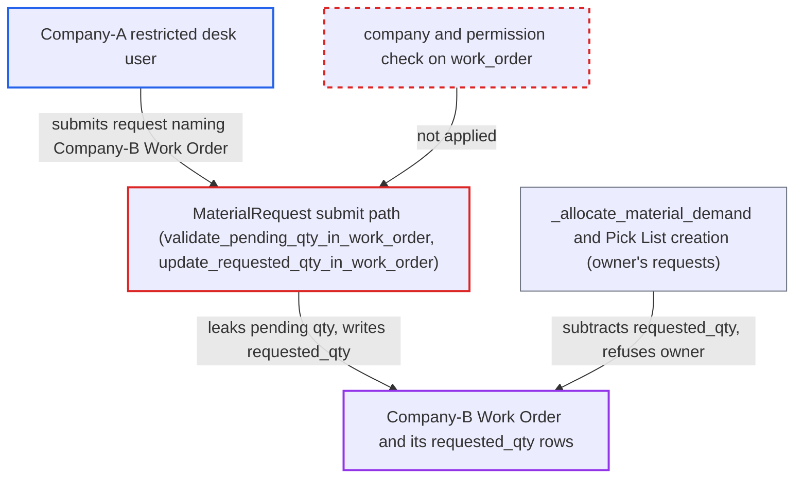

# Material Request work_order link alters another company's Work Order requested quantities

| Field | Value |
|---|---|
| ID | `find_012kb9yKdn2TbgpMy7dJdqF5` |
| Severity | **Medium** |
| Status | open |
| CWE | CWE-639 — Insecure Direct Object Reference |
| Created | 2026-10-27T22:31:58.343833Z |
| Claude Security | https://claude.ai/security/findings/find_012kb9yKdn2TbgpMy7dJdqF5 |

## Description

A desk user restricted to one company can read another company's Work Order data and block that company's Material Requests and Pick Lists for the Work Order. The attacker needs a role that can create and submit Material Requests, such as Stock User or Purchase User, and the default settings are enough. `MaterialRequest` accepts a client-supplied `work_order` and never checks its company or the caller's access to it.

1. **Attacker (Company-A restricted desk user)** saves a Company-A `Material Transfer` request with `work_order` set to a guessed Company-B Work Order. The `work_order` Link is only `read_only` in the form, so the server accepts any existing Work Order name sent by the client, such as a guessed sequential `MFG-WO-.YYYY.-` name. ([`erpnext/stock/doctype/material_request/material_request.json:319-325`](https://github.com/cx-benchmark/erpnext/blob/90e7aefca73da3c440d2e8da7472fcb67838e678/erpnext/stock/doctype/material_request/material_request.json#L319-L325))
2. **the controller `MaterialRequest`** skips any company or permission check on the named Work Order. `validate_with_previous_doc` compares `company` only for `sales_order`, and nothing else compares the Work Order's company with the request's `company`. ([`erpnext/stock/doctype/material_request/material_request.py:116-130`](https://github.com/cx-benchmark/erpnext/blob/90e7aefca73da3c440d2e8da7472fcb67838e678/erpnext/stock/doctype/material_request/material_request.py#L116-L130))
3. **the method `validate_pending_qty_in_work_order`** loads the foreign Work Order and checks the requested item quantities against it on submit. It uses a plain `frappe.get_doc(..., for_update=True)` with no permission check, and `before_submit` runs it for a submitted `Material Transfer` request. ([`erpnext/stock/doctype/material_request/material_request.py:365-380`](https://github.com/cx-benchmark/erpnext/blob/90e7aefca73da3c440d2e8da7472fcb67838e678/erpnext/stock/doctype/material_request/material_request.py#L365-L380))
4. **the method `validate_incoming_material_demand`** throws an error that reveals the other company's pending quantity and UOM. The error `Only {0} {1} of {2} is pending in Work Order {3}` appears only for item codes in the Work Order's `required_items`, so probing item codes also shows which raw materials are required. ([`erpnext/manufacturing/doctype/work_order/services/required_items.py:238-266`](https://github.com/cx-benchmark/erpnext/blob/90e7aefca73da3c440d2e8da7472fcb67838e678/erpnext/manufacturing/doctype/work_order/services/required_items.py#L238-L266))
5. **Attacker** resubmits the request with exactly the revealed pending quantity. The request now passes validation and `on_submit` calls `update_requested_qty_in_work_order`, which reloads the foreign Work Order. ([`erpnext/stock/doctype/material_request/material_request.py:545-554`](https://github.com/cx-benchmark/erpnext/blob/90e7aefca73da3c440d2e8da7472fcb67838e678/erpnext/stock/doctype/material_request/material_request.py#L545-L554))
6. **the function `update_requested_qty_for_required_items`** writes the summed quantity into each `Work Order Item.requested_qty` of the Company-B Work Order. It sums every submitted, unstopped `Material Transfer` request naming the Work Order, of any company, and uses `db_set`, which bypasses permissions. ([`erpnext/manufacturing/doctype/work_order/services/required_items.py:269-292`](https://github.com/cx-benchmark/erpnext/blob/90e7aefca73da3c440d2e8da7472fcb67838e678/erpnext/manufacturing/doctype/work_order/services/required_items.py#L269-L292))
7. **the function `_allocate_material_demand`** treats the materials as already requested and refuses the owner's own requests. The owner's Material Requests fail with `No Pending Materials`, and Pick Lists and the form's `get_max_requestable_qty` also subtract `requested_qty`. ([`erpnext/manufacturing/doctype/work_order/mapper.py:611-639`](https://github.com/cx-benchmark/erpnext/blob/90e7aefca73da3c440d2e8da7472fcb67838e678/erpnext/manufacturing/doctype/work_order/mapper.py#L611-L639))

## Assessment

The attacker is a desk user with a role that can create and submit Material Requests (Stock User or Purchase User). A Company User Permission restricts them to Company A. They reach the code through REST or the form. They save and submit a Company-A `Material Transfer` request with `work_order` set to a guessed Company-B Work Order, Company-A warehouses, and candidate item codes at a large quantity. They then resubmit with the exact pending quantity that the error reveals. No victim action is needed and the default settings suffice. The report assumes Frappe `>=17.0.0-dev,<18`, which is not in the checkout. It assumes save-time `has_user_permission` checks a Link only when the user has User Permissions on the Link's target doctype, so a Company restriction does not cover `work_order`. The sanctioned path, `make_material_request`, checks read permission on the source Work Order through `get_mapped_doc`, but a hand-built request skips it.

Impact: The attacker learns another company's required raw materials and their pending quantities, one item at a time. They can set `requested_qty` and `picked_qty` on that company's Work Order rows, which is a tracking roll-up with no ledger effect. The owner's Material Requests and Pick Lists for that Work Order are refused until the foreign request is stopped or cancelled. Users restricted to Company B cannot do that. Direct Stock Entry transfers are not gated by `requested_qty` and still work.

## Recommendation

`MaterialRequest` trusts the client-supplied `work_order` (and `job_card`) link. It never checks that the referenced document belongs to the request's `company` or that the caller may access it. It validates against that document and writes roll-up quantities into it anyway.

Fix criteria: Saving or submitting a Material Request whose `work_order` or `job_card` belongs to another company, or that the user's permissions do not allow, fails at validate. This happens before `validate_pending_qty_in_work_order` can return pending quantities. To verify, a Company-A-restricted Stock User submits a `Material Transfer` request naming a Company-B Work Order. They get a validation or permission error with no pending-quantity text. That Work Order's `requested_qty` and `picked_qty` rows stay unchanged.

## Evidence

**https://github.com/cx-benchmark/erpnext**

- [`erpnext/stock/doctype/material_request/material_request.py:116-130`](https://github.com/cx-benchmark/erpnext/blob/90e7aefca73da3c440d2e8da7472fcb67838e678/erpnext/stock/doctype/material_request/material_request.py#L116-L130)
- [`erpnext/stock/doctype/material_request/material_request.py:365-380`](https://github.com/cx-benchmark/erpnext/blob/90e7aefca73da3c440d2e8da7472fcb67838e678/erpnext/stock/doctype/material_request/material_request.py#L365-L380)
- [`erpnext/manufacturing/doctype/work_order/services/required_items.py:238-266`](https://github.com/cx-benchmark/erpnext/blob/90e7aefca73da3c440d2e8da7472fcb67838e678/erpnext/manufacturing/doctype/work_order/services/required_items.py#L238-L266)
- [`erpnext/stock/doctype/material_request/material_request.py:545-554`](https://github.com/cx-benchmark/erpnext/blob/90e7aefca73da3c440d2e8da7472fcb67838e678/erpnext/stock/doctype/material_request/material_request.py#L545-L554)
- [`erpnext/manufacturing/doctype/work_order/services/required_items.py:269-292`](https://github.com/cx-benchmark/erpnext/blob/90e7aefca73da3c440d2e8da7472fcb67838e678/erpnext/manufacturing/doctype/work_order/services/required_items.py#L269-L292)
- [`erpnext/manufacturing/doctype/work_order/mapper.py:611-639`](https://github.com/cx-benchmark/erpnext/blob/90e7aefca73da3c440d2e8da7472fcb67838e678/erpnext/manufacturing/doctype/work_order/mapper.py#L611-L639)
- [`erpnext/stock/doctype/material_request/material_request.json:319-325`](https://github.com/cx-benchmark/erpnext/blob/90e7aefca73da3c440d2e8da7472fcb67838e678/erpnext/stock/doctype/material_request/material_request.json#L319-L325)

